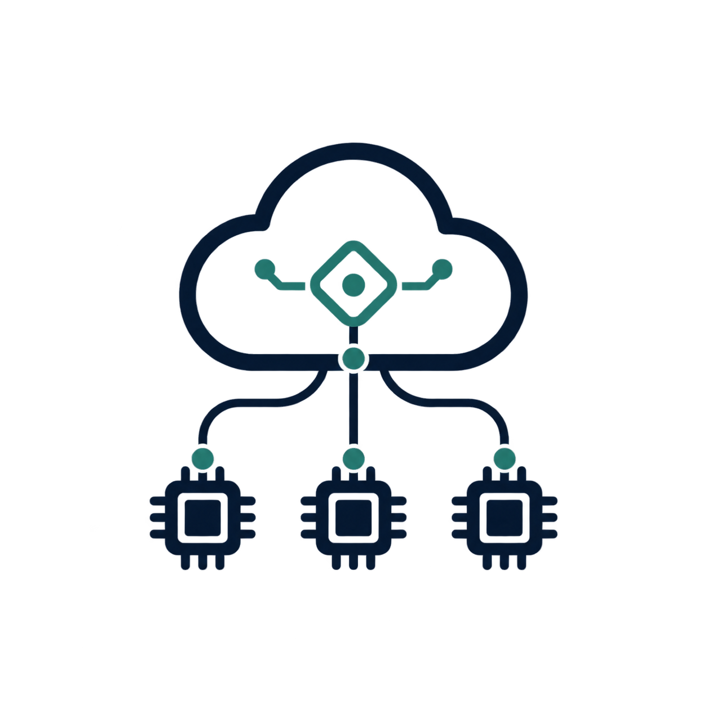

  

  

<h1 align="center">云哨 边缘智枢</h1>

<em>让边缘看见异常，让协同抵达现场，让智能推动改进。</em>

## 介绍

从零部署云端、Web/PWA、MediaMTX 和 Atlas 边缘端，请按[部署指南](DEPLOY.md)操作。

“云哨·边缘智枢”是一套面向园区、工厂、企业、校园等公共场所的云边端协同智能平台，集异常事件感知、智能数据分析、告警消息推送和对外 MCP 服务于一体。

团队自主研发的垂直领域计算机视觉算法，首发部署于华为 Atlas 200I DK A2 开发者套件。通过分析摄像头采集的实时视频流，平台能够感知异常事件。边缘设备集群既可以通过流媒体技术，将算法处理后的视频流实时传输至监控大屏，也可以将检测到的异常事件上传至平台数据库。

用户可以在实时监控大屏的各个分屏中，查看对应边缘设备的运行状态、所在位置及其处理后的视频画面；也可以在历史告警界面浏览告警列表，并点击进入详情页，查看异常事件发生时的单帧截图、地点和时间等信息。告警产生后，用户还可以通过手机客户端（PWA、Android App、iOS App）接收后台通知，无需一直关注客户端。点击通知即可进入告警详情页，了解事件信息并前往处理。

除实时监控大屏和历史告警列表及详情页外，平台还规划建设第三个主要界面——**智能数据分析大屏**。该界面将汇总分析已发生的异常事件，呈现事件分布和变化情况，帮助管理者发现高发点位与时段，为巡查安排和后续改进提供依据。

平台不仅注重用户体验，也面向现代 AI 应用提供支持。内置的 MCP 服务可接入各类成熟的 AI Agent 客户端。用户可以在 AI Agent 客户端中设置定时任务，让 Agent 通过 MCP 分析当日异常事件的分布情况，并根据分析建议采取后续措施，降低类似事件再次发生的概率，或为系统底层算法的优化提供参考。

## 项目亮点

1. **云边端协同**：边缘设备连接摄像头，在本地运行计算机视觉算法，实时分析视频流并识别异常；云端平台统一管理设备状态与位置，汇聚并存储异常事件；监控大屏和手机客户端展示设备画面与告警信息，支持查看和处置，形成从边缘感知、云端汇聚到终端响应的协同链路。
2. **用户友好**：平台围绕实时监控、历史告警和智能数据分析构建三类主要界面，覆盖实时查看、单个事件追溯和整体情况研判；其中智能数据分析大屏为规划建设内容。告警可推送至 PWA、Android App 和 iOS App，用户点击通知即可进入事件详情，无需持续盯守监控画面。
3. **AI 友好**：平台内置 MCP 服务，可接入各类 AI Agent 客户端。用户可设置定时任务，让 Agent 分析异常事件的发生时段和高发点位，并结合分析结果提出巡查、处置或算法优化建议。

## 首发场景：教室行为检测

首发以 **教室行为检测** 验证边缘推理、视频展示、设备管理和云端业务链路。现有课堂模型流程定义 `hand-raising`、`reading`、`writing` 三类检测，输入尺寸为 640；模型权重文件后续提供并完成 Atlas OM 转换后才能进行真实设备推理验收。行为类别只描述画面中的可见行为，不代表学生身份、成绩或专注度。

### 最小业务闭环

1. **接入点位**：登记 Atlas 200I DK A2、教室摄像头和位置，使用经授权的 H.264 教室视频源。
2. **边缘推理与展示**：在 Atlas 上运行已登记版本的课堂行为模型，实时输出行为类别、边界框和置信度；设备状态与算法状态分开展示。
3. **告警规则**：三类检测的告警初始全部关闭。只有用户显式启用并配置类别规则后，边缘端才将满足规则的行为作为异常事件上报；单帧检测本身不自动等于告警。
4. **查询与处置**：云端按账号隔离保存已生成的异常事件，允许查询、查看授权截图、记录处置结果；截图上传后保存 24 小时。
5. **PWA 与统计**：仅对已启用规则产生的事件创建通知意图和告警统计；推送点击后先鉴权再打开详情。

MVP 阶段采用 **华为 Atlas 200I DK A2（Ascend 310B4）**。端侧模型链路为 PyTorch → ONNX → CANN ATC → OM，使用 AscendCL 推理。模型文件暂未入库，权重交付后再记录哈希、转换报告及板端评估证据。消防通道检测作为后续场景保留，不属于首发演示或验收范围。
