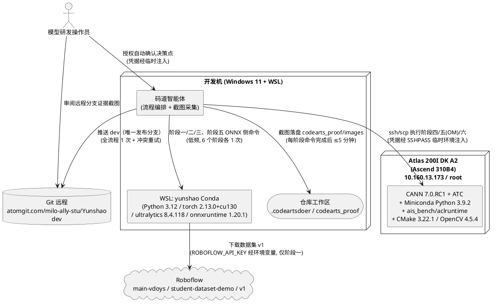
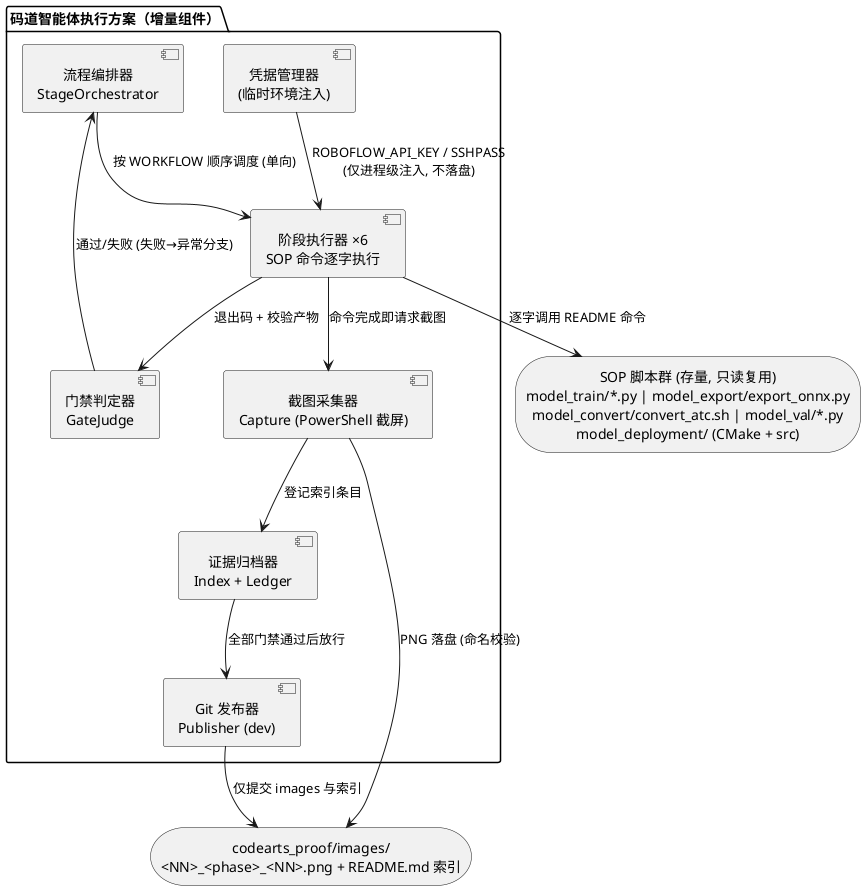
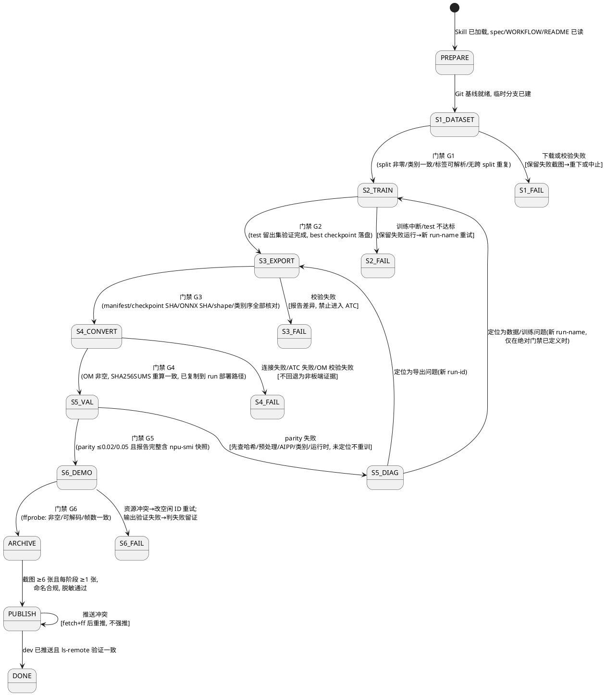
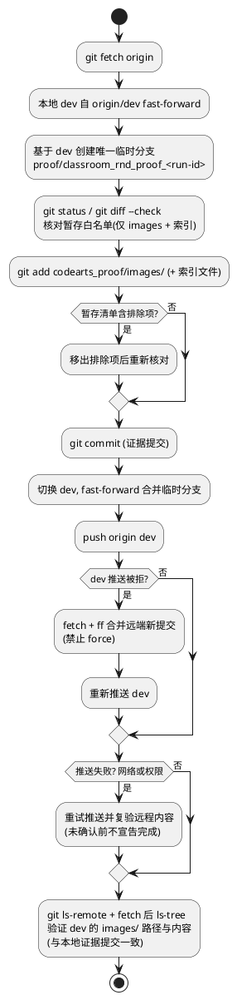
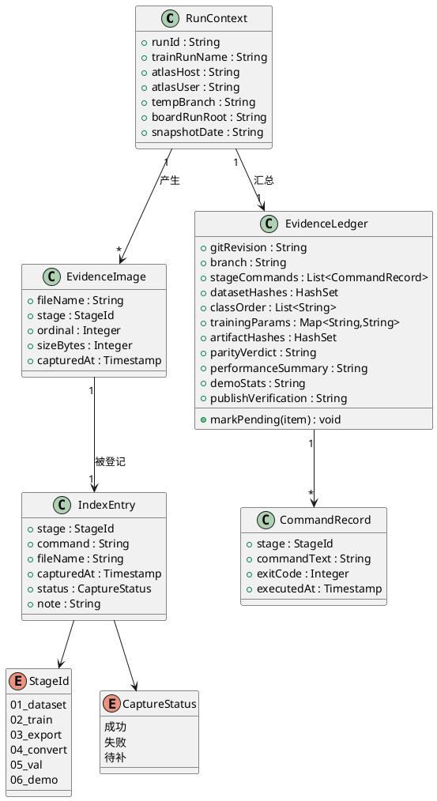

# 云韶课堂行为检测模型研发复刻与证据采集——技术设计文档

> 需求输入：[spec.md](./spec.md)（8 个功能模块 / 42 条 EARS 业务规则 / 20 个异常场景 / 6 类 DFX 约束）
> 驱动工作流：`yunshao-classroom-model-rnd` Skill（`C:\Users\miligting\Desktop\SKILL.md`）
> 仓库 SOP：[classroom_behavior_detection/spec.md](../../../project/docs/Specification/classroom_behavior_detection/spec.md)、[WORKFLOW.md](../../../project/preparation/model_classroom_behavior/WORKFLOW.md) 及五阶段 README
> 状态：待评审。
> 变更记录：2026-10-22 依据用户指示，发布目标由"临时分支→ff 合 main→同步 dev→双分支验证"调整为"临时分支（基于 dev 创建）→ff 合 dev→推 dev→ls-remote 验证"；I0、I7、D10、2.1 上下文/组件视图、2.1.3 状态机与发布活动图等已同步修订，不再提交 main 分支。
> 安全声明：本设计不包含任何凭据（板卡密码、API key）。凭据仅通过临时环境注入或交互方式使用，不持久化。

# 一、需求与存量功能关系分析

本需求的性质是**流程复刻 + 证据采集**，而非新功能开发：六个研发阶段（数据集校验 → 训练验证 → ONNX 导出 → ATC 转换 → 评估 → H.264 demo）的命令载体在仓库中**全部已存在**且可执行，需要新增的是**流程编排与门禁判定、终端截图采集、证据索引与台账、dev 分支发布**这四类围绕既有 SOP 的增量能力。因此匹配度分析按"命令载体是否已具备"为判定依据，并结合 spec 的复刻要求评估覆盖差距。

## 1.1 需求功能与存量功能对比

### 1.1.1 已实现功能

| 需求功能（spec 章节） | 存量功能 | 代码位置 | 匹配度 |
|---|---|---|---|
| 5.1 Skill 加载与 SOP 前置 | Skill 工作流定义（七步研发流程、门禁、边界） | `C:\Users\miligting\Desktop\SKILL.md`（仓库镜像：`codearts_proof/skills/yunshao-classroom-model-rnd/`） | 100% |
| 5.1 R2 SOP 命令唯一来源 | 五阶段 SOP 文档（命令、参数、产物、追溯要求逐项可查） | `project/preparation/model_classroom_behavior/model_{train,export,convert,val,deployment}/README.md` | 100% |
| 5.1 R3 依赖变更约束 | `yunshao` Conda 环境定义（Python 3.12、torch 2.13.0+cu130、ultralytics 8.4.118、roboflow 1.1.53、onnx 1.17.0、onnxruntime 1.20.1；板端 CANN 7.0.RC1 / Miniconda Python 3.9.2 / NumPy 1.23.5） | `project/preparation/model_classroom_behavior/environment.yml` | 100% |
| 5.2 R1 数据源固定下载 | Roboflow 固定版本下载（workspace `main-vdoys` / project `student-dataset-demo` / version `1`；`data.yaml` 实测 nc=3、names 顺序 hand-raising/reading/writing） | `project/preparation/model_classroom_behavior/model_train/1-download-dataset.py`、`model_train/datasets/classroom_behavior/data.yaml` | 100% |
| 5.2 R3 训练前完整性校验 | 数据质量分析与摘要（`dataset_summary.json`，split/类别/标签检查） | `project/preparation/model_classroom_behavior/model_train/2-analyse-dataset.py` | 100% |
| 5.3 R1/R2 固定超参训练 | YOLO11n/640 训练脚本（`--epochs/--imgsz/--batch/--device/--workers/--seed/--run-name`；脚本内固定 deterministic=true、patience=30、拒绝覆盖已有运行目录） | `project/preparation/model_classroom_behavior/model_train/3-train-model.py`（参数定义 L26–L40） | 100% |
| 5.3 R4 test 留出集验证 | best checkpoint 独立 test split 验证（`--split test`，产出 evaluation.json/report.csv） | `project/preparation/model_classroom_behavior/model_train/4-validate-model.py` | 100% |
| 5.4 固定参数 ONNX 导出 | 静态 ONNX 导出（batch 1、640×640、opset 17、CPU；`--weights-root` 支持重试轮次隔离；产出 `export_manifest.json` 记录双端 SHA-256） | `project/preparation/model_classroom_behavior/model_export/export_onnx.py` | 100% |
| 5.5 R2/R4/R5 ATC 板端转换 | ATC 转换脚本（输入 1×3×640×640、AIPP NV21、soc Ascend310B4、TE_PARALLEL_COMPILER=1；atc 缺失时自动加载 `set_env.sh` 与板载 Miniconda base；产出 OM + SHA256SUMS；`test -s` 保证 OM 非空） | `project/preparation/model_classroom_behavior/model_convert/convert_atc.sh`（L1–L22）、`model_convert/aipp_nv21.cfg` | 100% |
| 5.6 R1/R2 同条件精度评估 | ONNX/OM 双端 accuracy_eval（`--metric-mode native --conf 0.25`，无 `--limit` 为正式报告） | `project/preparation/model_classroom_behavior/model_val/accuracy_eval.py` | 100% |
| 5.6 R4 性能与内存评估 | 性能（FPS、延迟分位）与内存（模型大小、进程 RSS、张量大小）评估 | `project/preparation/model_classroom_behavior/model_val/performance_eval.py`、`model_val/memory_eval.py` | 100% |
| 5.6 R3 等价门禁 | ONNX↔OM 精度对比（`--max-map-drop 0.02 --max-class-ap50-drop 0.05`，核对 YAML/哈希/split/阈值/类别） | `project/preparation/model_classroom_behavior/model_val/precision_eval.py` | 100% |
| 5.7 H.264 demo 验收 | AscendCL 视频 demo（CMake 构建、`--vpss-group/--region-handle` 资源避让、H.264 输入输出、运行统计；`classes.txt` 顺序实测 hand-raising/reading/writing） | `project/preparation/model_classroom_behavior/model_deployment/`（`CMakeLists.txt`、`src/main.cpp`、`classes.txt`） | 100% |
| 5.8 R6 dev 分支远程 | 远程 `origin = atomgit.com/milo-ally-stu/Yunshao`，远程分支 `dev` 存在（本轮唯一发布目标） | `.git/config`（`git remote -v` 实测） | 100% |
| 4.3/6.3 敏感产物排除 | 模型产物目录忽略规则（datasets/runs/train_result/artifacts/*.om/reports 全部 ignore，与 spec 排除项一一对应） | `project/preparation/model_classroom_behavior/.gitignore` | 100% |

匹配度判定依据：上表所有功能均能在当前工作区找到可执行脚本或已验证配置，且接口参数与 spec 业务规则逐项对齐（`data.yaml` 与 `classes.txt` 的类别顺序已实测核对）；100% 表示**命令载体层面无需任何开发**。

### 1.1.2 需要扩展的功能

| 需求功能 | 存量功能 | 差异说明 | 扩展方向 |
|---|---|---|---|
| 5.5 R1 板卡连接（IP 10.160.13.173 / root） | README 命令模板使用示例地址 `root@192.168.0.2` | **输入差异**：SOP 示例 IP 为占位值，实际部署板卡为 10.160.13.173；命令模板、参数、路径不变，仅主机值替换。依据 spec 4.3.2，该 IP 与用户名 `root` 属已批准部署环境信息 | 在执行层做主机地址参数化（`ATLAS_HOST` 默认 10.160.13.173），README 原文不改；台账记录替换关系 |
| 5.5 R3 隔离与实验目录 | README 板端固定路径 `/root/model_library/model_classroom_behavior/`（直接覆盖式 staged） | **边界条件差异**：spec 要求每次实验放唯一板端 run 目录、不得覆盖既有模型与运行时文件；README 路径为固定根 | 板端在固定根下增设 `runs/<run-id>/` 隔离层，隔离层内部保持 README 规定的相对目录结构（`model_convert/`、`model_export/artifacts/`、`model_deployment/`、`model_train/datasets/classroom_behavior/`、`model_val/`），使 README 命令的相对路径逐项不变 |
| 5.3 R3 / 5.6 报告路径独立 | model_val README 的 `--output` 固定为 `reports/release/onnx` 等路径，与存量历史报告（`reports/release/`、`release_20261018/`、`release_20261020/`）同层 | **输出差异**：本轮复刻产物若写固定路径会覆盖存量报告，违反"重试产物独立"规则 | `--output` 参数（README 本就参数化）取值追加 run-id 段：`model_val/reports/release/<run-id>/…`；固定参数（conf/iou/metric-mode 等）保持逐项一致 |
| 5.4 R1 导出对象隔离 | `export_onnx.py` 默认读 `train_result/` 根下的 best checkpoint | **输入差异**：本轮使用新 run-name 训练，best checkpoint 位于 `train_result/<run-name>/` | 导出命令附加 `--weights-root model_train/train_result/<run-name>`（README 明示的重试机制）；导出前记录存量 ONNX 与 manifest 哈希，防止无记录覆盖 |
| 5.5 R4 换行符归一化 | `convert_atc.sh` 为 bash 脚本（`set -euo pipefail`），仓库检出环境为 Windows（CRLF 风险） | **边界条件差异**：CRLF 会导致板端 bash 解析失败；spec 要求仅对隔离副本归一化 | 上传后在板端 run 目录内检测 CRLF，仅对 staged 副本执行 LF 归一化并记录归一化后哈希；原始仓库文件不动 |
| 5.5 R1 SSH 认证 | README 示例为默认 ssh（密钥或交互式密码） | **输入差异**：自动化会话需免交互认证，且凭据不得持久化（spec 4.3.1） | 采用 `sshpass` + `SSHPASS` 临时环境变量方式执行 ssh/scp；凭据不写入命令行明文、不落盘、不入截图；交互式输入为兜底 |
| 4.1 截图时效 | 无存量机制 | **输出差异**：spec 要求单张截图距阶段命令完成 ≤5 分钟 | 阶段命令完成后立即在同终端会话内触发截图，截图脚本直接落盘 `codearts_proof/images/` |

### 1.1.3 需要新增的功能或接口

以下能力在仓库中**完全没有对应实现**，按业务模块分组：

**A. 证据采集模块（spec 1.3/4.2/4.4/5.8）**
- **终端截图采集器**：对开发机终端与板端 SSH 会话窗口截屏并输出 PNG 至 `codearts_proof/images/`。输入：目标窗口/屏幕区域；输出：命名合规的 PNG 文件（`<两位阶段号>_<阶段标识>_<两位序号>.png`，≤10 MB）。当前 `codearts_proof/` 下仅有 `prompts/` 与 `skills/`，无 `images/` 目录，也无任何截图组件。
- **截图索引**：`codearts_proof/images/README.md` 索引文件，每条记录含阶段、命令、文件名、采集时间、状态（成功/失败/待补）。
- **证据台账**：汇总 Git 版本/分支、各阶段命令与退出码、数据集哈希、类别顺序、训练参数与 checkpoint 哈希、ONNX/OM 清单哈希、评估与等价结论、性能/内存/NPU 快照摘要、demo 输入来源与输出哈希；缺失项标注"待补"。依赖：各阶段命令输出与报告文件。

**B. 流程编排模块（spec 5.1 R4/R5、4.2 R1）**
- **阶段调度与门禁判定**：强制 WORKFLOW.md 顺序（dataset → train → export → convert → val → demo），每阶段结束执行门禁判定，未通过不得进入下一阶段；失败证据保留。输入：阶段退出码与校验产物（dataset_summary、export_manifest、SHA256SUMS、report JSON）；输出：门禁结论与分支走向。
- **Git 基线管理**：fetch 远程 → 从最新 `origin/dev` fast-forward → 创建唯一临时分支；隔离用户未提交改动（当前工作区存在：`codearts_proof/skills/yunshao-classroom-model-rnd/SKILL.md` 删除态、`.arts/`、`model_train/yolo11n.pt`、`yolo26n.pt` 未跟踪——均不得混入本任务提交）。

**C. 发布模块（spec 5.8 R5/R6/R7）**
- **dev 分支发布器**：仅暂存 `codearts_proof/images/` 与索引文件 → 提交 → 合入本地 `dev`（fast-forward）→ 推送远程 `dev` → `git ls-remote`/`ls-tree` 验证远程 dev 分支内容与本地提交一致。依赖：Git 远程配置。（2026-10-22 修订：不再提交 main 分支）

**D. 环境适配模块（spec 5.1 R3、5.3 R1）**
- **开发机执行环境桥接**：SOP 前置条件为 WSL/Linux 仓库根目录执行 Conda 与 Python 命令；Windows 侧（git-bash/PowerShell）仅承担 git 操作、截图采集与文件管理。依赖：WSL 内仓库路径与 `yunshao` 环境。

## 1.2 存量功能详细分析

### 1.2.1 model_train 脚本群（阶段一、二载体）

- **接口契约**：`3-train-model.py` 暴露 `--epochs 100 --imgsz 640 --batch 8 --device 0 --workers 4 --seed 42 --run-name <唯一名>`；`4-validate-model.py` 暴露 `--datasets classroom_behavior --split test --checkpoint best --imgsz 640 --batch 8 --device 0`。产物路径约定：训练 `runs/train/<run-name>/` 与 `train_result/<run-name>/`（checkpoint 固定名 `yolo11n_classroom_behavior_best.pt` / `_last.pt` + `training.json`）；验证 `runs/validation/` 下 timestamped 目录、`evaluation.json`、`report.csv`。
- **业务规则**：脚本内固定 deterministic=true、patience=30；run-name 受 `[A-Za-z0-9][A-Za-z0-9_.-]*` 校验并拒绝覆盖已有运行目录——与 spec 5.3 R2/R3 逐项对应，复刻时**固定参数不得改动**。
- **约束**：训练须在 WSL/Linux 的 `yunshao` 环境执行；`--device 0` 要求 CUDA 设备可用（environment.yml 注明 CUDA 13.0 wheel 适配 RTX 5060，训练前须验证 CUDA op）；数据完整性校验是训练前置门禁（spec 5.2 R3）。存量 `runs/train/` 已有 `yolo11n_classroom_behavior` 与 `yolo11n_classroom_behavior_preenv_py314_20261021` 两轮运行，本轮必须使用新 run-name。

### 1.2.2 model_export（阶段三载体）

- **接口契约**：`export_onnx.py --model-name yolo11n --datasets classroom_behavior --checkpoint best --imgsz 640 --device cpu --opset 17 [--weights-root <dir>]`。产物：`model_export/artifacts/yolo11n_classroom_behavior_best.onnx` + `export_manifest.json`（记录导出时间、Ultralytics 版本、输入尺寸、opset、权重与 ONNX 的 SHA-256）。
- **业务规则**：只允许导出已完成 test 验证的 checkpoint（spec 5.4 R1）；manifest 五要素（存在性、checkpoint SHA-256、ONNX SHA-256、输入 shape、类别顺序）是进入 ATC 的门禁（spec 5.4 R3）。
- **约束**：`model_export/artifacts/` 被忽略且当前已存在历史 ONNX 与 manifest——本轮导出前必须记录其哈希，导出后核对 manifest 指向本轮 `train_result/<run-name>/` 的权重哈希。

### 1.2.3 model_convert（阶段四载体）

- **接口契约**：`bash model_convert/convert_atc.sh model_export/artifacts/<name>.onnx`（自 staged 模型根的 model_convert 目录运行）。脚本行为：atc 不在 PATH 时自动 `source /usr/local/Ascend/ascend-toolkit/set_env.sh`；检测到板载 Miniconda 则激活 base 并重载 CANN；`TE_PARALLEL_COMPILER` 默认 1；ATC 参数固定 `--framework=5 --input_format=NCHW --input_shape="images:1,3,640,640" --insert_op_conf=<aipp_nv21.cfg> --soc_version=Ascend310B4`；`test -s` 校验 OM 非空后生成 SHA256SUMS（ONNX/AIPP/OM 三项）。
- **业务规则**：staged ONNX 哈希须与 `export_manifest.json` 一致（spec 5.5 R2）；OM 非空且哈希可复算后方可复制到 `model_deployment/`（spec 5.5 R5）。
- **约束**：脚本对 CRLF 敏感（`set -euo pipefail` + bash 语法）；Atlas 开发套件内存 cgroup 较小，编译并行度保持默认 1；转换输出依赖目标板 CANN 版本（基线 7.0.RC1），必须记录转换设备与 toolkit 信息。

### 1.2.4 model_val 脚本群（阶段五载体）

- **接口契约**：`accuracy_eval.py --backend {onnx,om} --model <path> --data <data.yaml> --split test --output <dir> --imgsz 640 --conf 0.25 --iou 0.45 --device 0 --warmup 5 --metric-mode native`（OM 端用板载 `/usr/local/miniconda3/bin/python`）；`performance_eval.py` / `memory_eval.py` 参数同构（memory 允许 `--limit 1`）；`precision_eval.py --onnx-report <json> --om-report <json> --output <dir> --max-map-drop 0.02 --max-class-ap50-drop 0.05`。
- **业务规则**：两端同快照/同 data.yaml/同清单/同 split/同类别/同 640/同阈值；正式报告无 `--limit` 且 `native` 模式；等价门限 0.02/0.05 为 parity 判断而非绝对质量目标；绝对阈值未定义时如实标注"未定义"（spec 5.6 R5）；`npu-smi` 快照前后各一次，RSS 与设备内存不得互相冒充（spec 5.6 R4）。
- **约束**：ONNX Runtime 1.20.1 固定 CPUExecutionProvider；`--device` 仅作用于 OM 的 ais_bench InferSession；OM 报告须先 scp 回开发机同目录再运行 precision_eval。

### 1.2.5 model_deployment（阶段六载体）

- **接口契约**：`cmake -S . -B <build目录> -DCMAKE_BUILD_TYPE=Release && cmake --build <build目录> -j2`（板端 staged 目录内、加载 CANN 环境后）；运行 `./build/atlas_yolo_acl_demo --model yolo11n_classroom_behavior_best.om --video <h264> --output detected.h264 --labels classes.txt --conf 0.25 --iou 0.45 --vpss-group 1 --region-handle 1`；验证 `ffprobe -v error -f h264 -count_frames -show_entries stream=codec_name,width,height,nb_read_frames …`。
- **业务规则**：构建须用全新 `build_<run-id>` 目录并传 run 专属 OM 与 `classes.txt`（spec 5.7 R2）；类别顺序错误或形状不匹配必须明确失败（spec 5.7 R3）；VPSS group 0 / Region handle 0 可能被产品服务占用，冲突时改选空闲 ID，绝不动产品服务（spec 5.7 R4）；demo 运行记录退出码/帧数/FPS/推理耗时/峰值 RSS/输出 SHA-256（spec 5.7 R6）。
- **约束**：输入必须 H.264（仓库 `video/classroom_behavior.mp4` 若为 HEVC 须先 ffmpeg 转码）；`samples/smoke_h264.mp4` 仅作链路烟测；demo 不是常驻服务，不负责安装/激活/告警（spec 1.4 R2）。

### 1.2.6 Git 仓库与证据目录约束

- **远程与分支**：`origin = https://atomgit.com/milo-ally-stu/Yunshao.git`（blob:none 部分克隆，fetch 正常）；远程分支含 `main`（HEAD 默认）与 `dev`（本轮唯一发布目标分支）；本地当前处于 `model_codex_single-classroom-cycle` 分支。
- **工作区用户改动（不得覆盖/混入）**：`D codearts_proof/skills/yunshao-classroom-model-rnd/SKILL.md`（删除未提交）、未跟踪 `.arts/`、`model_train/yolo11n.pt`、`model_train/yolo26n.pt`。
- **忽略规则与提交白名单**：根 `.gitignore` 未排除 `codearts_proof/`（images 可入库）；模型目录 `.gitignore` 已忽略全部大产物，天然满足 spec 6.3 排除项——本任务提交范围仅需主动约束为 `codearts_proof/images/` 及索引文件。
# 二、增量设计方案

组织原则：先给出整体执行模型（谁在哪台机器上按什么顺序做什么），再逐阶段给出命令序列接口与门禁判定，最后给出证据数据模型与发布方案。所有阶段命令**逐字取自对应阶段 README**，仅以下三类可变值按本方案取值并在台账中记录理由：①主机地址（README 示例 `192.168.0.2` → 实际部署板卡 `10.160.13.173`）；②run 隔离标识（`<run-id>`，满足 spec 唯一性与隔离规则）；③`--output`/`-B` 等本就参数化的输出路径（追加 run-id 段实现产物隔离）。固定参数（超参、阈值、metric-mode 等）一律不变。

## 2.1 实现模型

### 2.1.1 上下文视图



通信协议与频率：开发机内为本地进程调用；对 Roboflow 为 HTTPS（仅阶段一，凭据经环境变量）；对板卡为 SSH/SCP（阶段四、五 OM 侧、六，凭据经 `sshpass` 临时注入，会话结束即失效）；对远程为 HTTPS Git（仅发布阶段）。

### 2.1.2 服务/组件总体架构



组件职责与配置项：

| 组件 | 职责 | 关键配置项与取值策略 |
|---|---|---|
| 流程编排器 | 强制阶段顺序（5.1 R5 禁止跳序）；驱动门禁失败时的异常分支 | 阶段表固定：01_dataset→02_train→03_export→04_convert→05_val→06_demo→archive→publish |
| 凭据管理器 | 凭据只经进程级环境变量注入（`ROBOFLOW_API_KEY`、`SSHPASS`），会话结束失效，绝不写入文件/命令历史/截图 | 注入方式：`export` 于当前 shell（前缀空格规避命令历史），或交互输入 |
| 阶段执行器 | 在正确宿主（WSL / 板卡 SSH）中逐字执行 README 命令；记录完整命令与退出码 | 宿主路由：阶段一~三、五 ONNX 侧 → WSL `yunshao`；阶段四、五 OM 侧、六 → 板卡 SSH |
| 门禁判定器 | 按各阶段验收条件判定通过/失败；失败不阻断证据采集 | 输入：退出码、`dataset_summary.json`、`export_manifest.json`、SHA256SUMS、report JSON |
| 截图采集器 | 截取终端窗口（含 SSH 会话）→ PNG → 命名校验 → 落盘 | 触发时机：阶段命令完成后立即（≤5 分钟）；>10 MB 压缩后归档 |
| 证据归档器 | 维护截图索引与台账；缺失项标"待补"；脱敏检查 | 载体：`codearts_proof/images/README.md` |
| Git 发布器 | 基线更新（自 origin/dev）→临时分支→白名单暂存→提交→合入 dev→推 dev→验证 | 分支策略见 2.2.2-I0/I7 |

### 2.1.3 实现设计文档

**（a）总体阶段状态机**（每状态出口即门禁；失败态保留证据并按异常路径处置）：



**（b）dev 分支发布流程（含冲突与推送失败重试分支；2026-10-22 修订：仅提交 dev，不再合入/推送 main）**：



**（c）扩展点设计**：本方案不修改任何 SOP 脚本（spec 1.4 R1）。唯一的"扩展面"是执行参数化层：主机地址、run-id、输出路径隔离段三个可变值集中定义于编排器配置，全部在台账中记录取值理由；若未来 SOP 更新（如板卡路径变更），仅需更新该配置层而不触碰阶段执行器逻辑。

## 2.2 接口设计

### 2.2.1 总体设计

接口分为三类：**SOP 命令执行接口**（I0–I6，与 README 命令一一对应，稳定性=稳定，因其锚定 SOP 文档）、**证据采集接口**（C1–C3）、**发布接口**（I7）。命令接口无独立版本化问题（以 SOP 文档版本为准）；变更策略：SOP 变更时阶段命令随之更新并在台账记录差异。

**42 条 EARS 业务规则 → 技术方案映射总表**：

| spec 模块（规则数） | 映射的方案章节 | 门禁/校验落点 |
|---|---|---|
| 5.1 Skill 加载与研发准备（5 条） | 2.2.2-I0（准备接口） | SOP 文档齐套检查；`conda env update -n yunshao -f environment.yml` 后一致性确认；Git 基线四查（根/远程/分支/用户改动） |
| 5.2 数据集固定与校验（4 条） | 2.2.2-I1 | G1：`dataset_summary.json` 判定 + 凭据零落盘检查 |
| 5.3 训练与验证（6 条） | 2.2.2-I2 | G2：`--split test` 的 `evaluation.json` 存在；run-name 唯一性由脚本拒绝覆盖逻辑保证 |
| 5.4 ONNX 导出（3 条） | 2.2.2-I3 | G3：manifest 五要素核对（存在/双哈希/shape/类别序） |
| 5.5 ATC 转换（5 条） | 2.2.2-I4 | G4：staged ONNX 哈希=manifest 记录；OM 非空；SHA256SUMS 重算一致 |
| 5.6 评估（6 条） | 2.2.2-I5 | G5：两报告 `metric_mode/conf/iou` 相同 + parity 门限判定 + 报告完整度（FPS/延迟分位/RSS/npu-smi×2） |
| 5.7 H.264 demo（6 条） | 2.2.2-I6 | G6：ffprobe 三条件（非空/可解码 H.264/帧数=日志）；资源冲突改 ID 重试 |
| 5.8 证据归档与 dev 分支推送（7 条） | 2.2.2-I7 + 2.3（数据模型） | 命名正则校验；数量下限校验；脱敏检查；白名单暂存；ls-remote 远程 dev 内容验证 |

### 2.2.2 接口清单

以下命令中：`$ATLAS` = `10.160.13.173`（部署环境信息白名单值，替换 README 示例 `192.168.0.2`）；`$RUN` = 本轮唯一 run-id，取 `rnd_proof_<yyyymmdd>`（如 `rnd_proof_20261022`）；训练 run-name 取 `yolo11n_classroom_behavior_$RUN`。板端 staged 根为 `/root/model_library/model_classroom_behavior/runs/$RUN/`（隔离层，内部相对结构与 README 一致）。

**I0 准备接口（Skill 加载与研发准备）**

- 命令序列（开发机 git-bash，git 操作）：
```bash
cd <仓库根> && git remote -v && git branch --show-current && git status --short
git fetch origin
git checkout dev && git merge --ff-only origin/dev
git checkout -b proof/classroom_rnd_proof_$RUN   # 唯一临时工作分支（基于 dev）
```
- WSL 环境准备（SOP 原文，model_train/README L13–L17）：
```bash
cd project/preparation/model_classroom_behavior
conda env update -n yunshao -f environment.yml
conda activate yunshao
```
- 门禁：远程与分支与 spec 3.2 一致（`origin=atomgit.com/milo-ally-stu/Yunshao`，远程含 dev——本轮唯一发布目标分支）；用户未提交改动（SKILL.md 删除态、`.arts/`、`*.pt`）保持原样不暂存；`yunshao` 环境与 environment.yml 一致。
- 异常：SOP 文档缺失 → 停止并输出缺失清单（spec 5.1.3-2）；本地改动冲突 → 不覆盖不混入（spec 5.1.3-3）。
- 覆盖规则：5.1 R1–R5。本接口不产生截图（准备态非六阶段之一）。

**I1 数据集固定与校验（阶段一，截图前缀 01_dataset）**

- 凭据注入（仅当前 shell，不落盘）：`export ROBOFLOW_API_KEY=<运维安全注入>`。
- 命令序列（WSL，SOP 原文 L30/L36）：
```bash
python model_train/1-download-dataset.py
python model_train/2-analyse-dataset.py
```
- 门禁 G1（读取 `model_train/dataset_analysis/classroom_behavior/dataset_summary.json`）：train/valid/test 三 split 数量非零；类别 ID 与 `data.yaml` names（hand-raising/reading/writing）一致；标签可解析；无跨 split 重复或缺失标签。任一失败 → 重新下载，禁止训练（spec 5.2.1 R3/R4）。
- 截图采集点：`01_dataset_01.png`（下载命令完成输出，可辨识 provider/version）；`01_dataset_02.png`（分析命令输出 + `dataset_summary.json` 关键字段，含 `data.yaml` 哈希与清单哈希）。
- 异常：下载失败 → 保留失败截图、本阶段标"待补/失败"（spec 5.2.3-1）；校验失败 → 停止训练链路（spec 5.2.3-2）。
- 覆盖规则：5.2 R1–R4。

**I2 训练与验证（阶段二，截图前缀 02_train）**

- 命令序列（WSL，SOP 原文 L44/L52，run-name 为隔离参数）：
```bash
python model_train/3-train-model.py --epochs 100 --imgsz 640 --batch 8 --device 0 --workers 4 --seed 42 --run-name yolo11n_classroom_behavior_$RUN
python model_train/4-validate-model.py --datasets classroom_behavior --split test --checkpoint best --imgsz 640 --batch 8 --device 0
```
- 门禁 G2：训练退出码 0；`train_result/yolo11n_classroom_behavior_$RUN/` 下 best/last checkpoint 与 `training.json` 存在；`--split test` 的 `evaluation.json`/`report.csv` 落盘（val 指标不得替代 test，spec 5.3 R4）。
- 截图采集点：`02_train_01.png`（训练命令与启动回显，可辨识全部超参与 run-name）；`02_train_02.png`（训练完成产物清单 + best/last checkpoint SHA-256）；`02_train_03.png`（test 留出集验证输出 + 逐类指标）。
- 异常：训练中断 → 保留失败目录与日志，诊断设备/显存；test 不达标且绝对门禁已定义 → 新 run-name 重试（`…_retry_01`），test 集封存（spec 5.3.3）。
- 覆盖规则：5.3 R1–R6（追溯记录由台账承载：命令、代码版本、数据集哈希、环境/GPU 版本、日志、checkpoint 哈希、逐类指标）。

**I3 ONNX 导出（阶段三，截图前缀 03_export）**

- 前置动作：记录存量 `model_export/artifacts/` 内 ONNX 与 manifest 哈希（防无记录覆盖）。
- 命令序列（WSL，SOP 原文 L21 + `--weights-root` 重试参数）：
```bash
python model_export/export_onnx.py --model-name yolo11n --datasets classroom_behavior --checkpoint best --imgsz 640 --device cpu --opset 17 --weights-root model_train/train_result/yolo11n_classroom_behavior_$RUN
```
- 门禁 G3（逐项核对 `export_manifest.json`）：manifest 存在；checkpoint SHA-256 = 本轮 `train_result/<run-name>/…_best.pt` 实算值；ONNX SHA-256 = artifacts 实算值；输入 shape = 1×3×640×640 静态；类别顺序 = hand-raising/reading/writing。任一不匹配 → 阻断 ATC（spec 5.4.1 R3）。
- 截图采集点：`03_export_01.png`（导出命令输出 + manifest 内容，可辨识 opset/shape/双哈希）。
- 覆盖规则：5.4 R1–R3。

**I4 Atlas 板端 ATC 转换（阶段四，截图前缀 04_convert）**

- 凭据注入：`export SSHPASS=<交互或临时注入>`；后续 ssh/scp 统一 `sshpass -e ssh root@$ATLAS …`（凭据不出现在命令明文与截图中）。
- 建立板端隔离 run 目录并 staged（对应 model_convert/README L12–L14，IP 替换 + 隔离层，相对结构不变）：
```bash
sshpass -e ssh root@$ATLAS 'mkdir -p /root/model_library/model_classroom_behavior/runs/$RUN/model_convert /root/model_library/model_classroom_behavior/runs/$RUN/model_export/artifacts /root/model_library/model_classroom_behavior/runs/$RUN/model_deployment'
sshpass -e scp project/preparation/model_classroom_behavior/model_convert/convert_atc.sh project/preparation/model_classroom_behavior/model_convert/aipp_nv21.cfg root@$ATLAS:/root/model_library/model_classroom_behavior/runs/$RUN/model_convert/
sshpass -e scp project/preparation/model_classroom_behavior/model_export/artifacts/yolo11n_classroom_behavior_best.onnx root@$ATLAS:/root/model_library/model_classroom_behavior/runs/$RUN/model_export/artifacts/
```
- 板端转换（SSH 会话内，SOP 原文 L28–L30，cd 路径指向隔离 run 根）：
```bash
cd /root/model_library/model_classroom_behavior/runs/$RUN
source /usr/local/Ascend/ascend-toolkit/set_env.sh
# CRLF 防护：仅对隔离副本检测并归一化
file model_convert/convert_atc.sh | grep -q CRLF && tr -d '\r' < model_convert/convert_atc.sh > model_convert/convert_atc_lf.sh && mv model_convert/convert_atc_lf.sh model_convert/convert_atc.sh
sha256sum model_export/artifacts/yolo11n_classroom_behavior_best.onnx   # 与 export_manifest.json 核对
bash model_convert/convert_atc.sh model_export/artifacts/yolo11n_classroom_behavior_best.onnx
```
- 门禁 G4：staged ONNX 哈希与 manifest 一致（前置）；转换退出码 0（脚本内建 `test -s` OM 非空断言）；`model_convert/artifacts/yolo11n_classroom_behavior_best/SHA256SUMS` 三项（ONNX/AIPP/OM）重算一致；随后复制 OM 至 run 专属部署路径 `…/runs/$RUN/model_deployment/yolo11n_classroom_behavior_best.om`（不手改文件名与清单）。
- 截图采集点：`04_convert_01.png`（板端会话：环境加载 + 哈希核对 + ATC 成功与 OM 路径/大小）；`04_convert_02.png`（SHA256SUMS 重算核对输出）。
- 异常：连接失败 → 停止，不伪造非板端证据（spec 5.5.3-1）；ATC 失败 → 保留错误截图，诊断归类（导出/ATC/运行时）后再定重试路径（spec 5.5.3-2）；OM 校验失败 → 禁止复制与评估（spec 5.5.3-3）。
- 覆盖规则：5.5 R1–R5。

**I5 精度、性能与内存评估（阶段五，截图前缀 05_val）**

- 开发机 ONNX 精度报告（WSL，SOP 原文 L23，`--output` 加 run-id 隔离段）：
```bash
python model_val/accuracy_eval.py --backend onnx --model model_export/artifacts/yolo11n_classroom_behavior_best.onnx --data model_train/datasets/classroom_behavior/data.yaml --split test --output model_val/reports/release/$RUN/onnx --imgsz 640 --conf 0.25 --iou 0.45 --device 0 --warmup 5 --metric-mode native
```
- 数据与脚本同步至板端 run 根（同快照、同相对路径——model_val/README L26 要求）：scp `data.yaml` + test split 数据 + `model_val/*.py` + OM。
- 板端 OM 精度报告（SSH 会话，SOP 原文 L29–L30，输出 run-id 隔离段）：
```bash
source /usr/local/Ascend/ascend-toolkit/set_env.sh
/usr/local/miniconda3/bin/python model_val/accuracy_eval.py --backend om --model model_deployment/yolo11n_classroom_behavior_best.om --data model_train/datasets/classroom_behavior/data.yaml --split test --output model_val/reports/release/$RUN/om --imgsz 640 --conf 0.25 --iou 0.45 --device 0 --warmup 5 --metric-mode native
```
- 性能与内存（两端各两条，SOP 原文 L40–L41/L50–L51，输出路径同规则隔离）：`performance_eval.py`（`--output …/$RUN/onnx_performance.json` 与 `…/$RUN/om_performance.json`）与 `memory_eval.py`（`--limit 1`，`…_memory.json`）；板端运行前后各采集一次 `npu-smi` 快照，另记录板卡温度/健康（`npu-smi info`）与并发负载。
- 等价性对比（OM 报告先 scp 回开发机相同 `reports/release/$RUN` 目录；SOP 原文 L59）：
```bash
python model_val/precision_eval.py --onnx-report model_val/reports/release/$RUN/onnx/onnx_report.json --om-report model_val/reports/release/$RUN/om/om_report.json --output model_val/reports/release/$RUN/onnx_vs_om --max-map-drop 0.02 --max-class-ap50-drop 0.05
```
- 门禁 G5：两报告 `metric_mode=native`、conf=0.25、iou=0.45 完全一致（不一致视为无效对比重跑，spec 5.6 R1）；正式报告无 `--limit`（发现即降级为 smoke，spec 5.6 R2）；parity：mAP50-95 降幅 ≤0.02 且逐类 AP50 降幅 ≤0.05（spec 5.6 R3）；性能/内存报告完整（FPS、延迟分位、模型大小、峰值 RSS、张量大小、npu-smi 前后快照，spec 5.6 R4）。绝对 mAP/FPS/内存阈值：项目未定义 → 结论区如实标"未定义"，仅报告测量值（spec 5.6 R5）。
- 截图采集点：`05_val_01.png`（ONNX 端 accuracy_eval 输出：mAP50-95 与逐类 AP50）；`05_val_02.png`（板端 OM 端同级输出）；`05_val_03.png`（precision_eval 对比结论 + performance/memory 摘要与 npu-smi 快照）。
- 异常：parity 失败 → 先查哈希/预处理/AIPP/类别顺序/运行时，未定位不重训（spec 5.6.3-1）；评估数据不完整 → 修复或记录差异，不得声称完整集结果（spec 5.6.3-2）。
- 覆盖规则：5.6 R1–R6（环境记录项：板卡温度、健康状态、CANN/运行时版本、并发负载入台账）。

**I6 H.264 部署演示验收（阶段六，截图前缀 06_demo）**

- 前置门禁：G5 通过（评估未过禁止构建 demo，spec 5.7 R1）。
- 输入准备（优先级：授权 H.264 样例/RTSP → 仓库 `video/classroom_behavior.mp4` ffmpeg 转码（SOP 原文 L21）→ 从留出 test 图像合成烟测视频置于 `acceptance_$RUN/`，明确标注"软件链路烟测"）。板端另 staged `model_deployment` 源码（`CMakeLists.txt`、`src/`、`classes.txt`，可选 `samples/smoke_h264.mp4`）。
- 板端构建（SSH 会话，SOP 原文 L33–L37；构建目录按 spec 5.7 R2 用全新 `build_$RUN`）：
```bash
cd /root/model_library/model_classroom_behavior/runs/$RUN/model_deployment
source /usr/local/Ascend/ascend-toolkit/set_env.sh
cmake -S . -B build_$RUN -DCMAKE_BUILD_TYPE=Release
cmake --build build_$RUN -j2
```
- 类别校验（spec 5.7 R3）：核对 `classes.txt` 三行顺序 = hand-raising、reading、writing（与 `data.yaml`/模型输出一致；不符则 demo 必须明确失败，禁止改标签绕过）。
- 运行（SOP 原文 L46，demo 二进制位于 `build_$RUN/`）：
```bash
./build_$RUN/atlas_yolo_acl_demo --model yolo11n_classroom_behavior_best.om --video <h264输入> --output detected.h264 --labels classes.txt --conf 0.25 --iou 0.45 --vpss-group 1 --region-handle 1
```
- 输出验证（SOP 原文 L60）：
```bash
ffprobe -v error -f h264 -count_frames -show_entries stream=codec_name,width,height,nb_read_frames -of default=noprint_wrappers=1 detected.h264
```
- 门禁 G6：退出码 0 且运行统计齐全（处理/编码帧数、有效 FPS、推理耗时、峰值 RSS、输出 SHA-256，spec 5.7 R6）；ffprobe 三条件：codec=H.264、非空可解码、`nb_read_frames` = demo 日志帧数。
- 截图采集点：`06_demo_01.png`（CMake 构建成功输出，可辨识 `build_$RUN`）；`06_demo_02.png`（demo 运行统计：模型输出形状/帧数/FPS/耗时/RSS/退出码）；`06_demo_03.png`（ffprobe 验证输出）。
- 异常：VPSS/Region 资源冲突 → 改空闲 ID 重试并记录所换 ID，不动产品服务（spec 5.7.3-1）；输出验证失败 → 判失败保留错误证据（spec 5.7.3-2）。
- 覆盖规则：5.7 R1–R6。

**I7 证据归档与 dev 分支提交推送（含截图采集接口 C1–C3）**

- **C1 截图采集**：阶段命令完成后（≤5 分钟）在显示该命令输出的终端窗口触发截屏（实现方式：Windows PowerShell `CopyFromScreen` 脚本截取前台窗口 → PNG；人工截图工具兜底），直接落盘 `codearts_proof/images/`；单张 >10 MB 时压缩后归档。
- **C2 命名校验**：正则 `^(01_dataset|02_train|03_export|04_convert|05_val|06_demo)_[0-9]{2}\.png$` 全量校验；不合规文件归档前重命名（spec 6.1.2）。
- **C3 脱敏检查**：逐一检查截图画面，无 API key/密码/私钥/令牌；`10.160.13.173` 与 `root` 为白名单可保留（spec 4.3.3/6.1.6）。
- 提交与推送（开发机 git-bash；2026-10-22 修订：仅推送 dev 分支，不提交 main）：
```bash
git status --short && git diff --check          # 白名单核对
git add codearts_proof/images/                   # 仅截图 + 索引文件
git commit -m "proof: classroom rnd cycle evidence ($RUN)"   # 消息不含凭据
git checkout dev && git merge --ff-only proof/classroom_rnd_proof_$RUN
git push origin dev
git ls-remote origin dev                         # 验证；fetch 后 ls-tree 核对 images/ 内容与本地提交一致
```
- 门禁：每阶段 ≥1 张、总数 ≥6 张（不足则台账标"待补"并列入补采清单，不伪造）；推送后远程 dev 分支 `codearts_proof/images/` 内容与本地证据提交一致；全程无 force push、无删除远程分支、无任何针对 main 的合并与推送（spec 5.8 R7）。
- 异常：推送冲突 → fetch + ff 重推（spec 5.8.3-1）；推送失败 → 重试并复验（spec 5.8.3-2）；事后发现敏感信息 → 脱敏替换提交修正（spec 5.8.3-3）。
- 覆盖规则：5.8 R1–R7。

## 2.3 数据模型

### 2.3.1 设计目标

1. 支持的业务场景：六阶段证据的可追溯归档（每张截图可反查阶段、命令、时间与状态）、远程 dev 分支内容验证、失败/待补项的显式管理。
2. 性能与容量：全流程截图 9–13 张（每阶段 1–3 张，下限 6 张），单张 ≤10 MB，总量可控；索引为单个 Markdown 文件，无数据库依赖。
3. 与存量数据的兼容：`codearts_proof/images/` 为全新目录（存量仅有 `prompts/`、`skills/`），无迁移问题；不与任何被忽略的模型产物路径冲突。

### 2.3.2 模型实现



- **对象关系**：`RunContext` 是本轮复刻的聚合根，持有全部可变执行参数（runId、主机、分支、板端 run 根）；`EvidenceImage` 与 `IndexEntry` 一一对应；`EvidenceLedger` 聚合各阶段 `CommandRecord` 与哈希、结论类字段。
- **创建/销毁策略**：`RunContext` 随流程启动创建、随发布完成定稿；截图 PNG 一经采集不得改名覆盖（序号递增）；失败截图同样保留，不删除。
- **持久化策略**：`EvidenceImage` → `codearts_proof/images/<NN>_<phase>_<NN>.png`（入 Git）；`IndexEntry` 集合 → `codearts_proof/images/README.md` 的索引表（入 Git）；`EvidenceLedger` → 索引文件的"证据台账"章节（含发布验证记录），缺失项统一标注"待补"。RunContext 的可变参数取值与理由（IP 替换、run-id、输出路径隔离）一并记录于台账，满足 spec 5.1 R2 的"命令与参数逐项一致"审计要求——固定参数逐字照抄 README，可变参数显式留痕。

---

## 附：已自动确认的关键决策点（依据用户授权）

| # | 决策点 | 采用方案 | 理由 |
|---|---|---|---|
| D1 | 板卡地址取值 | README 示例 `192.168.0.2` 替换为实际部署板卡 `10.160.13.173`（root） | spec 4.3.2 部署环境信息白名单；命令模板与参数不变 |
| D2 | SSH 认证方式 | `sshpass` + `SSHPASS` 临时环境变量注入；交互式兜底 | 免交互自动化 + spec 4.3.1 凭据不持久化红线 |
| D3 | 开发机执行宿主 | 阶段一~三与阶段五 ONNX 侧命令在 WSL `yunshao` 环境执行；Windows 侧仅做 git/截图/文件管理 | SOP 前置条件为 WSL/Linux；environment.yml 注释明示 |
| D4 | 本轮 run-name | `yolo11n_classroom_behavior_rnd_proof_<yyyymmdd>` | 唯一性规则；存量已有 `yolo11n_classroom_behavior` 与 `…_preenv_py314_20261021` 不得覆盖 |
| D5 | 板端隔离目录 | `/root/model_library/model_classroom_behavior/runs/<run-id>/`（内部保持 README 相对结构） | spec 5.5.1 R3 隔离规则与 README 相对路径兼容 |
| D6 | 评估输出路径 | `--output` 追加 run-id 段（`reports/release/<run-id>/…`） | spec 5.3 R3 产物独立；避免覆盖存量 `reports/release/` 报告 |
| D7 | 截图机制 | PowerShell `CopyFromScreen` 截取前台终端 → PNG 直写 `codearts_proof/images/`；手工截图兜底；>10 MB 压缩 | 脚本化满足 ≤5 分钟时效；PNG 满足格式约束 |
| D8 | 截图数量 | 每阶段 1–3 张，计划 12 张（下限 6 张） | 覆盖"命令执行 + 关键结果"双证据点，满足 spec 4.2 R1 |
| D9 | 证据索引 | 建立 `codearts_proof/images/README.md`（阶段/命令/文件名/时间/状态 + 台账章节） | spec 6.2 索引为可选项，选择建立以增强可追溯性 |
| D10 | 发布路径 | 临时分支 `proof/classroom_rnd_proof_<run-id>`（基于 dev 创建）→ ff 合并本地 dev → 推送 origin dev → ls-remote 验证 | 兼容 Skill"临时分支"过程约束与 spec 5.8 R6 仅 dev 分支结果要求；2026-10-22 变更：用户指示不再提交 main |
| D11 | CRLF 处理 | 板端 staged 副本检测 CRLF → `tr -d '\r'` 归一化 → 记录归一化后哈希 | spec 5.5.1 R4；原始仓库文件不动 |
| D12 | demo 构建/输入 | 全新 `build_<run-id>` 目录 + run 专属 OM/classes.txt；输入优先授权源 → 仓库视频转码 → 合成烟测（标注"软件链路烟测"） | spec 5.7 R2/R5；不声称真实课堂流验收 |
| D13 | 数据集策略 | 重新执行阶段一完整命令（下载 + 分析），不复用旧产物 | 复刻定义（spec 领域术语）要求重新执行并保留本轮证据 |
| D14 | 绝对阈值 | 无项目定义门限时如实报告测量值并标"未定义" | spec 5.6 R5 / 1.4 R3 禁止发明阈值 |
| D15 | 用户未提交改动 | 保持原样，不暂存不混入（SKILL.md 删除态、`.arts/`、两个 .pt） | spec 4.5 R3 / 5.1.3-3 |