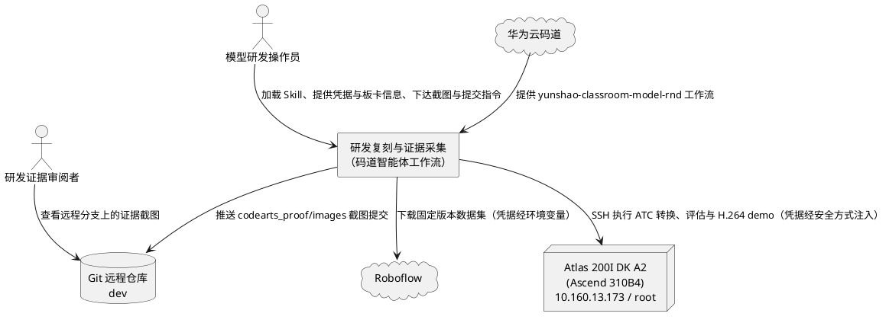
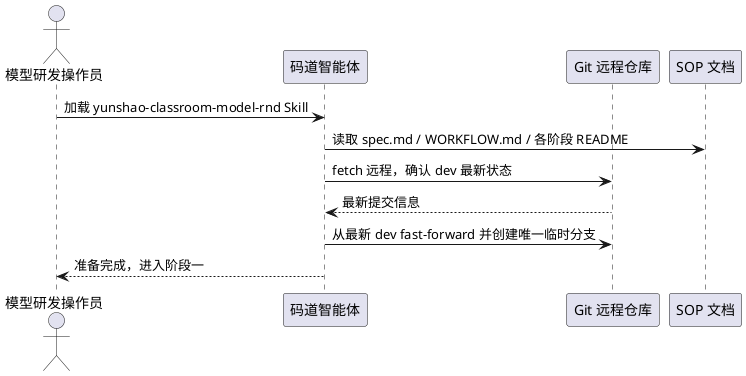
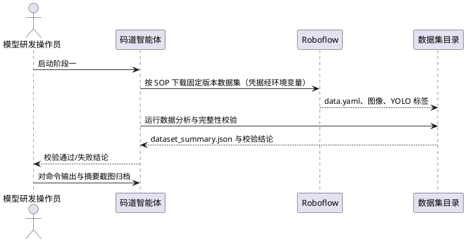
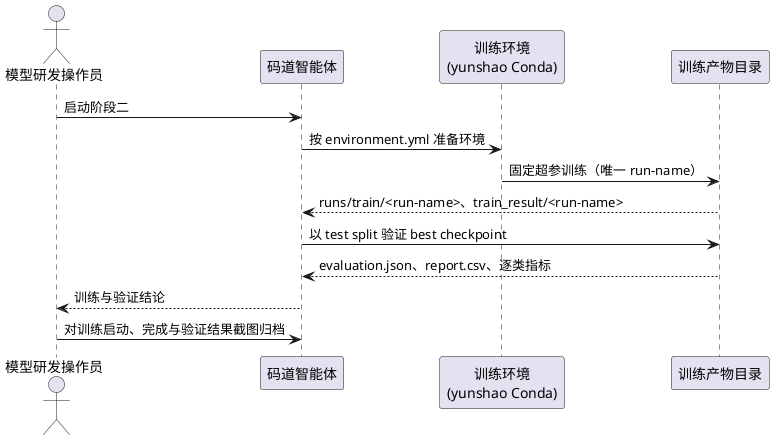
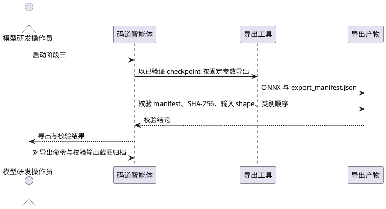
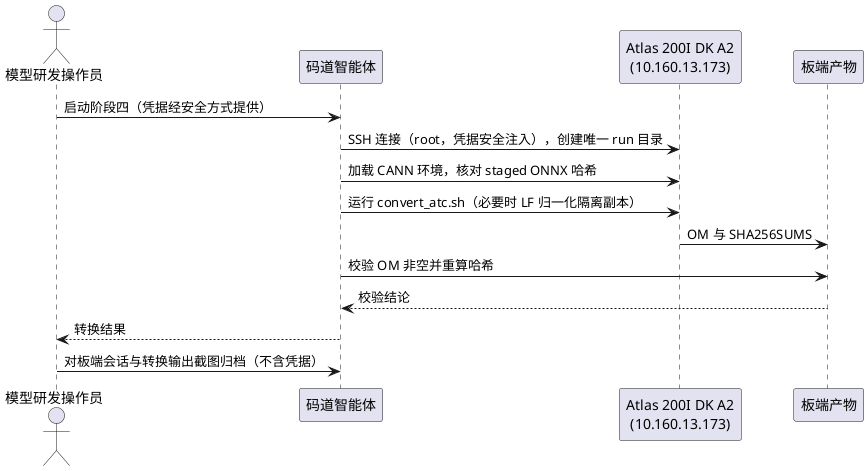
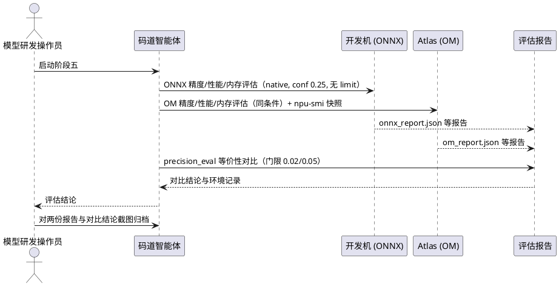
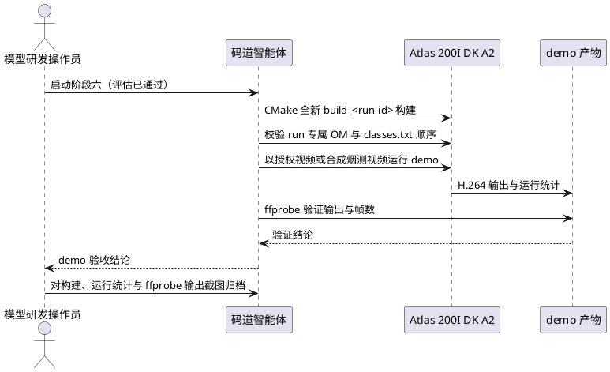
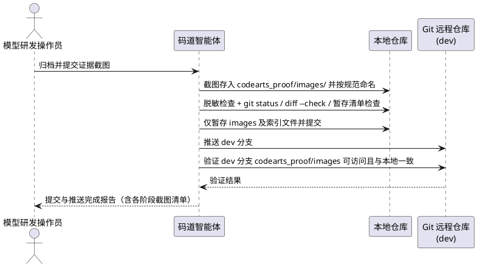

# 云韶课堂行为检测模型研发复刻与证据采集需求规格

> 关联 SOP：[课堂行为检测行为规格](../../../project/docs/Specification/classroom_behavior_detection/spec.md)、[阶段索引 WORKFLOW.md](../../../project/preparation/model_classroom_behavior/WORKFLOW.md) 及各阶段 README.md。
> 驱动来源：华为云码道加载的 `yunshao-classroom-model-rnd` Skill 工作流。
> 状态：待评审。
> 变更记录：2026-10-22 依据用户指示，证据提交推送目标由"main+dev 双分支"调整为"仅远程 dev 分支"（`codearts_proof/images/` 路径，不再提交 main 分支）；1.1/1.2/1.3、3.2/3.3、4.2/4.5、5.1、5.8、6.3 章节表述已同步修订。

# **1. 组件定位**

## **1.1 核心职责**

本组件负责复刻云韶课堂行为检测模型（YOLO11n/640 → ONNX → Atlas 310B4 OM）单垂直场景的研发全流程，采集各阶段过程证据截图归档至 `codearts_proof/images`，并提交推送到远程 `dev` 分支（不提交 main 分支）。

## **1.2 核心输入**

1. **Skill 工作流**：华为云码道智能体加载的 `yunshao-classroom-model-rnd` Skill，来源为码道 Skill 环境，内容为课堂行为检测模型七步研发工作流（数据集固定与校验 → 训练验证 → ONNX 导出 → Atlas 板端 ATC 转换 → 精度/性能/内存评估 → H.264 演示验收 → 证据打包）。
2. **仓库 SOP 文档**：`project/docs/Specification/classroom_behavior_detection/spec.md`、`project/preparation/model_classroom_behavior/WORKFLOW.md` 及 `model_train`、`model_export`、`model_convert`、`model_val`、`model_deployment` 五个阶段目录的 README.md，来源为仓库现有文件。
3. **数据集凭据**：Roboflow API key（`ROBOFLOW_API_KEY`），来源为环境变量或受批准的密钥存储，禁止写入文件。
4. **板卡访问通道**：Atlas 200I DK A2（Ascend 310B4）板卡，部署环境信息为 IP `10.160.13.173`、SSH 用户 `root`；SSH 认证凭据（密码或密钥）由用户在会话中提供，仅通过交互式输入或临时环境注入等安全方式使用，绝不写入本规格、源文件、日志、报告或任何将被提交的文件。
5. **Git 远程仓库**：atomgit.com/milo-ally-stu/Yunshao 的远程地址与 `dev` 分支（本轮唯一提交目标分支），来源为仓库现有配置。
6. **研发过程界面**：各阶段命令在开发机终端、Atlas 板端 SSH 会话中的实际执行输出与结果文件，来源为复刻过程本身。

## **1.3 核心输出**

1. **证据截图**：各研发阶段的过程截图文件，输出至仓库内 `codearts_proof/images/` 路径，每张截图须能辨识所属阶段与关键结果。
2. **Git 提交**：包含 `codearts_proof/images/` 下截图的提交，推送到远程 `dev` 分支（不提交 main 分支）。
3. **远程验证记录**：推送后通过 `git ls-remote` 或重新拉取确认远程 `dev` 分支 `codearts_proof/images/` 路径存在且内容与本地提交一致。
4. **过程证据台账**：以截图为主体，必要时附带截图索引，记录每张截图对应的阶段、命令与时间，缺失项标注"待补"。

## **1.4 职责边界**

1. **不修改现有 SOP 与脚本**：复刻过程不改动 `model_classroom_behavior` 各阶段 README、脚本命令与参数约定；发现 SOP 问题时记录并反馈，不在复刻中擅自变更。
2. **不触碰产品运行时**：不修改、不替换 `project/src/device_sides/atlas200idka2/` 下的产品代码；研发 demo 不承担产品安装、激活、告警、云端事件职责。
3. **不发明质量阈值**：绝对 mAP/FPS/内存验收阈值未定义时，如实报告测量值并标注"未定义"，不虚构通过标准。
4. **不上传大文件与敏感物**：数据集、checkpoint、ONNX、OM、视频产物、凭据一律不入库、不入截图明文。
5. **不替代精度验收结论**：截图仅证明研发过程真实发生，合成视频烟测不得描述为真实课堂流或产品验收。
6. **不负责后续设计与任务分解**：design.md 与 tasks.md 由其他角色处理。

# **2. 领域术语**

**垂直场景**
: 指一个具体业务领域的完整模型研发链路。本规格中专指云韶课堂行为检测（hand-raising、reading、writing 三类行为检测）这一单一场景。

**复刻**
: 按仓库既有 SOP 与 Skill 工作流在当前环境中重新执行完整研发过程并保留证据的操作。复刻必须保持 SOP 规定的阶段顺序、固定数据版本与命令参数不变。

**证据截图**
: 对研发过程中命令执行、终端输出、报告文件等界面进行截图得到的图像文件，用于证明对应阶段确实执行且结果可追溯。

**codearts_proof**
: 仓库中存放华为云码道智能体研发证据的顶层目录。本规格要求在其下建立 `images/` 子目录存放过程截图。

**数据集固定**
: 将数据源锁定为 Roboflow workspace `main-vdoys`、project `student-dataset-demo`、version `1`，类别顺序为 hand-raising、reading、writing。任何数据版本或类别映射变化都须作为新实验记录，不得覆盖为同一次复现。

**run-name**
: 每次训练尝试的唯一名称。重试必须使用新 run-name 并保留独立产物目录，禁止覆盖已有运行。

**ONNX**
: 开放神经网络交换格式。已验证 checkpoint 按固定参数（batch 1、640×640、静态 shape、opset 17、CPU）导出的中间模型产物。

**ATC**
: 昇腾张量编译器。在 Atlas 板端将 ONNX 转换为 OM 的工具，执行前须加载 CANN 环境脚本。

**OM**
: 昇腾离线模型格式。ONNX 经 ATC 转换得到、供 AscendCL 推理使用的板端模型产物。

**CANN**
: 华为昇腾神经网络计算架构。本流程板端基线版本为 7.0.RC1。

**SHA-256**
: 用于数据集清单、checkpoint、ONNX、AIPP 配置、OM、输出视频等产物完整性校验的哈希算法。

**精度等价（parity）**
: ONNX 与 OM 两后端在相同测试条件下的精度差异检查，门限为 mAP50-95 下降不超过 0.02、逐类 AP50 下降不超过 0.05；该门限是等价性判断，不是绝对质量目标。

**烟测（smoke）**
: 仅验证推理与媒体链路连通性的快速验证方式。烟测结果不得写成正式精度结论，不得替代 test split 完整评估。

**证据台账**
: 汇总 Git 版本/分支、阶段命令与退出码、数据集来源与哈希、类别顺序、训练参数与 checkpoint 哈希、ONNX/OM 清单与哈希、评估报告与对比结论、性能/内存/NPU 快照、demo 输入来源与输出哈希的追溯记录；缺失项标注"待补"。

# **3. 角色与边界**

## **3.1 核心角色**

- 模型研发操作员：通过华为云码道智能体加载 Skill、按 SOP 执行各阶段命令、采集截图并完成提交推送的研发人员。
- 研发证据审阅者：查看 `codearts_proof/images/` 截图以核对研发过程真实性与完整性的项目成员或评审者。

## **3.2 外部系统**

- 华为云码道：提供 Skill 加载与智能体执行环境，驱动整个复刻流程并产出截图。
- Roboflow：提供固定版本的课堂行为数据集（workspace `main-vdoys` / project `student-dataset-demo` / version `1`），凭据经环境变量注入。
- Atlas 200I DK A2（Ascend 310B4）：承载 ATC 转换、OM 评估与 H.264 demo 的板端执行环境，部署环境信息为 IP `10.160.13.173`、SSH 用户 `root`；SSH 认证凭据由用户提供并仅经安全方式使用，CANN 基线 7.0.RC1。
- Git 远程仓库（atomgit.com/milo-ally-stu/Yunshao）：接收证据截图提交的 `dev` 分支。

## **3.3 交互上下文**

# **4. DFX约束**

## **4.1 性能**

1. 截图采集必须在对应阶段命令执行完成之后进行，禁止为截图中断或重启正在运行的阶段任务。
2. 单张截图从阶段命令完成到文件落盘的间隔不超过 5 分钟，避免截图与实际执行环境脱节。
3. 全流程总时长不设硬性上限，但各阶段命令必须按 SOP 原样完整执行，禁止用 `--limit` 试跑替代完整 test 评估作为正式证据。

## **4.2 可靠性**

1. 六个研发阶段（数据集校验、训练验证、ONNX 导出、ATC 转换、评估、H.264 demo）每个阶段至少 1 张证据截图，全流程合计不少于 6 张；缺失视为证据不完整，须补采或在台账中标注"待补"。
2. 推送完成后，通过 `git ls-remote` 或重新拉取验证远程 `dev` 分支的 `codearts_proof/images/` 路径下文件确实存在且内容与本地证据提交一致。
3. 某阶段失败时，失败证据同样保留（含错误输出截图），不得删除失败记录后只展示成功片段。

## **4.3 安全性**

1. **板卡凭据安全**：Atlas 板卡 SSH 认证凭据（含用户在会话中提供的密码）绝不写入 spec.md、源文件、日志、报告或任何将被提交的文件；仅在会话交互过程中通过交互式输入或临时环境注入等安全方式使用，会话结束后不在持久化载体中留存。
2. **部署环境信息白名单**：板卡 IP `10.160.13.173` 与 SSH 用户名 `root` 属于已获批准的部署环境信息，可记录于规格与提交文件；其余任何凭据类信息一律禁止记录。
3. **截图脱敏**：截图画面及提交内容中禁止出现 API key、密码、私钥、访问令牌等敏感信息；发现即脱敏处理后归档。
4. **禁止提交敏感产物**：禁止将数据集、checkpoint（PT）、ONNX、OM、生成的视频、凭据文件提交入库。
5. **数据集凭据注入**：Roboflow 凭据只经环境变量或受批准的密钥存储注入，不写入源文件、命令历史、日志、报告与截图。

## **4.4 可维护性**

1. 截图文件名必须包含阶段序号前缀，命名规则见数据约束章节；同一阶段多张截图按两位序号递增。
2. 截图须能辨识阶段命令与关键结果（如命令行内容、指标数值、报告文件名或产物清单），不得使用无法辨识内容的全黑/空白画面。
3. 建立截图索引时，每条记录包含：阶段、命令、截图文件名、采集时间。

## **4.5 兼容性**

1. 远程 `dev` 分支的 `codearts_proof/images/` 内容必须与本地证据提交一致；不向 `main` 分支提交。
2. 提交前必须基于远程最新 `dev` fast-forward 更新本地基线，禁止覆盖他人提交或用户未提交改动。
3. 提交只涉及 `codearts_proof/images/` 及必要的索引文件，不得夹带无关用户改动。

# **5. 核心能力**

## **5.1 Skill 加载与研发准备**

### **5.1.1 业务规则**

1. **Skill 前置规则**：操作员必须先通过华为云码道加载 `yunshao-classroom-model-rnd` Skill，再开始复刻。
   a. 验收条件：码道会话已加载 Skill → 复刻按 Skill 指引先读取 spec.md 与 WORKFLOW.md，再进入阶段一。
2. **SOP 命令唯一来源规则**：各阶段命令必须取自对应阶段 README.md，禁止用猜测命令替代 SOP 提供的命令。
   a. 验收条件：README 提供了某阶段命令 → 实际执行的命令与其参数、路径逐项一致。
3. **依赖变更约束规则**：修改依赖前必须读取模型根目录 `environment.yml`，按其创建/更新 `yunshao` Conda 环境。
   a. 验收条件：训练前检查环境 → `yunshao` 环境与 environment.yml 一致。
4. **Git 基线规则**：编辑仓库前必须确认实际 Git 根、远程、当前分支与用户改动；fetch 远程并从最新 `dev` fast-forward，再创建唯一临时工作分支。
   a. 验收条件：远程 dev 有新提交 → 本地先更新基线再开工；本地存在用户未提交改动 → 不覆盖、不混入。
5. **禁止项**：禁止未加载 Skill 或未读 SOP 就执行阶段命令；禁止跳过 WORKFLOW.md 规定的阶段顺序；禁止虚构分支或远程。
   a. 验收条件：尝试直接执行阶段命令 → 流程拒绝并先完成准备项检查。

### **5.1.2 交互流程**

### **5.1.3 异常场景**

1. **Skill 加载失败**
   a. 触发条件：码道环境中 Skill 不存在或加载报错。
   b. 系统行为：停止复刻，向操作员报告失败原因，不执行任何阶段命令。
   c. 用户感知：明确的加载失败提示与后续操作建议。
2. **SOP 文档缺失或不一致**
   a. 触发条件：阶段 README、WORKFLOW.md 或 spec.md 缺失，或内容相互矛盾。
   b. 系统行为：停止对应阶段执行，记录缺口，向操作员请求确认。
   c. 用户感知：缺失文件路径清单与"待补"标注。
3. **本地有未提交用户改动**
   a. 触发条件：`git status` 显示工作区存在与本任务无关的用户改动。
   b. 系统行为：不覆盖、不暂存用户改动；截图提交仅包含本任务产物。
   c. 用户感知：提交清单中不出现用户改动文件的提示。

## **5.2 数据集固定与校验复刻（阶段一）**

### **5.2.1 业务规则**

1. **数据源固定规则**：必须使用 Roboflow workspace `main-vdoys`、project `student-dataset-demo`、version `1`，类别顺序 hand-raising、reading、writing；禁止静默更换提供商、版本、类别映射或 split。
   a. 验收条件：执行下载命令 → 产物记录提供商、版本、许可证/来源与 `data.yaml` 哈希、图像/标签清单哈希，且不含凭据。
2. **凭据注入规则**：`ROBOFLOW_API_KEY` 只经环境变量或受批准密钥存储注入，禁止写入文件、命令历史、日志、报告与截图。
   a. 验收条件：检查下载产物与截图 → 任何位置不出现明文 key。
3. **训练前完整性校验规则**：训练开始前必须确认 train/valid/test 图像与标签齐全、类别 ID 与 `data.yaml` 一致、标签可解析、各 split 数量非零、无跨 split 重复或缺失标签。
   a. 验收条件：任一校验失败 → 停止训练并修复或重新下载数据集，不继续后续阶段。
4. **禁止项**：禁止使用已知缺 test 标签的快照直接训练并报告完整精度。
   a. 验收条件：检测到 test 标签缺失 → 流程中止并提示重新下载。

### **5.2.2 交互流程**

### **5.2.3 异常场景**

1. **下载失败**
   a. 触发条件：凭据缺失、网络错误或 Roboflow 返回失败。
   b. 系统行为：停止并报告失败原因，不生成本阶段"通过"截图。
   c. 用户感知：失败提示；本阶段截图仅记录失败现场或标注"待补"。
2. **完整性校验失败**
   a. 触发条件：split 数量为零、类别 ID 不匹配、标签不可解析或跨 split 重复。
   b. 系统行为：停止训练流程，提示修复或重新下载。
   c. 用户感知：具体失败项清单；不出现"可继续训练"的结论。

## **5.3 训练与验证复刻（阶段二）**

### **5.3.1 业务规则**

1. **环境规则**：必须从模型根目录按 `environment.yml` 创建或更新 `yunshao` Conda 环境并在其中执行训练。
   a. 验收条件：训练命令在 `yunshao` 环境中运行，环境与 environment.yml 一致。
2. **固定超参规则**：必须按 SOP 参数训练 YOLO11n/640：100 epochs、batch 8、device 0、workers 4、seed 42、deterministic 模式、patience 30。
   a. 验收条件：训练命令执行 → 参数逐项与 README 一致；使用 CPU 须显式改 device 并记录为不同实验。
3. **唯一 run-name 规则**：每次训练尝试必须分配唯一 `--run-name`，禁止覆盖已有运行目录。
   a. 验收条件：发起重试 → 使用新 run-name，导出、报告、OM、demo 路径均独立。
4. **留出集规则**：必须用独立 test split 验证 best checkpoint；验证 split 仅用于选择训练调整，test split 作为留出集，禁止基于单个 test 样本调参或调阈值。
   a. 验收条件：验证命令指定 `--split test` → 仅该结果记录为留出集结果；训练日志 val 指标不得替代 test 结果。
5. **失败重试规则**：质量或下游门禁失败时，先诊断失败属于数据/训练/导出/ATC/运行时/阈值哪一类再决定重训；重试用新 run-name 并保留失败证据。
   a. 验收条件：门禁失败 → 保留失败产物与截图，重试使用新 run-name。
6. **追溯记录规则**：必须归档完整命令、代码版本、数据集哈希、环境/GPU 版本、训练日志、best/last checkpoint 哈希与逐类指标。
   a. 验收条件：阶段完成 → 台账含上述各项，缺失标注"待补"。

### **5.3.2 交互流程**

### **5.3.3 异常场景**

1. **训练中断/失败**
   a. 触发条件：GPU 不可用、显存不足或训练进程异常退出。
   b. 系统行为：保留失败运行目录与日志，提示诊断路径（设备/CPU 差异须记录为不同实验）。
   c. 用户感知：失败原因与重试指引（新 run-name）。
2. **test 指标不达标**
   a. 触发条件：留出集指标低于项目或用户定义的门禁。
   b. 系统行为：返回训练环节并以新 run-name 重试，test 集保持封存用于最终选择。
   c. 用户感知：失败证据截图保留；不出现把 val 指标冒充 test 的输出。

## **5.4 ONNX 导出复刻（阶段三）**

### **5.4.1 业务规则**

1. **导出对象规则**：只允许导出已完成验证的 checkpoint；重试时 `--weights-root` 指向该轮 `train_result/<run-name>` 目录。
   a. 验收条件：导出执行 → 权重来源为已验证 best checkpoint，且与导出记录一致。
2. **固定导出参数规则**：必须使用 SOP 设置：batch 1、640×640、静态 shape、opset 17、CPU 导出。
   a. 验收条件：导出命令执行 → 参数逐项与 README 一致。
3. **导出校验规则**：继续前必须校验 `export_manifest.json`、checkpoint SHA-256、ONNX SHA-256、输入 shape 与类别顺序。
   a. 验收条件：任一项不匹配 → 停止并报告差异，不进入 ATC 转换。

### **5.4.2 交互流程**

### **5.4.3 异常场景**

1. **导出校验失败**
   a. 触发条件：manifest 缺失、哈希不匹配或类别顺序与固定顺序不一致。
   b. 系统行为：阻止进入 ATC 转换，报告具体差异项。
   c. 用户感知：差异清单与"停止后续阶段"提示。

## **5.5 Atlas 板端 ATC 转换复刻（阶段四）**

### **5.5.1 业务规则**

1. **板卡与环境规则**：必须使用 Atlas 200I DK A2（Ascend 310B4，部署环境信息：IP `10.160.13.173`、SSH 用户 `root`）与 SOP 声明的 CANN 版本；SSH 认证凭据由用户提供并仅通过交互式输入或临时环境注入等安全方式使用，禁止将板卡密码等凭据写入源码、规格、日志、报告或将提交的文件。
   a. 验收条件：连接板卡 → 使用用户提供的安全注入凭据；提交的文件与截图中无任何凭据明文，IP 与用户名仅作为部署环境信息出现。
2. **staged 校验规则**：转换前必须加载 `/usr/local/Ascend/ascend-toolkit/set_env.sh`，核对 staged ONNX 哈希与 `export_manifest.json` 一致，再从 staged 模型根运行 `model_convert/convert_atc.sh`。
   a. 验收条件：staged ONNX 哈希不匹配 → 停止转换并报告。
3. **隔离与实验目录规则**：每次实验必须放在唯一板端 run 目录；不得覆盖既有模型与运行时文件。
   a. 验收条件：再次实验 → 新 run 目录，既有文件保持原样。
4. **换行符归一化规则**：板端 shell 脚本为 CRLF 时，仅对隔离副本归一化为 LF 后执行，并记录其最终哈希。
   a. 验收条件：发现 CRLF → 只处理隔离副本，原始仓库文件不变。
5. **OM 校验规则**：转换后必须确认 OM 非空，并从 `SHA256SUMS` 重算 ONNX、AIPP、OM 哈希，通过后才可复制 OM 到 run 专属部署路径。
   a. 验收条件：OM 为空或哈希不符 → 不复制、不进入评估，报告差异。

### **5.5.2 交互流程**

### **5.5.3 异常场景**

1. **板卡连接失败**
   a. 触发条件：IP 不可达、认证失败或网络不通。
   b. 系统行为：停止阶段并报告；不回退到非板端转换冒充板端证据。
   c. 用户感知：连接失败提示与检查建议。
2. **ATC 转换失败**
   a. 触发条件：算子不支持、CANN 版本不符或输入模型异常。
   b. 系统行为：保留错误输出截图，诊断是否为导出/ATC/运行时问题后再决定重试路径。
   c. 用户感知：错误摘要与诊断方向。
3. **OM 校验失败**
   a. 触发条件：OM 为空或 SHA256SUMS 核对不一致。
   b. 系统行为：阻止复制与评估，报告差异项。
   c. 用户感知：差异清单与"禁止继续"提示。

## **5.6 精度、性能与内存评估复刻（阶段五）**

### **5.6.1 业务规则**

1. **同条件评估规则**：ONNX 与 OM 必须使用同一 Roboflow 快照、`data.yaml`、清单、test split、类别顺序、640 输入与相同置信度/IoU 阈值；两份报告须记录相同 `metric_mode`、置信度与 IoU 后才可解读精度/召回差异。
   a. 验收条件：任一条件不一致 → 视为无效对比，重新执行。
2. **完整评估规则**：正式 test 报告必须以 `--metric-mode native --conf 0.25` 且不带 `--limit` 运行；禁止跨机器使用 `auto` 模式；smoke 结果须与正式报告分开保留。
   a. 验收条件：发现 `--limit` 或 `auto` 的正式报告 → 视为 smoke，不得写入完整精度结论。
3. **等价门禁规则**：必须运行 SOP 的 `precision_eval.py` 对比，门限 `--max-map-drop 0.02`、`--max-class-ap50-drop 0.05`；该门限是 ONNX→OM 等价性判断，不是绝对质量目标。
   a. 验收条件：mAP50-95 或逐类 AP50 下降超门限 → 等价性失败，先检查哈希、预处理、AIPP、类别顺序与运行时，再考虑重训。
4. **性能与内存报告规则**：必须运行完整 test 的 OM 性能评估与 SOP 内存评估，记录 pipeline FPS、延迟分位、模型大小、进程峰值 RSS、输入/输出张量大小及前后 `npu-smi` 快照；RSS 为主机进程内存，`npu-smi` 为设备级内存，不得互相冒充。
   a. 验收条件：报告缺少 FPS/延迟分位/RSS/npu-smi 快照 → 视为不完整，补齐后再判定。
5. **绝对阈值规则**：绝对 mAP/FPS/内存验收门限仅采用项目已定义或用户提供的值；无则如实报告测量值并标注"未定义"，禁止发明通过阈值。
   a. 验收条件：无定义门限时 → 结论区出现"未定义"标注而非虚构通过。
6. **环境记录规则**：记录板卡温度、健康状态、CANN/运行时版本与并发负载，避免不同运行条件下的数值直接比较。
   a. 验收条件：报告归档 → 上述环境项齐全或标注"待补"。

### **5.6.2 交互流程**

### **5.6.3 异常场景**

1. **等价性门禁失败**
   a. 触发条件：ONNX→OM mAP50-95 或逐类 AP50 下降超门限。
   b. 系统行为：先检查哈希、预处理、AIPP、类别顺序与运行时差异；未定位前不重训。
   c. 用户感知：失败项数值与诊断建议；不出现直接"重训"结论。
2. **评估数据不完整**
   a. 触发条件：缺标签、图片不可读、标注类型不兼容或两端口径不一致。
   b. 系统行为：先修复或明确记录差异，不得声称完整集结果。
   c. 用户感知：缺失项清单与 smoke/正式区分标注。
3. **绝对质量门禁失败（若已定义）**
   a. 触发条件：项目或用户定义的绝对 mAP/FPS/内存门限未达标。
   b. 系统行为：以新 run-name 返回训练，test 集保持封存用于模型选择。
   c. 用户感知：失败指标与重试指引。

## **5.7 H.264 部署演示验收复刻（阶段六）**

### **5.7.1 业务规则**

1. **前置门禁规则**：只有评估阶段通过后才允许构建与运行 demo；评估未通过时禁止进入本阶段。
   a. 验收条件：评估门禁未通过 → demo 阶段不启动。
2. **构建规则**：必须从 staged `model_deployment` 源码以 CMake 在全新 `build_<run-id>` 目录构建；传入 run 专属 OM 与 `classes.txt`。
   a. 验收条件：构建执行 → 使用新构建目录，OM 与 labels 来自本轮 run，不与其他轮次混用。
3. **类别顺序规则**：必须校验 labels 顺序保持 hand-raising、reading、writing，且模型输出与 demo 兼容；错误输入或输出形状不匹配时明确失败。
   a. 验收条件：labels 顺序错误或形状不匹配 → demo 明确报错退出，不输出含糊成功。
4. **产品隔离规则**：禁止停止或重配置运行中的课堂产品服务；VPSS group 0 与 Region handle 0 可能已被占用，demo 须以 `--vpss-group` 与 `--region-handle` 选择空闲资源（当前默认 group 1、handle 1）；资源已存在错误视为冲突，改选其他空闲 ID。
   a. 验收条件：出现资源占用冲突 → 更换空闲 ID 重试，产品服务不受影响。
5. **输入来源规则**：优先使用授权的 H.264 课堂样例或 RTSP 源；无授权源时，从留出的 test 图像生成命名清晰的合成 H.264 烟测视频，存放于本轮 `acceptance_<run-id>` 目录。
   a. 验收条件：使用合成视频 → 截图与记录中明确标注"软件链路烟测"，不声称真实课堂流或产品验收。
6. **运行记录规则**：运行 demo 须记录退出码、处理/编码帧数、有效 FPS、推理耗时、峰值 RSS 与输出 SHA-256；用 `ffprobe` 确认输出为非空、可解码 H.264 且帧数与 demo 日志一致。
   a. 验收条件：输出为空、不可解码或帧数不符 → 判定失败并保留错误证据。

### **5.7.2 交互流程**

### **5.7.3 异常场景**

1. **资源冲突**
   a. 触发条件：VPSS group 或 Region handle 已被占用。
   b. 系统行为：按规则改选空闲 ID 重试，不动产品服务。
   c. 用户感知：冲突提示与所换 ID 记录。
2. **输出验证失败**
   a. 触发条件：输出为空、不可解码或帧数与日志不符。
   b. 系统行为：判定失败，保留错误输出截图与日志。
   c. 用户感知：失败项与退出码记录。

## **5.8 证据截图归档与 dev 分支提交推送**

### **5.8.1 业务规则**

1. **归档路径规则**：全部证据截图必须存放于仓库内 `codearts_proof/images/` 路径。
   a. 验收条件：截图落盘 → 路径为 `codearts_proof/images/`，无散落他处。
2. **命名规则**：截图文件名必须采用 `<两位阶段号>_<阶段标识>_<两位序号>.png` 格式（如 `01_dataset_01.png`、`06_demo_02.png`），仅允许小写字母、数字、下划线。
   a. 验收条件：出现不符合命名的文件 → 归档前重命名。
3. **完整性规则**：六个阶段每阶段至少 1 张截图，全流程不少于 6 张；失败阶段同样保留失败证据截图。
   a. 验收条件：某阶段无截图 → 台账标注"待补"并列入补采清单。
4. **脱敏规则**：归档前必须逐一检查截图，无 API key、密码、私钥、令牌等敏感信息；板卡 IP `10.160.13.173` 与 SSH 用户名 `root` 属于已批准的部署环境信息，可在截图中保留。
   a. 验收条件：截图含凭据类敏感信息 → 脱敏后重新归档，原始含敏文件不入库。
5. **提交范围规则**：提交前必须检查 `git status`、`git diff --check` 与实际暂存清单；只提交 `codearts_proof/images/` 及必要索引文件，排除下载数据、权重、ONNX/OM、生成视频、凭据与无关用户改动。
   a. 验收条件：暂存清单出现排除项 → 移出后再提交。
6. **dev 分支推送规则**：截图提交必须推送到远程 `dev` 分支（不提交 `main` 分支）；推送后验证该分支 `codearts_proof/images/` 可访问且内容与本地证据提交一致。
   a. 验收条件：推送完成 → `git ls-remote` 或重新拉取确认远程 `dev` 分支路径存在且内容与本地提交一致。
7. **禁止项**：禁止删除远程分支（用户明确点名除外）；禁止强推覆盖他人提交；禁止把失败烟测包装成验收通过。
   a. 验收条件：推送操作 → 均为 fast-forward 或常规提交，无 force 覆盖记录。

### **5.8.2 交互流程**

### **5.8.3 异常场景**

1. **推送冲突**
   a. 触发条件：远程 dev 在推送前有新提交。
   b. 系统行为：fetch 并 fast-forward 合并后重新推送，不覆盖他人提交。
   c. 用户感知：冲突解决记录与最终推送成功确认。
2. **推送失败**
   a. 触发条件：向远程 dev 推送因网络、认证或权限原因失败。
   b. 系统行为：重试推送并重新验证远程 dev 分支内容，未确认前不宣告完成。
   c. 用户感知：失败原因、重试结果与远程内容验证输出。
3. **敏感信息已入库**
   a. 触发条件：推送后发现截图含凭据类敏感信息。
   b. 系统行为：脱敏替换文件后提交修正，并核查是否需作废旧敏感文件。
   c. 用户感知：修正提交说明与复查结论。
4. **阶段证据缺失**
   a. 触发条件：某阶段未采集到任何截图。
   b. 系统行为：在索引/台账中标注"待补"，向操作员列出补采清单，不伪造截图。
   c. 用户感知：缺失清单与"待补"标注。

# **6. 数据约束**

## **6.1 证据截图**

1. **存放路径**：仓库内 `codearts_proof/images/`；目录不存在时创建，禁止在其他路径散放研发截图。
2. **文件名**：`<两位阶段号>_<阶段标识>_<两位序号>.png`；阶段号与阶段标识固定为 01_dataset、02_train、03_export、04_convert、05_val、06_demo；仅允许小写字母、数字、下划线。
3. **文件格式**：PNG；单张文件大小不超过 10 MB，超出须压缩后再归档。
4. **数量下限**：每阶段至少 1 张，全流程合计不少于 6 张；失败阶段以失败现场截图计入。
5. **内容可辨识性**：画面须能辨识所属阶段（命令、路径或报告文件名）与关键结果（成功/失败状态、核心指标或产物名）。
6. **敏感信息**：禁止出现 API key、密码、私钥、访问令牌等凭据类信息；板卡 IP `10.160.13.173` 与 SSH 用户名 `root` 为已批准部署环境信息，可保留；发现凭据即脱敏。

## **6.2 截图索引（可选）**

1. **阶段**：取值限定为 01_dataset、02_train、03_export、04_convert、05_val、06_demo 之一。
2. **命令**：截图对应的 SOP 命令或操作摘要。
3. **截图文件名**：与 `codearts_proof/images/` 内实际文件一一对应。
4. **采集时间**：截图生成的时间戳。
5. **状态**：取值为 成功 / 失败 / 待补 之一；失败须附失败原因摘要。

## **6.3 Git 提交**

1. **目标远程**：atomgit.com/milo-ally-stu/Yunshao。
2. **目标分支**：远程 `dev` 分支（本轮唯一提交目标，不向 `main` 分支提交）。
3. **提交路径**：仅限 `codearts_proof/images/` 及必要索引文件。
4. **排除项**：数据集、PT 权重、ONNX、OM、生成视频、凭据文件（含任何记录板卡密码或 API key 的载体）、无关用户改动。
5. **提交方式**：基于远程最新分支 fast-forward 后的常规提交；禁止强推覆盖、禁止删除远程分支（用户明确点名除外）。