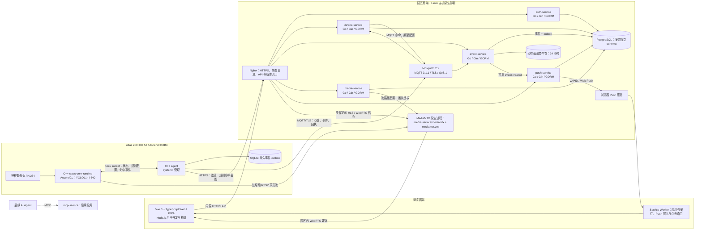
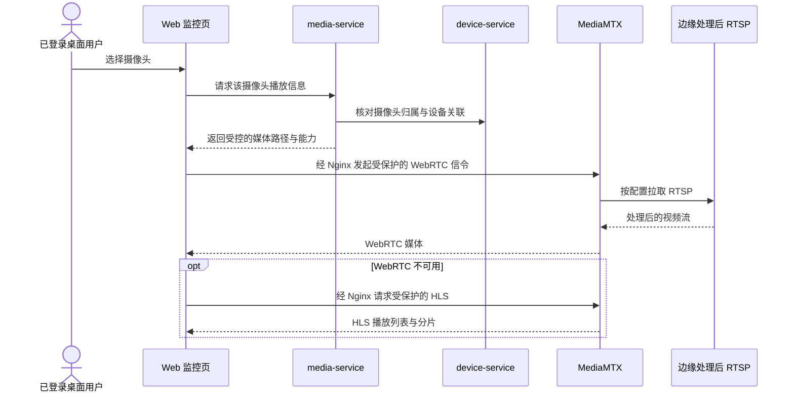
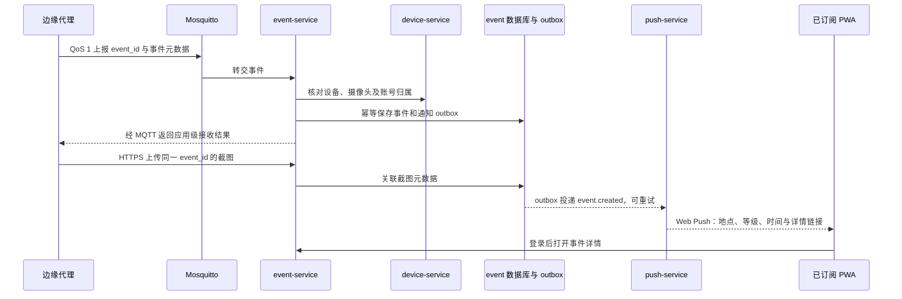
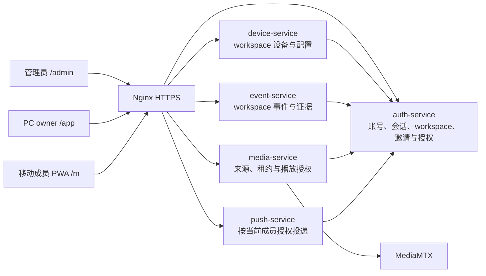
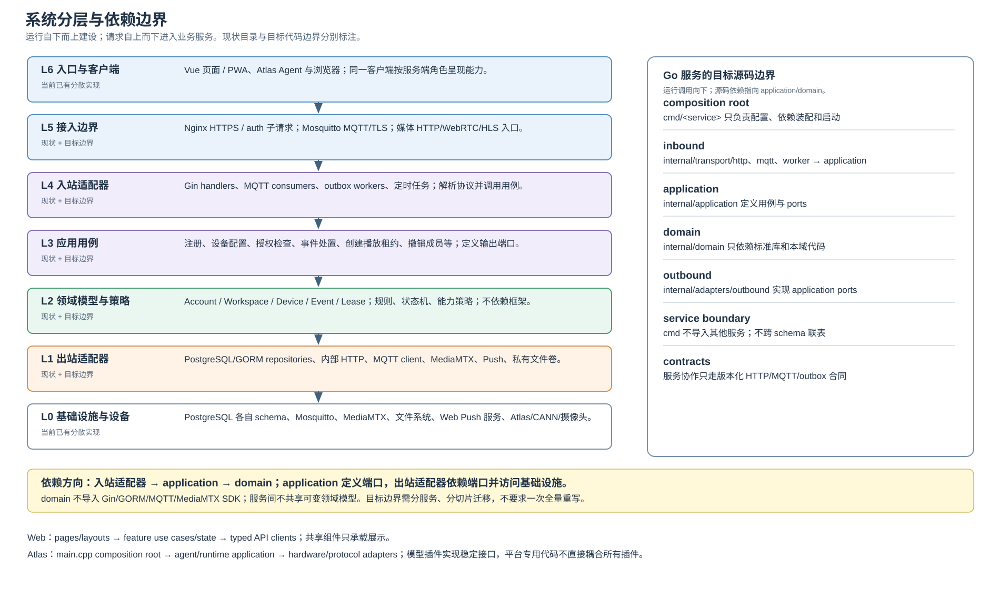
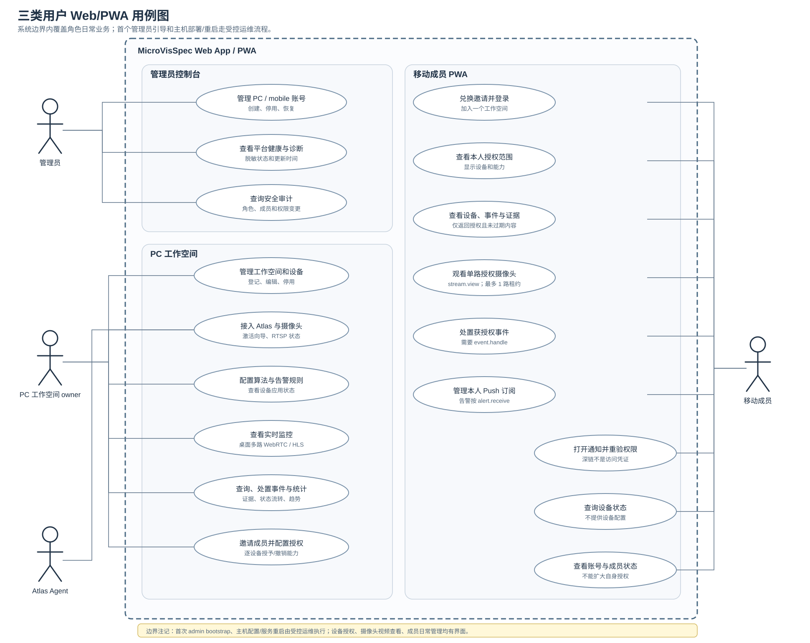
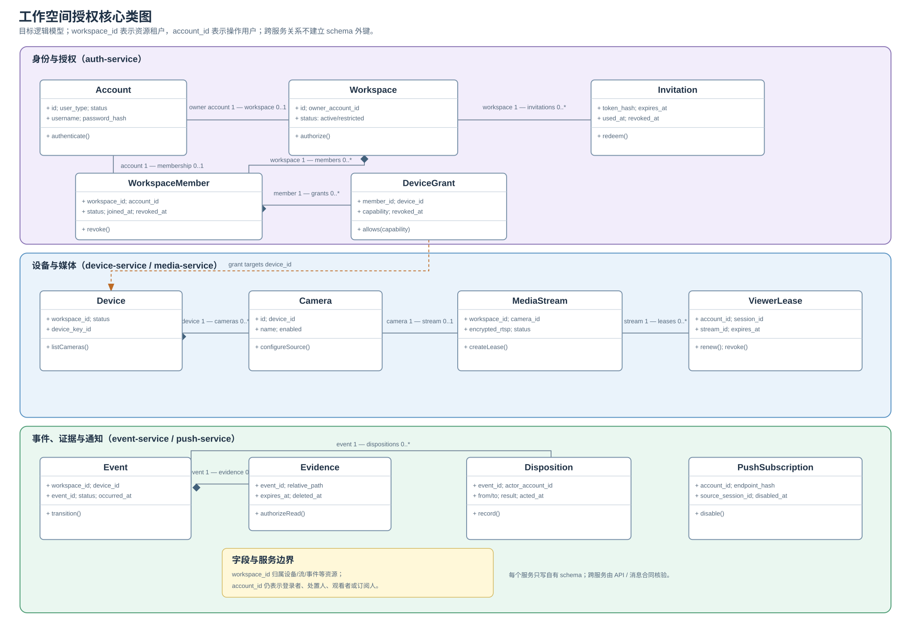
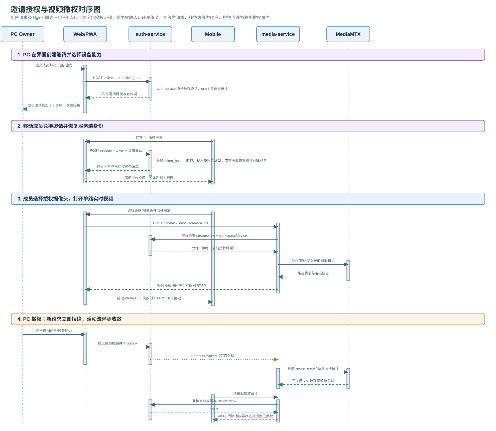
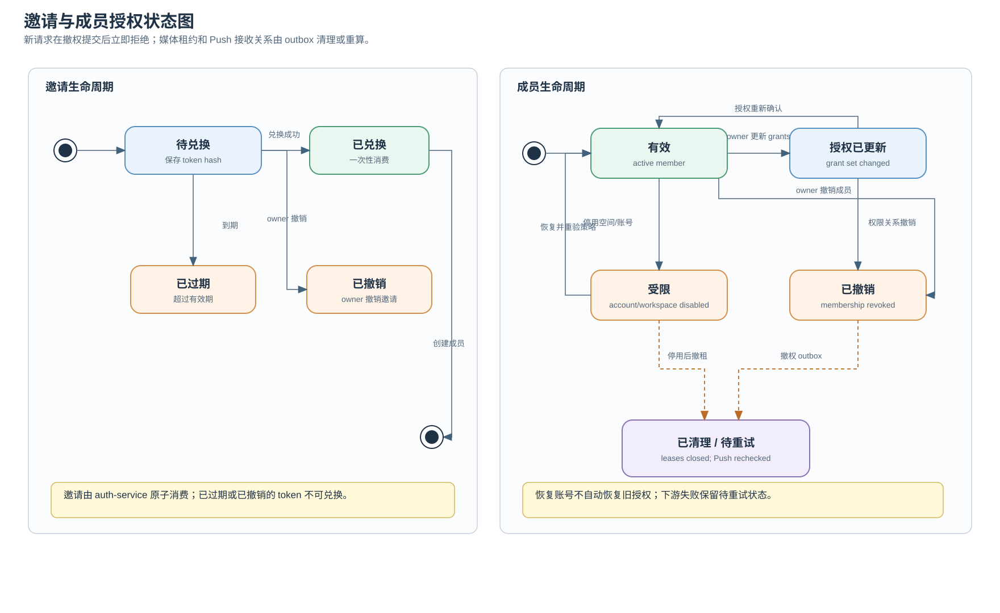

# 云哨边缘智枢系统架构设计

> 状态：设计草案，供页面与后端接口设计使用。
>
> 日期：2026-10-15。
>
> 依据：[产品需求](../Analysis/PRD.md)、[商用方案调研与决策](../Research/RESEARCH.md)、[项目介绍](../../../README.md)。README 描述产品愿景；首发范围以 PRD 和已确认的调研决策为准。

## 1. 目标、范围与原则

云哨连接摄像头和运行视觉算法的边缘设备，在平台侧汇聚设备状态、处理后的视频、通用异常事件及处置记录，并在 Web/PWA 中完成查看、告警响应和基础统计。教室行为检测用于首发验证，平台数据模型不能依赖某一种算法或场景。[PRD §1、§4](../Analysis/PRD.md)

现有 MVP 以完整业务闭环验收：注册登录 → 登记设备 → 查看状态和画面 → 接收事件与截图 → PWA 通知 → 处置反馈 → 查看基础统计。该基线采用个人账号数据边界，不包含成员邀请和共享。下一阶段拟增加平台管理员、PC 工作空间 owner 和移动成员；其目标边界与迁移方式见[三类用户与工作空间授权规格](../Specification/multi_user_workspace_access/)。在该组完成评审和实现验收前，不把目标入口描述为当前能力。现有移动端为同一 Web/PWA 的响应式入口，原生应用与 MCP 工具仍属后续阶段。[PRD §4、§6](../Analysis/PRD.md)

| 设计约束 | 架构落点 |
| --- | --- |
| 六个业务服务边界 | auth、device、event、media、push 在首发运行；mcp-service 保留边界，系统稳定后启用。 |
| Go + Gin + GORM，每个业务服务独立二进制 | 五个服务分别以单个 Go 二进制和 systemd unit 部署；Nginx、PostgreSQL、Mosquitto 与 MediaMTX 在主机原生运行。 |
| 最多 12 路并发视频通道 | 首发每台 Atlas 200I DK A2 默认处理并输出 1 路视频；平台最多同时拉取 12 路，支持 2 个桌面端同时观看完整 12 分屏。边缘输出 720p/15 fps/H.264 Baseline，目标 1.5 Mb/s；WebRTC 优先，HLS 回退。 |
| 设备通信使用 MQTT | Mosquitto 2.x、MQTT 3.1.1、设备独立身份、TLS、最小主题权限、QoS 1；业务事件按事件 ID 去重。[调研决策](../Research/RESEARCH.md) |
| 截图暂存后端服务器 | 私有文件卷保存图片，上传成功起保留 24 小时，过期删除；事件元数据与处置记录另行保留。 |
| 基础分析大屏纳入首发 | 前端分别调用 device-service 和 event-service 的账号级统计接口，展示设备概况、事件趋势、等级、类型、高发位置和处置状态，不设 analysis-service。 |

设计坚持两条边界：业务记录由相应服务独占写入，跨服务通过 API 或可靠事件交互；边缘设备的媒体流、设备消息和事件证据分别走适合自己的通道，不把大图或视频帧塞进 MQTT。

## 2. 系统边界与整体结构

外部参与者包括平台用户、摄像头、运行边缘代理及视觉算法的设备、浏览器推送服务，以及后续的 AI Agent。首发边缘硬件确定为 Atlas 200I DK A2；上报协议和事件模型保持通用，不绑定某个视觉模型或教室场景。[README 首发场景](../../../README.md)

首发部署固定在单个园区：后端服务器、Atlas 200I DK A2 边缘设备和桌面监控终端处于同一内网或可路由 VLAN。MediaMTX 在内网拉取边缘 RTSP，浏览器 WebRTC 通过内网 UDP 连接 MediaMTX；PWA 从外部通过公开的 Nginx HTTPS 入口查看告警详情和接收推送，手机端没有监控大屏。首发不部署 STUN/TURN，也不开放公网 WebRTC 媒体端口；不在内网的桌面浏览器可通过 HTTPS 尝试 HLS。Mosquitto 仅向内网设备开放 MQTT/TLS；数据库、MediaMTX 控制 API、各 Go 服务内部端口和截图文件卷均不直接暴露。手工登记 IP 只完成资产登记，不能替代 RTSP 网络连通检查。跨园区设备接入需另行增加 VPN 或受认证推流方案，不属于这次单园区 MVP 拓扑。[PRD §5](../Analysis/PRD.md)

### 2.1 连接与鉴权边界

| 连接 | 协议与入口 | 身份及授权 |
| --- | --- | --- |
| Web/PWA → 业务服务 | HTTPS，经 Nginx 的 /api 路由 | 登录 Cookie；Nginx 验会话，目标服务按账号和对象再次授权。 |
| 边缘代理 → device-service | HTTPS 激活入口 | 一次性激活凭据，换取设备独立身份。 |
| 边缘代理 → Mosquitto | 私有网络中的 MQTT/TLS | 每台设备独立凭据与主题 ACL。 |
| 边缘代理 → event-service | HTTPS 截图入口 | 设备身份与 event_id、设备归属校验。 |
| MediaMTX → 边缘 RTSP | 园区内网或可路由 VLAN | 私有源流地址与媒体来源凭据；不暴露给浏览器。 |
| 桌面 Web → MediaMTX | WebRTC 信令经 Nginx；园区内网 UDP 传媒体，失败后 HLS 经 HTTPS | 浏览器会话及摄像头归属校验，MediaMTX 禁止未经受控代理的 HTTP 读取。 |
| push-service → 浏览器 Push 服务 | 出站 HTTPS | VAPID 签名；投递对象来自当前账号的有效订阅。 |

### 2.2 运行进程与部署单元

| 部署单元 | 作用 | 首发 |
| --- | --- | --- |
| Nginx | 提供 Vue 构建产物、TLS、同源 API 路由、媒体 HTTP 入口和请求鉴权子请求。 | 是 |
| auth-service、device-service、event-service、media-service、push-service | 各自一个 Go/Gin 二进制，由 systemd 管理并绑定独立 loopback 端口，使用 GORM 访问自身数据。 | 是 |
| Web/PWA 与 Nginx | Node/Vite 生成静态目录，由系统 Nginx 提供 HTTPS、API 和媒体代理。 | 是 |
| MediaMTX 原生进程 | 官方 `mediamtx` 可执行文件与 `mediamtx.yml` 位于 media-service 目录；拉取 RTSP 并提供 WebRTC/HLS，由 systemd 管理运行、media-service 管理流配置和访问。 | 是 |
| Mosquitto 2.x | 系统服务，提供设备 MQTT/TLS 消息交换、会话及待传消息持久化。 | 是 |
| PostgreSQL | 系统服务，单实例部署；服务分 schema、账号和迁移，业务服务不能读写其他服务 schema。 | 是 |
| mcp-service | 面向 AI Agent 的受控业务能力入口；具体工具、授权与审计以后确定。 | 否 |

首发在园区一台 Linux 后端服务器上以原生服务运行，截图落在私有文件目录。边缘代理、算法进程和 RTSP 输出运行在 Atlas 200I DK A2 设备。单机部署降低首发运维复杂度；服务器仍是单点，数据库与配置通过备份恢复，24 小时截图不做长期备份。

### 2.3 源码与部署文件布局

部署入口与构建文件属于源码树，开发者从源码检出即可准备本地配置并构建完整服务。`src/services/build.sh` 将五个 Go 模块构建为独立 Linux amd64 二进制；各 `*-service` 保存自己的 systemd unit、环境样例与服务配置。Web 客户端通过 Node/Vite 构建静态文件，Nginx 从源码配置部署。Atlas 的 agent、模型入库代码和课堂 AI 推理代码均属于 `src/device_sides/atlas200idka2/` 产品工程。

```mermaid
flowchart TB
    subgraph WebSource[project/src/clients/web]
        WebBuild[package.json：Node 构建 Vue/PWA 静态文件]
        WebNginx[nginx/：Nginx 主配置与片段]
        WebApp[src/、public/、package.json、lockfile]
        WebSecrets[部署机 TLS 与敏感 header 文件：Git 忽略]
        WebBuild --> WebApp
        WebBuild --> WebNginx
    end

    subgraph EdgeSource[project/src/device_sides/atlas200idka2]
        EdgeConfig[config：models、streams、alarm_rules JSON]
        EdgeAgent[src/agent：C++ 云边代理与 SQLite outbox]
        EdgeCommon[include/common + src/common：core.hpp/core.cpp、config.hpp/config.cpp]
        EdgeManagers[src/manager：配置、流、推理、告警管理器；VideoStreamManager 经 port 查询租期状态]
        EdgeApplication[include/application + src/application：告警事件 use case、租期 gate、Agent 控制/outbox/MQTT/evidence/service lifecycle/配置与租期 writer ports、MQTT session、cloud cycle 与 inbox]
        EdgeAdapters[include/adapters + src/adapters：插件、Agent/runtime Unix socket、SQLite outbox、MQTT、HTTPS evidence/transport、systemd 生命周期、agent.env 与激活覆盖文件/租期读写和证据文件 adapters]
        EdgePlugins[plugins/model_classroom_behavior_detection.cpp：ModelClassroomBehaviorDetection / libmodel_classroom_behavior_detection.so]
        EdgeMedia[include/media 与 src/media：Atlas DVPP/FFmpeg pipeline 接口与同名实现]
        EdgeApp[src/main.cpp：classroom-runtime 组装入口]
        EdgeSystemd[systemd：agent 与 runtime 服务单元]
        EdgeTests[tests：配置、模型、规则与集成测试]
        EdgeAgent --> EdgeManagers
        EdgeAgent --> EdgeCommon
        EdgeAgent --> EdgeAdapters
        EdgeAdapters --> EdgeApplication
        EdgeApp --> EdgeManagers
        EdgeApp --> EdgeApplication
        EdgeApp --> EdgeAdapters
        EdgeManagers --> EdgeAdapters
        EdgeAdapters --> EdgePlugins
        EdgeManagers --> EdgeMedia
        EdgeManagers --> EdgeConfig
        EdgeSystemd --> EdgeAgent
        EdgeSystemd --> EdgeApp
        EdgeTests --> EdgeManagers
        EdgeTests --> EdgeApp
    end

    subgraph ServiceSource[project/src/services]
        Build[build.sh：五个 Go 服务各构建一个二进制]
        EnvTemplate[各服务 .env.example：非敏感配置及机密文件路径]
        Ops[README：运维命令、机密文件准备、smoke、备份与恢复说明]
        AuthFiles[auth-service：DB 初始化与账号服务凭据]
        DeviceFiles[device-service：Mosquitto 配置/初始化和 broker 凭据]
        MediaFiles[media-service：Go 服务、mediamtx 可执行文件、mediamtx.yml 和媒体凭据]
        EventPush[event-service、push-service：各自源码和凭据]
        OpsFiles[备份存放在仓库外；smoke 命令写在 README]
        LocalOnly[运行环境文件与 .secret-*：Git 忽略]
    end

    Build --> AuthFiles
    Build --> DeviceFiles
    Build --> MediaFiles
    Build --> EventPush
    Ops --> OpsFiles
    EnvTemplate -.复制后配置.-> LocalOnly
```

`project/src/services/build.sh` 为五个 Go 服务分别生成一个 Linux amd64 二进制；各 service unit、环境样例和专属初始化文件归对应 `*-service`。系统 Nginx 托管 `clients/web` 生成的静态站点，前后端分别升级但共享主机网络，通过 loopback 端口通信。PostgreSQL、Mosquitto 使用主机原生服务；MediaMTX 单文件与 YAML 归 `media-service`。不建立独立 `postgres/`、`mosquitto/`、`mediamtx/`、`scripts/`、`secrets/` 或 `web-service/` 目录。机密由部署者保存在 `/etc/microvisspec`，环境样例只记录密钥文件路径。Atlas 工程内 `config/models.json` 只存非机密模型 profiles，推理实现留在 Atlas 工程，`preparation/` 只保留转换/评估和验证工具。仓库部署不依赖 Docker；运维说明使用简洁命令，不提供 PowerShell 脚本。

## 3. 业务服务职责与数据所有权

| 服务 | 负责 | 自有数据 | 不负责 |
| --- | --- | --- | --- |
| **auth-service** | 用户名密码注册、登录、登出、旧密码校验后的改密、会话校验。 | 账号、密码哈希、会话。 | 成员邀请、组织权限、设备与事件业务数据。 |
| **device-service** | 手动登记边缘设备；设备激活与身份关联；设备、摄像头、位置、算法和参数目录；心跳、在线状态、受支持参数及课堂告警规则的期望/实报版本。 | 设备、摄像头、算法绑定、设备凭据映射和状态、不可变配置版本。 | 视频转发、告警处置、截图文件。 |
| **event-service** | 接收通用事件、核对设备归属、幂等去重、截图关联、按账号查询、详情、状态流转、处置历史、事件统计。 | 事件、证据元数据、处置记录、可靠通知事件。 | 直接发送 Web Push、跨账号全局看板。 |
| **media-service** | 管理摄像头与媒体路径映射、RTSP 来源和凭据、MediaMTX 配置协调、播放授权与播放状态。 | 流配置、来源凭据、路径映射、配置版本。 | 自行转码或承载媒体包；媒体数据由 MediaMTX 传输。 |
| **push-service** | PWA 订阅管理、VAPID 密钥、事件通知投递、重试与失效订阅清理。 | 浏览器订阅、投递任务与结果。 | 事件真相、账号登录、原生 App 推送。 |
| **mcp-service（后续）** | 将已稳定的业务能力按账号授权提供给 AI Agent，并记录调用审计。 | 后续定义的授权与审计数据。 | 首发实现；不得直接跨服务读数据库。 |

各业务对象使用稳定 ID。账号 ID 是服务之间传递的数据归属键；设备 ID、摄像头 ID、事件 ID 和流 ID 用于关联。跨服务 ID 为逻辑关联，不创建跨 schema 外键。事件入库时保存设备名称、地点、摄像头等必要快照，避免设备信息修改后重写历史事实。

### 3.1 同步与异步协作

- 浏览器通过同源路径访问各服务：/api/v1/auth、/api/v1/devices、/api/v1/events、/api/v1/media、/api/v1/push。注册和登录是匿名入口；其余浏览器请求由 Nginx 校验会话，服务查询必须再次按账号 ID 限定对象，不能接受前端自行声明的账号 ID。设备激活与截图上传走独立的设备认证入口，不使用浏览器会话。
- device-service 是设备和摄像头归属的唯一来源。event-service 接收事件时通过受保护的内部查询核对设备、摄像头和账号，并记录当时的元数据快照；media-service 配置流时同样核对摄像头归属。
- 首发算法为 YOLO11n/640 教室行为检测；device-service 将 `hand-raising`、`reading`、`writing` 三类规则默认全部关闭。event-service 还须通过 device-service 校验命中事件使用的规则版本已在设备生效且数值/等级符合配置；配置验证服务不可用时不 ACK。
- event-service 保存事件与 outbox 记录于同一数据库事务。后台投递器把 event.created 交给 push-service；push-service 以事件 ID 做收件去重并独立重试推送。首发不增设 Kafka、NATS 或另一个业务消息总线。
- auth-service 将显式登出或改密导致的会话撤销与 session.revoked outbox 记录同事务保存，再可靠通知 push-service 停用对应订阅、media-service 终止对应播放会话。普通登录会话自然过期时，已同意的 Push 订阅仍可继续接收该账号告警；点击通知后必须重新登录。浏览器换账号时将同一个订阅 endpoint 重新绑定到新账号，避免继续推送旧账号内容。
- 服务间请求使用独立的服务身份和内网路由，不接受客户端伪造的内部身份头；失败采用超时、重试及补偿。设备控制和事件上报使用 MQTT，业务服务之间不以设备主题充当通用集成接口。

## 4. Web 与 PWA 客户端

现有前端位于 [project/src/clients/web](../../src/clients/web/README.md)，使用 Vue 3、TypeScript、Vue Router、Vite 与 vite-plugin-pwa。router 已挂载真实设备、监控、事件、统计和设置页面，但只支持单账号；下面先列代码现状，再列下一阶段角色路由目标。

| 当前路由 | 页面与服务 | 当前能力 |
| --- | --- | --- |
| /login、/register | 注册登录；auth-service。 | 已实现 |
| /（AppShell 子路由） | 统一当前账号工作台导航；Vue router。 | 已实现；没有角色分流 |
| /devices、/devices/:deviceId | 设备登记/编辑/停用；首次 SSH 指纹确认、引导 job、激活/续期；摄像头登记和 RTSP 来源管理。 | 已实现；仍按当前账号隔离 |
| /monitor | 最多渲染 12 个播放器；media-service + device-service + CameraPlayer。 | 桌面多路；窄屏仅变为单列栅格，挂载的播放器仍各自申请租约；没有 mobile member grant 过滤 |
| /events、/events/:eventId | 事件查询、截图和处置；event-service。 | 已实现；通知深链指向事件详情 |
| /analytics | 基础设备与事件统计。 | 已实现 |
| /settings | 改密与当前浏览器 Push 订阅；auth-service + push-service。 | 已实现 |

下列角色路由是下一阶段目标，不是当前路由：

| 目标入口 | 目标页面与服务 | 目标范围 |
| --- | --- | --- |
| /admin | 管理账号、健康、脱敏诊断和审计。 | 首个 admin 初始化、主机配置和服务重启仍走受控运维流程。 |
| /app | PC owner 工作台。 | 保留现有设备/视频/事件流程；新增成员邀请及逐设备能力授权/撤权。 |
| /m | 移动成员 PWA。 | 邀请兑换、查看本人授权范围、事件/截图/Push、按 stream.view 看单路视频；设备列表和播放由服务端授权过滤。 |

页面组件放在 src/pages，路由集中在 src/router；src/api 按 auth、device、event、media、push 拆分有类型的客户端，公共请求层处理会话失效、错误码和请求 ID。界面层不拼接 RTSP 地址、不保存服务器凭据。桌面监控页负责分屏、播放状态、设备位置和状态展示；播放失败先做可解释的错误提示，再尝试 HLS。事件详情保留处理历史并支持待处置 → 处理中 → 已解除/误报，服务端验证状态流转。[PRD §3](../Analysis/PRD.md)

PWA 与 Web 共用页面和路由。生产环境使用 HTTPS、manifest、可从根路径访问的 service worker；离线缓存仅限应用壳和静态资源，API 响应、截图、用户数据、媒体流及推送订阅不进入离线缓存。推送订阅须由登录用户主动触发授权；service worker 收到推送后显示包含地点、危险等级和时间的通知，点击 /events/:eventId，必要时先登录再返回目标页。订阅绑定当前账号与创建时的会话；自然过期不终止用户已授权的后台推送，显式登出、改密或换账号会解除对应关联。iOS/iPadOS 16.4 及以上的 Web Push 还要求 Web App 加入主屏幕，界面要给出安装和授权引导。[Push API](https://www.w3.org/TR/push-api/)、[Apple Web Push](https://developer.apple.com/documentation/usernotifications/sending-web-push-notifications-in-web-apps-and-browsers)

当前 Vite 配置已预缓存应用壳，但尚无 push 事件处理。实现推送时需为 service worker 增加 push 与 notificationclick 处理，并维持现有 API/媒体网络访问与缓存排除规则；具体构建方式在前端实施任务中确定。

## 5. 关键业务链路

### 5.1 设备登记、激活与状态

1. 当前 Web 的“边缘设备”页允许登录用户录入 IP、名称、位置；详情页可登记摄像头、配置 RTSP 来源和算法绑定。device-service 创建归属于当前账号的设备记录；录入 IP 也作为受限接入向导的目标地址。
2. 首次接入在 `DeviceDetailPage` 完成：用户先让 device-service 检查已登记 IP 并确认 SSH host-key 指纹，再输入现场管理员提供的 SSH 用户名/密码及使用期限并提交。device-service 限制目标 IP 在配置的私网 CIDR 中、校验已确认的指纹、生成有审计记录的异步 provisioning job；凭据不落库/不写日志，页面轮询任务并在提交后清空密码字段。任务完成后 Agent 通过 HTTPS 激活并领取独立 MQTT 身份。用户不需要手工调用 API 或进入开发板命令行。
3. 已接入设备可在同一详情页激活、续期和查看状态；一次性激活凭据由服务端管理，Agent 主动通过 HTTPS 领取凭据并完成 MQTT 身份同步。SSH 仅是首次受限引导/必要人工维护通道，不承担正常业务消息。
4. 边缘代理以 MQTT/TLS 发送心跳、运行状态、摄像头与算法实报配置。device-service 根据最后心跳时间计算在线状态，并把“设备在线”“算法运行”和“视频可播放”分别展示，不用一个布尔值混淆三种状态。心跳周期及离线阈值是可配置运维参数。
5. 对设备支持的算法参数，device-service 保存期望配置版本，通过 MQTT 下发命令；边缘代理返回应用结果与实报版本。超时或失败显示未生效，不把“命令已发出”等同于“算法已更新”。参数可编辑的范围由设备上报的能力和算法参数约束决定；首发优先实现查看和已有能力支持的配置。
6. 首发课堂规则配置按类别独立启用；新设备默认全部关闭。启用时必须设置置信度阈值、持续时间、冷却时间及事件等级；只有收到设备对相应版本的 applied ACK 后，该版本规则才能触发业务事件。

MQTT 使用独立设备身份和最小发布/订阅权限。QoS 1 只保证至少一次交付，服务端消费和设备命令均需幂等；设备离线时边缘代理须有有界本地队列与重试机制。Mosquitto 持久化和持久会话要显式配置并监控积压，不能把 broker 的 PUBACK 当作业务事件已落库。[MQTT 3.1.1](https://docs.oasis-open.org/mqtt/mqtt/v3.1.1/mqtt-v3.1.1.html)、[Mosquitto 配置](https://mosquitto.org/man/mosquitto-conf-5.html)

### 5.2 实时视频与授权播放

media-service 保存摄像头与媒体路径映射、源 RTSP 地址和凭据，并协调 MediaMTX 的路径配置；可对按需观看的源启用按需拉流。前端只拿到受保护的播放路径，不拿到设备的 RTSP 凭据。Nginx 对 WebRTC 信令和每个 HLS 请求校验登录态及摄像头归属；MediaMTX 的 HTTP 读入口只允许经受控代理访问，并以内部身份限制直接读取，控制 API 只在内部网络开放。一个可访问的流地址并不代表账号有播放权限。[MediaMTX 鉴权](https://mediamtx.org/docs/features/authentication)、[控制 API](https://mediamtx.org/docs/features/control-api)、[配置参考](https://mediamtx.org/docs/references/configuration-file/)

当前 `MonitorPage` 按登录账号加载最多 12 路活动摄像头；每个 `CameraPlayer` 挂载时向 media-service 申请观看租约。窄屏 CSS 只把栅格改为单列，页面仍会渲染这些播放器，因此不能把当前窄屏布局称作“单路视频播放”。三角色目标必须由服务端按设备授权过滤摄像头与播放请求；移动页只展示 `stream.view` 覆盖设备下的摄像头，一次只挂载/播放用户选中的一路，切换摄像头先释放旧租约。单列布局本身不能替代授权检查或连接数控制。

Atlas 200I DK A2 首发边缘设备每台默认运行 1 路摄像头推理并输出 1 路带算法标注的 RTSP 预览流。模型由 CANN ATC 转换为面向 Ascend 310B4 的 OM，边缘应用通过 AscendCL 推理，并按开发套件软件栈使用 VENC 编码。推理输入可保留摄像头原始分辨率，输出预览分辨率可独立设置。华为官方开发文档提供 Atlas 200I DK A2 的 VENC 接口；下表是待首发实机联调验收的 MVP 配置，不代表已测得的设备并发能力。[Atlas 200I DK A2 VENC 应用开发指南](https://www.hiascend.com/document/detail/zh/Atlas200IDKA2DeveloperKit/23.0.RC2/Application%20Development%20Guide/aadgc/aclcppdevg_000033.html)、[CANN ATC 模型转换指南](https://www.hiascend.com/doc_center/source/zh/canncommercial/70RC1/inferapplicationdev/atctool/CANN%207.0.RC1%20ATC%E5%B7%A5%E5%85%B7%E4%BD%BF%E7%94%A8%E6%8C%87%E5%8D%97%2001.pdf)

| 参数 | 首发配置 |
| --- | --- |
| 预览流 | 每台 Atlas 200I DK A2 默认 1 路处理后 RTSP；平台同时活动源流最多 12 路，须在目标软件栈上实测。 |
| 视频编码 | H.264/AVC Baseline、8-bit 4:2:0、无 B 帧；首发预览流不含音频。 |
| 画面与速率 | 1280 × 720、15 fps、目标码率 1.5 Mb/s、关键帧间隔约 2 秒。 |
| 浏览器播放 | 园区内网桌面端优先 WebRTC；UDP 不通或园区外桌面访问时回退 HTTPS HLS。 |
| 观看预算 | 最多 2 个同时在线的 12 分屏桌面会话；全平台最多 24 个视频观看连接。超额请求明确提示容量已满。 |
| 网络预算 | 12 路边缘上行约 18 Mb/s 视频净载荷；两个完整大屏约 36 Mb/s 服务器下行净载荷，另计协议开销。后端使用千兆内网接口；若两个大屏经公网 HLS 观看，园区公网可用上行带宽至少 100 Mb/s。 |

MediaMTX 在首发只做拉流与分发，不承担统一软件转码；若设备码流不符合浏览器要求，在 Atlas 200I DK A2 侧修正编码配置。H.264 中的 B 帧与浏览器 WebRTC 不兼容，所以使用 Baseline 且关闭 B 帧。MediaMTX 的 ICE 仅公布后端内网地址并开放内网 UDP 8189，不配置 STUN/TURN；Nginx 的 HTTPS 代理只负责 WebRTC 信令和 HLS 请求。HLS 连接更容易，但延迟通常更高。媒体流只用于实时查看；历史事件凭 24 小时内的截图追溯，不承诺录像回放。[MediaMTX 浏览器播放](https://mediamtx.org/docs/read/web-browsers)、[WebRTC 编码与连接](https://mediamtx.org/docs/features/webrtc-specific-features)、[MediaMTX 转码边界](https://mediamtx.org/docs/features/remuxing-reencoding-compression)

media-service 记录并限制活动源流及观看连接；已登记但未播放的摄像头不占活动源流。以上码率和带宽是资源配置基线，真实设备上的推理、叠加、编码及两屏观看仍作为首发联调验收项，不能只凭 Atlas 200I DK A2 的标称编码上限认定已达成。

### 5.3 通用事件、截图与实时告警

边缘上报的通用事件至少包含稳定 event_id、设备/摄像头标识、事件类型、发生时间、危险等级、位置线索和证据状态。首发课堂事件还包含行为类别、置信度、观测持续时间与已应用规则配置版本。普通帧检测只绘制在实时预览上，不持久化、不上报；规则默认关闭。event-service 先核验设备身份和配置版本，再以设备 ID + event_id 建唯一约束；重复到达返回相同业务结果。一次持续规则触发只生成一个事件 ID，不把相邻独立触发模糊合并。事件同时记录边缘发生时间和平台接收时间，并保留算法、规则版本与原始事件类型，便于排查时钟偏移及配置变化。

截图通过设备认证的 HTTPS 单独上传，按 event_id 与事件关联；列表与详情可先显示“证据上传中”，失败后可重试或明确显示缺失。event-service 限制图片大小、格式与访问路径，文件写入私有卷，数据库保存相对路径、校验信息、上传时间与过期时间。截图从成功上传起保存 24 小时；过期后即使清理任务尚未删掉文件，鉴权接口也不再返回图片，详情页显示“截图已过期”，但事件和处置记录仍可查看。文件写入与数据库事务无法原子提交，定时任务清理孤儿文件和过期截图。

事件落库和 outbox 在同一事务内完成。push-service 对 event.created 去重，按所属账号的有效订阅投递，失败按类型退避重试，失效订阅及时清理；推送服务接受请求不等于设备已展示通知，投递记录区分“已提交给推送服务”和最终不可观测的用户阅读状态。通知只含定位事件所需的地点、危险等级、时间与跳转信息；事件截图与完整详情由登录后的详情页获取。[GORM 事务](https://gorm.io/docs/transactions.html)、[Push API](https://www.w3.org/TR/push-api/)

### 5.4 处置与统计

event-service 维护待处置 → 处理中 → 已解除/误报的状态流转，记录每次操作的账号、时间、旧/新状态和处理结果。终态必须有处理结果；所有写操作按事件 ID 和账号 ID 限定，并用版本号避免多个页面同时修改造成覆盖。仅有个人账号时，处置人就是该账号用户；未来若引入共享，再单独设计成员身份与权限。

告警列表默认最近 7 天、按发生时间倒序，采用稳定游标分页；每页默认 20 条、最多 100 条。筛选维度覆盖时间、类型、危险等级、设备/摄像头、位置和处置状态。[调研决策 §3](../Research/RESEARCH.md)

首发 /analytics 固定提供“今天、近 7 天、近 30 天”三个时间范围，默认近 7 天；按北京时间展示，数据库仍保存 UTC。设备卡片反映当前状态，事件卡片与图表按所选时间范围计算；所有事件统计按 event_id 去重，包含误报，处置状态图单独标出误报。

| 展示区域 | 首发内容 | 数据来源与口径 |
| --- | --- | --- |
| 概览卡片 | 已登记设备、在线设备、所选时段事件数、当前未闭环事件数。 | device-service 提供当前设备数；event-service 提供时段事件数与全量待处置/处理中数，避免旧事件被时间筛选隐藏。 |
| 事件趋势 | 今天按小时、近 7/30 天按日显示事件数量。 | event-service 按发生时间聚合。 |
| 危险等级分布 | 各等级事件占比与数量。 | event-service 按事件生成时的等级聚合。 |
| 事件类型分布 | 数量最高的 5 类及“其他”。 | event-service 按通用事件类型聚合。 |
| 高发位置 | 事件数量最高的 5 个位置。 | event-service 使用事件发生时的位置快照聚合。 |
| 处置状态分布 | 待处置、处理中、已解除、误报。 | event-service 按当前状态聚合。 |

前端分别调用 device-service 和 event-service 的账号级统计接口组合页面，不设 analysis-service。两类数据的更新时间分别标注；页面进入及切换时间范围时刷新，保持在前台时每 60 秒刷新一次。空数据展示空状态，不将异步接口结果描述为同一时刻的原子快照。截图过期不影响基于事件元数据的统计。

## 6. 数据组织、一致性与生命周期

| 数据域 | 保存位置 | 关键关系与规则 |
| --- | --- | --- |
| 账号、会话及会话 outbox | auth schema | 用户名唯一；密码只存强哈希；会话可在改密与登出时撤销，并可靠传播撤销结果。 |
| 设备、摄像头、算法状态 | device schema | 每条资产有 account_id；期望配置与实报配置分离；心跳最后时间与设备上报时间均保留。 |
| 事件、处置、通知 outbox | event schema | account_id 与设备/摄像头 ID 一起存；设备 ID + event_id 幂等；地点等字段在事件发生时快照。 |
| 截图 | event-service 私有文件卷 + event schema 元数据 | 文件名不使用用户输入；上传后 24 小时过期，只经鉴权接口读；过期不删除事件与处置记录。 |
| 媒体路径、RTSP 来源 | media schema | account_id、camera_id、stream_id 映射；来源凭据加密保存，不返回浏览器或写入日志。 |
| Push 订阅与投递 | push schema | 订阅绑定 account_id 与设备/浏览器；endpoint 去重；登出、换账号和失效响应触发解绑。 |

截图自成功上传起保留 24 小时，不因事件仍待处置而延长；event-service 每小时批量清理过期文件并保留过期标记。已闭环事件及处置记录自进入终态起保留 90 天，未闭环事件持续保留，二者不随截图一起删除。截图容量按“每日事件数 × 平均截图大小 × 1 天”估算并留文件系统余量；达到低磁盘阈值时告警并保护写入链路，不能静默丢弃新事件。MVP 定期备份 PostgreSQL 与服务配置，截图卷不做长期备份，灾难恢复后对缺失图片显示“截图不可用”。默认查询最近 7 天、截图保留 24 小时和事件记录保留 90 天是三个不同口径。

跨服务操作不使用数据库分布式事务。设备资料与媒体路径通过版本号及定期对账达到最终一致；事件通知通过 outbox 重试；截图先后到达由证据状态承接。客户端须能区分处理中、失败、可重试三类结果。后续详细消息字段、索引、事务边界和 API 错误码在技术规格中落地。

## 7. 安全与信任边界

1. **账号与浏览器**：auth-service 以用户名和密码管理账号；密码采用 Argon2id 等适当强哈希。登录会话使用 Secure、HttpOnly、SameSite Cookie，经 HTTPS 传输。若使用 Cookie 作为写操作凭据，须做 CSRF 防护。Nginx 做会话入口校验，各服务仍按 account_id 过滤对象；未知或越权资源不泄露其他账号信息。Gin 只信任明确配置的反向代理。[Gin 可信代理](https://gin-gonic.com/en/docs/server-config/trusted-proxies/)
2. **内部服务**：内部调用使用独立服务凭据、限流和超时；Nginx 清除来自公网的身份转发头后注入已验证身份。数据库账号只访问本服务 schema；密钥、VAPID 私钥、MQTT 凭据和 RTSP 密码由部署机密提供，不进入仓库或普通日志。
3. **设备与 MQTT**：一次性激活凭据仅用于初次绑定；每台设备有独立、可撤销的 MQTT 身份和主题 ACL。设备上报中的 account_id 不能作为可信归属，归属由 device-service 的登记记录确定。SSH 可由网页向导用于受限首次 provisioning，也可用于必要人工维护；使用私网 CIDR allowlist、用户确认的 pinned host-key fingerprint 和临时凭据，不承载常规业务消息。凭据不落库、不写日志，正常设备业务走 HTTPS/MQTT。
4. **媒体与证据**：RTSP 源地址和凭据不发往浏览器；播放入口检查摄像头归属，MediaMTX 管理口和原始 RTSP 流保持内部可达。截图文件卷无公开静态映射；下载和预览均经 event-service 授权。日志应隐藏会话、订阅 endpoint、媒体凭据与证据路径。
5. **Push 与后续 MCP**：Web Push 订阅只能绑定当前登录账号，通知点击重新鉴权；mcp-service 启用时须沿用账号级授权并留下调用审计，不能因为 Agent 接入而绕过业务服务。

## 8. 运行、故障与交付顺序

首发部署由主机原生服务组成：系统 Nginx 托管 Vue/PWA 静态文件并反向代理五个 loopback Go 端口；五个 Go 服务各为一个二进制并由 systemd 管理；PostgreSQL、Mosquitto 和 MediaMTX 作为系统进程运行。启动顺序为配置/启动 PostgreSQL 与 Mosquitto、启动 MediaMTX、启动 push/auth/device/media/event、最后构建并发布 Web 静态文件及 Nginx。Go 服务提供存活与就绪探针。园区内网须允许 Atlas 200I DK A2 访问 MQTT/TLS、后端拉取边缘 RTSP、桌面终端连接 MediaMTX UDP 8189；Nginx HTTPS 面向手机 PWA，push-service 可出站连接浏览器推送服务。数据库迁移由对应服务负责，发布顺序先兼容旧字段、再切换调用方、最后清理旧字段。单机首发定期备份 PostgreSQL 及 Mosquitto 必要配置，并实际演练恢复；截图按 24 小时过期规则管理，不做长期备份。[部署规格](../Specification/platform_deployment/spec.md)

| 故障 | 用户可见表现与恢复策略 |
| --- | --- |
| 边缘离线或 MQTT 中断 | device-service 标记设备离线；边缘有界缓存事件，恢复后重发，event-service 幂等入库。已在服务器上的历史事件仍可查询。 |
| RTSP 源不可达或浏览器播放失败 | 监控卡片区分设备离线、拉流失败、编码不兼容及 WebRTC 网络失败；尝试 HLS，仍失败则提示运维排查。告警接收不依赖监控页保持打开。 |
| push-service 或浏览器推送平台失败 | 告警已入库；outbox 和投递任务保留并重试，前台列表可查询。 |
| 截图上传晚于事件或上传失败 | 事件先可见，证据显示待上传/缺失；边缘按 event_id 重试上传。 |
| 数据库或截图卷不可用 | 相关服务就绪检查失败并告警；事件不能可靠落库时不发送业务级成功回执，边缘继续保留待传记录。 |

观测至少覆盖设备心跳延迟、MQTT 消费积压、事件接收/去重数量、截图上传失败与到期清理数、outbox 积压、推送失败、活动源流和观看连接数、WebRTC/HLS 播放失败、服务器磁盘余量和各服务错误率。日志与请求带统一关联 ID，便于从边缘 event_id 追踪到事件、截图和推送结果。首发验收按 PRD 的业务闭环完成；12 路预览及两个大屏同时观看须在目标 Atlas 200I DK A2 和园区网络中联调确认。

建议按依赖顺序交付：账号与前端路由 → 设备登记及边缘身份 → 事件/截图及处置 → MediaMTX 播放 → PWA Push → 基础统计与整链路验收。各阶段可以并行开发接口与界面，但最终必须从真实边缘事件走通完整链路。

## 9. 设计取舍与需求追踪

| 需求或决定 | 架构落点 | 依据 |
| --- | --- | --- |
| 个人账号及隔离 | auth-service 会话；每个业务服务按 account_id 授权。 | [PRD §3–§5](../Analysis/PRD.md) |
| 设备登记、状态、算法参数 | device-service + MQTT 边缘代理；参数期望/实报版本。 | [PRD §3–§4](../Analysis/PRD.md) |
| 首发教室行为与异常规则 | YOLO11n/640 Atlas runtime；三类规则初始禁用；event-service 校验已应用的规则配置版本后接收事件。 | [PRD §4](../Analysis/PRD.md)、[课堂检测规格](../Specification/classroom_behavior_detection/spec.md) |
| Atlas 200I DK A2 与 12 路实时视频 | 每台设备默认 1 路 720p/15 fps H.264 预览；media-service 控制面 + MediaMTX 媒体面，WebRTC/HLS 播放。 | [PRD §4](../Analysis/PRD.md)、[调研决策 §3](../Research/RESEARCH.md) |
| 通用事件、处置和截图 | event-service + 私有文件卷；event_id 幂等、24 小时截图和独立的处置历史。 | [PRD §3–§5](../Analysis/PRD.md) |
| 手机后台告警 | push-service + PWA service worker；event outbox 可靠投递。 | [PRD §4](../Analysis/PRD.md) |
| 基础统计大屏 | 现有 device/event 统计接口在 Vue 前端组合。 | [PRD §4、§6](../Analysis/PRD.md) |
| AI Agent 接入 | mcp-service 边界保留，工具、权限和审计延后定义。 | [PRD §4](../Analysis/PRD.md) |

调研已比较传统 VMS、通用 IoT 平台与云厂商托管方案；当前选择自有业务服务和可自托管的媒体/消息组件，以保留通用视觉事件、个人账号数据和处置体验的控制权。[商用方案调研 §2–§3](../Research/RESEARCH.md) 分析大屏由已有服务汇总，避免单为界面新建服务；首发事件通知以 PostgreSQL outbox 和内部投递完成，减少额外消息基础设施。MediaMTX 是媒体数据面，media-service 是权限与配置控制面，两者需分别部署。

## 10. 首发定案与变更记录

| 决策 | 首发定案 |
| --- | --- |
| 边缘硬件与视频 | 华为 Atlas 200I DK A2（Ascend 310B4）；模型以 CANN ATC 转换为 OM，端侧由 AscendCL 推理，视频编码使用套件提供的 VENC 接口。单路 720p/15 fps/H.264 Baseline、目标 1.5 Mb/s 和多路容量均为首发实机验收目标。 |
| 首发视觉场景 | YOLO11n/640 教室行为检测，类别为举手/阅读/书写；告警规则均默认关闭，显式配置并由设备确认应用后才产生异常事件；权重与 OM 后续提供。 |
| 试点网络 | 单园区可路由内网，MediaMTX 拉取 RTSP，内网 WebRTC UDP 8189；园区外桌面回退 HTTPS HLS；不部署 STUN/TURN。 |
| 截图与事件记录 | 截图上传后保存 24 小时；已闭环事件及处置记录保留 90 天，未闭环事件持续保留。 |
| 分析大屏 | 今天/近 7 天/近 30 天；设备与事件概览、事件趋势、危险等级、类型、高发位置和处置状态，按账号聚合。 |

| 日期 | 变更 |
| --- | --- |
| 2026-10-04 | 基于 PRD、调研决策和已确认的六服务方向，建立首发 Web/PWA、边缘代理、媒体、事件、通知、数据所有权、部署与故障处理设计；MCP 标记为后续。 |
| 2026-10-15 | 将首发边缘平台更新为华为 Atlas 200I DK A2（Ascend 310B4）；视频编码、多路吞吐及观看容量保留为实机验收目标。 |
| 2026-10-18 | 首发场景切换为教室行为检测，采用 YOLO11n/640 规格；告警规则默认关闭，增加设备配置版本与事件准入校验；消防通道移出首发。 |

## 11. 三类用户扩展目标（尚未实现）

本节表达下一阶段的目标边界；完整需求和验收以[三类用户与工作空间授权规格](../Specification/multi_user_workspace_access/)为准。现有服务仍按个人账号过滤数据，不能据本节推断管理员控制台、workspace 或移动成员权限已经存在。

### 11.1 目标结构

目标沿用现有五个 Go 服务和同一媒体控制面。auth-service 管理账号类型/状态、workspace、成员、邀请、设备能力授权与管理审计；device/event/media/push 保持各自 schema 与数据写入边界，通过受服务认证的 authz 合同读取当前授权。服务不直接跨 schema 联表，授权依赖故障时拒绝敏感操作。

### 11.2 目标权限边界

| 身份 | 目标能力 | 明确限制 |
|---|---|---|
| `admin` | 账号状态、服务健康、运维元数据和审计 | 不默认读取客户视频、RTSP、事件截图或 workspace 业务详情。 |
| `pc` | 自己 workspace 的设备、媒体来源、AI 规则、监控、事件、统计与成员 | 不能访问别的 workspace；不允许经客户端改 owner 或角色。 |
| `mobile` | 按设备 grant 查看设备/事件/截图、处置事件、单路授权播放和收取 Push | 邀请加入单一 workspace；不能配置设备、RTSP、AI、成员或管理员功能。 |

工作空间归属只覆盖资源租户字段。会话账号、事件处置人、媒体观看者和 Push 订阅账号仍是实际用户主体；不能把所有 `account_id` 统一重命名或回填成 workspace 字段。

### 11.3 身份与媒体数据流

浏览器会话仍由 Nginx auth 子请求校验。auth-service 返回的类型和 workspace 上下文经 Nginx 清理客户端同名头后传递；业务服务再以本地资源 workspace、设备能力和当前会话调用 authz 检查。前端角色路由仅决定导航，不授予权限。

PC 与移动端继续调用 media-service 获取授权租约；RTSP 密钥留在媒体服务，MediaMTX 继续只处理经授权的流。WebRTC/HLS、12 路活动源和 24 个观看连接目标沿用当前基线。成员撤销后，新请求立即拒绝，media-service 消费撤权事件释放租约并断开活动连接；目标时限以领域规格待确认项为准。

事件归 workspace 并依设备授权过滤。Push 接收人应在投递时按当前 workspace/device grants 计算，避免使用创建事件时已经过期的成员快照。截图维持上传后 24 小时保留并始终经 event-service 授权读取。

### 11.4 迁移原则

先扩展列并兼容旧字段，再回填、核对、启用新授权，保留旧列直到回滚窗口结束。首版 workspace ID 建议复用 PC owner account UUID，以便服务在自己的 schema 内将旧租户 `account_id` 映射到 workspace；若实施前决定使用独立 UUID，必须提供跨 schema 的受控映射/核对工具。会话、actor、viewer lease 和 Push 订阅的账号主体字段不迁移。完整备份、孤儿核对、跨账号回归与恢复门禁见规格组 REQ-09。

## 12. 当前源码层次与目标代码边界

本节根据当前仓库目录核对现状，再定义未来重构约束。目标分层尚未在代码中完成；可执行验收见跨服务规格 REQ-10。下表中的目录名是现状证据，目标目录是建议，不应混为已实现结构。

### 12.1 现状目录与边界判断

| 子系统 | 当前可见结构 | 当前边界判断 |
|---|---|---|
| Go 后端 | 五个独立 Go module；各服务入口位于 go/cmd/service-name，业务实现主要集中在 package main。 | 运行时按服务拆分、schema 与数据库角色隔离；服务内部尚未普遍拆出 domain/application/adapters。 |
| Web/PWA | src/router、pages、layouts、api、state、components、lib；当前 router 提供登录/注册及统一账号工作台，DeviceDetailPage 含设备 SSH 指纹确认、provisioning job 轮询、激活/续期、摄像头/RTSP 管理，MonitorPage 将最多 12 个 CameraPlayer 渲染为栅格；窄屏 CSS 改为单列，各播放器仍会各自申请租约。 | 已有设备和视频 UI，但不是多角色 UI；尚无管理员路由、成员邀请/设备 grant、mobile 授权过滤与“仅一条活动租约”的单路成员视频入口。仍需按业务 feature 收敛状态/用例与类型化 API 依赖。 |
| Atlas runtime | `include/src` 有 `application`、`adapters`、common、agent、manager、media、plugins、tests、config；application 当前承载告警发布 use case、租期 gate、Agent 本机控制/持久 outbox/MQTT/evidence uploader/HTTPS transport/service-lifecycle/配置与租期 writer ports、`AgentMqttSession`、`AgentCloudCycle`、`AgentRunLoop`、`AgentActivationWorkflow`、`EvidenceFrameEncoder` port、命令/ACK inbox、云端命令处理与已应用规则 ACK 用例，adapters 隔离云规则配置与 applied-state、模型插件动态库、Agent/runtime Unix socket client/server、SQLite outbox、libmosquitto transport、libcurl HTTPS transport、systemd Agent 生命周期/截图上传、`agent.env` 与激活覆盖文件/租期文件读写、证据文件与事件元数据。 | 配置存储 adapter 已加入源码与 Agent CMake target；WSL GCC C++17 语法检查/对象编译及 Atlas ARM64 CMake configure、`yunshao-agent` build 均通过。本轮 `yunshao-agent` 与 `yunshao-classroom-runtime` 两个 ARM64 targets 均完成构建，分别包含 activation/run-loop 与 evidence-frame adapter。板端 clock-skew warning；未运行 CTest/运行时回归。`AgentRunLoop` 已承接 Agent 外层调度，`AgentActivationWorkflow` 已承接授权校验及配置/租期编排，`EvidenceFrameEncoder`/`AtlasEvidenceFrameEncoder` 已隔离 NV21 证据帧编码；激活 CLI/HTTPS/JSON、其余 AscendCL 和媒体 pipeline 仍未全面分层；其他 systemd 操作、租期及配置文件写入已通过 ports 注入 adapters，云端连接后的命令处理、应用规则 ACK、状态/事件发布和证据上传已由 `AgentCloudCycle` 编排，不能据目录推断完整分层已验收。 |
| 部署与数据 | systemd 单元、Nginx、PostgreSQL 各 schema/角色、Mosquitto、MediaMTX。 | 运行进程边界明确；服务对自有 schema 写入，外部设施由部署合同管理。 |

### 12.2 自基础设施向用户入口的分层

下表按“自下而上”梳理运行能力；实际请求从用户入口向下进入，用例再经端口访问出站适配器。前后端分别保持独立构建和部署。

| 层 | 责任与代表组件 | 允许依赖 |
|---|---|---|
| L0 基础设施与设备 | PostgreSQL 各服务 schema、Mosquitto、MediaMTX、私有文件卷、浏览器 Push 服务、Atlas/CANN、摄像头与 RTSP 源。 | 不依赖本项目上层代码。 |
| L1 出站适配器 | GORM repository、内部服务 HTTP client、MQTT client、MediaMTX control client、Push provider、文件存储适配器。 | 可依赖本服务 application port 与必要的 domain 类型；不得写其他服务数据。 |
| L2 领域模型与策略 | 账号/成员、设备、事件、处置、播放租约等实体；能力策略、规则和状态机。 | 本域代码与标准库；不得依赖 Gin、ORM、消息 broker 或平台 SDK。 |
| L3 应用用例 | 注册、授权、设备配置、事件处置、建立/续租播放、邀请和撤权等可执行业务流程；定义所需出站接口。 | domain 与本层定义的端口；不直接绑定数据库或网络实现。 |
| L4 入站适配器 | Gin HTTP handlers、MQTT consumers、outbox workers、定时任务。 | 将传输 DTO 转换为调用并处理应用用例结果；不承载核心授权/状态转换。 |
| L5 接入边界 | Nginx HTTPS/auth 子请求、Mosquitto 设备 ACL、受控媒体信令与 HLS 入口。 | 路由到对应入站适配器；不替代服务内授权判断。 |
| L6 表现与调用端 | 管理员/PC/mobile Vue 页面、PWA Service Worker、Atlas Agent/runtime client。 | 只调用受支持的 API、MQTT 或媒体合同；客户端状态不构成权限事实。 |

### 12.3 Go 服务内的目标代码布局与依赖规则

每个服务继续是独立 Go module 和部署二进制。逐步迁移后的目录建议如下：

    go/
    ├── cmd/service-name/main.go                 # 组合根：配置、依赖装配、启动
    └── internal/
        ├── domain/                           # 实体、值对象、策略、状态机
        ├── application/                      # 用例；定义 repository/client ports
        ├── transport/
        │   ├── http/                         # Gin handlers、DTO、路由
        │   ├── mqtt/                         # 设备消息入站/出站适配
        │   └── worker/                       # outbox、定时任务
        └── adapters/outbound/
            ├── postgres/                     # 本服务 schema 的仓储
            ├── serviceclient/                # 受认证的内部 API client
            ├── broker/                       # MQTT 实现
            ├── media/                        # MediaMTX 控制适配
            ├── push/                          # Web Push provider
            └── filesystem/                   # 私有证据文件

代码依赖约束：

- HTTP/MQTT/worker 适配器只把传输输入映射为 application command/query；Gin context 不进入 domain。
- application 编排用例并定义出站 port；domain 定义规则和状态转换。domain 不导入 Gin、GORM、MQTT、MediaMTX SDK、环境读取或部署包。
- 出站 adapter 实现本服务 port；事务与表访问留在自有 repository，不让 handler/用例执行原生跨服务 SQL。
- cmd 是唯一组合根，可以创建具体 adapters 并注入 ports。除生成的版本化客户端合同/纯传输类型外，一个服务不能导入另一个服务源码包。
- 服务间以版本化 HTTP、MQTT 或 outbox/inbox 交互；禁止跨 schema 联表、共享可变 domain model 和循环依赖。workspace/device 权限必须由服务端当前策略校验；不能把 Nginx 头、缓存或 Vue 路由当授权结果。
- 目录搬迁不得改变 API、数据库写入所有权、Atlas MQTT 协议、RTSP/MediaMTX 角色、WebRTC/HLS 行为或 Push/证据保留语义。

### 12.4 Web 与 Atlas 的代码边界

Web 目标结构沿用现有 Vue 工程目录，按 feature 加固依赖方向：pages/router/layouts 负责入口和呈现；feature 用例/store 组织各功能状态与流程；typed API clients 是唯一业务 HTTP 边界；components 放通用展示；lib 放跨 feature 的纯工具。保留并回归现有设备详情 SSH 指纹确认/引导任务/续期、RTSP 来源配置，以及桌面多路播放器；新增 admin/PC/mobile 角色路由、成员邀请与设备能力授权、移动成员授权范围和服务端过滤的单路视频。移动播放器仅为当前选中摄像头建立一条活动租约，切换时先释放旧租约。角色/设备授权状态可由页面呈现，但允许/拒绝必须来自服务端。Push 权限弹窗由浏览器在用户手势下显示，页面需引导并报告拒绝/不可用状态。Service Worker 只管理静态应用壳、Push 展示与通知点击，不缓存 API、截图和视频。

Atlas 目标结构从 main.cpp 组合入口向下分层：runtime application 编排激活、配置应用、检测结果和事件持久化；domain/policy 保持设备状态、规则版本和事件格式；AscendCL/VENC/RTSP、MQTT、SQLite 等放入平台适配器；算法实现以稳定的插件接口注册。该安排围绕现有 common/agent/manager/media/plugins 渐进拆分，不另起一套边缘协议或模型运行栈。

### 12.5 渐进重构顺序与验收门槛

1. 先以现有 API、消息、数据库所有权和端到端链路建立基线；每个领域规格记录当前行为和回归证据。
2. 按服务选择一个垂直切片，抽出 application 用例与端口，保持 transport 和持久化合同不变；先完成一个服务，再将相同规则应用到其他服务。
3. 成员授权先由 auth-service 形成唯一写入和决策边界；设备、事件、媒体和 Push 按本域 adapter 接入，不跨 schema 联表。
4. Web 按设备/事件/邀请等 feature 收敛页面与 API client；角色页面只调用服务端合同。Atlas 保留 Agent/MQTT/媒体协议，最后按硬件 adapter/plugin seam 分阶段整理。
5. 依赖检查阻止 domain → framework、service → service 源码依赖和循环引用；每个重构切片分别通过既有服务/协议合同及适用集成验收后再合并。
6. 不做一次性全量重写；任何数据迁移继续按先扩展/兼容、回填核对、切换读写、保留回滚窗口的顺序执行。

## 13. 三类角色目标 UML

以下均为目标行为视图。用例图表示角色在 Web/PWA 中完成的日常操作；类图表示逻辑实体及不同 account_id 语义；时序图说明设备授权、视频查看和撤权的服务协作；状态图表示邀请与成员生命周期。它们不证明路由、API、角色表或撤权实现已经存在。

### 13.1 用例图：管理员、PC owner、移动成员与 Atlas

**界面闭环说明**：PC 页面选择成员、设备与能力并提交授权；mobile PWA 兑换邀请、查看自己的设备范围，在有 stream.view 时查看授权设备下的单路摄像头视频，也可按 event.handle 处理事件。管理员通过控制台完成日常账号、健康、脱敏诊断和审计。首个 admin 初始化及主机部署/服务重启留在受控运维流程；首版设备级视频授权覆盖其全部摄像头。

### 13.2 类图：身份、工作空间、设备、事件与媒体

类图区分资源租户 workspace_id 与操作主体 account_id：会话、事件处置人、媒体观看者和 Push 订阅继续保存真实账号。跨服务 ID 是合同引用；每个服务只维护本服务 schema，不通过物理外键或联表跨域读取。

### 13.3 时序图：邀请兑换、单路播放与撤权

授权由 PC owner 在 UI 发起并由 auth-service 保存；mobile 兑换成功后调用现有 media-service 获取短时租约。RTSP 凭据留在媒体服务。撤权提交后新的授权检查立即拒绝；media-service 通过 outbox/重试关闭已有 MediaMTX 会话，并显示收敛状态。

### 13.4 状态图：邀请与成员生命周期

邀请为一次性并有有效期；兑换后建立成员关系。成员可处于有效、受限或撤销状态，权限更新不改变成员身份。恢复状态前重新检查 workspace、账号和 grant；撤销后不自动恢复旧权限。

## 14. 文档变更记录

| 日期 | 变更 |
|---|---|
| 2026-10-29 | 基于源码目录核对补充当前实现与目标分层边界；新增架构分层、用例/类/时序/状态 SVG，并明确角色日常操作的界面闭环。 |
