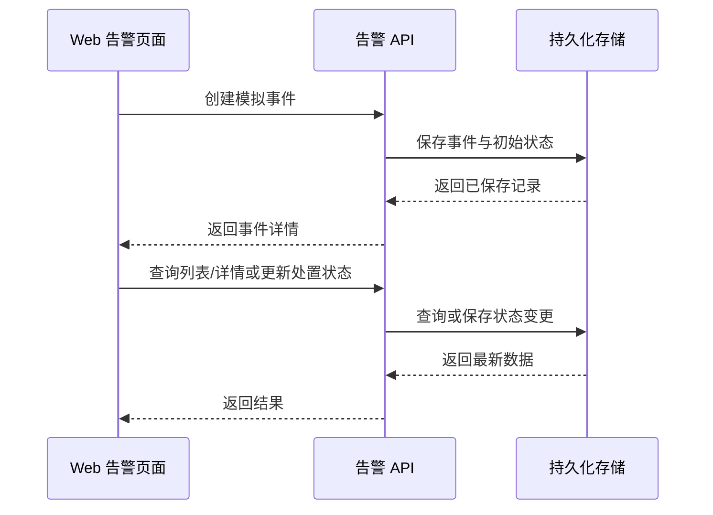

# 消防通道告警平台结构说明

> 状态：初稿；全栈联调部分是待团队确认的下一阶段提案
> 最近更新：2026-10-03

## 目的与范围

说明从当前浏览器模拟原型演进到单点位前后端联调演示版的建议结构。它不代表真实算法、摄像头或边缘设备已经接入。

## 系统边界

### 当前已有

- 本机工作区的浏览器原型维护一条模拟告警链路；本次文档交接不包含原型代码。
- 数据保存在打开该原型的浏览器 `localStorage`。
- 页面画面是静态示例内容。

### 下一阶段提案（待确认）

- 网页通过后端接口生成/读取模拟事件并更新状态。
- 后端负责校验、持久化和查询告警。
- 单一演示点位和静态示例截图作为演示数据，不在本阶段接真实摄像头或模型。

### 未来边界

- YOLO/边缘检测进程未来作为告警事件的另一个生产者。
- 摄像头/RTSP、边缘设备管理、移动端推送、分析大屏和 MCP 均属于后续阶段。

## 主要元素及职责

| 元素 | 本提案职责 | 状态 |
|---|---|---|
| Web 告警界面 | 展示告警列表、详情和证据；请求状态流转；提供模拟事件操作。 | 本机工作区有交互原型，当前使用本地存储；代码未随本次文档交接，后端联调待确认。 |
| 模拟事件入口 | 以清晰标记的模拟事件调用创建接口，用于开发和演示。 | 提案。 |
| 告警 API/应用服务 | 校验事件，创建/查询事件，更新处置状态，并返回统一数据结构。 | 尚未实现。 |
| 持久化存储 | 保存告警字段和状态，使同一服务下的浏览器会话共享记录。 | 类型待 Research/SPEC 决定。 |
| 示例证据 | 当前沿用静态模拟图；事件保存其固定引用。 | 已有静态资产，不涉及上传服务。 |
| YOLO/边缘事件适配 | 未来将模型输出转换为与平台约定一致的事件输入。 | 不属于模拟联调阶段，输入字段待算法协作确认。 |

## 建议交互流程

未来真实模型接入时，检测端通过适配器向告警 API 提交事件；它不会直接访问浏览器或数据库。模型具体结果格式和认证方式待后续阶段确定。

## 团队分工与交接边界

- **队友负责图片/算法链路：**数据采集与预处理、数据集划分、模型选型/设计/训练、格式导出与转换、精度/性能/内存评估、验证、剪枝及模型部署推理。该范围依据用户提供的分工截图。
- **用户负责其余项目工作：**平台前端、后端服务、数据持久化、告警处置流程，以及把算法推理结果接入平台。
- **双方共同交接：**约定推理输出字段、截图/证据传递方式、调用方向和失败处理。模型部署推理归队友，告警业务和平台 API 集成归用户；具体进程或服务边界待 SPEC 定义。

## 设计决策与待确认

- [提案] 先做单体告警服务，降低当前演示版的集成和运维负担；不先拆分 device/media/user 等多个独立服务。
- [提案] 模拟数据与将来模型数据走同一个事件契约，区分 `source` 标记，避免页面逻辑与模型绑死。
- [待确认] 团队是否批准本结构对应的全栈联调阶段。
- [待Research/SPEC] 后端技术、数据库、运行方式、证据文件保存方式。
- [待算法协作] 模型端谁负责发送事件、字段和失败重试策略。

## 变更记录

| 版本 | 日期 | 变更 |
|---|---|---|
| 0.1 | 2026-10-03 | 建立当前原型到全栈模拟联调的结构提案，区分现状、提案和未来边界。 |
| 0.2 | 2026-10-03 | 根据用户提供的团队分工明确图片/算法、平台前后端和双方交接责任。 |
