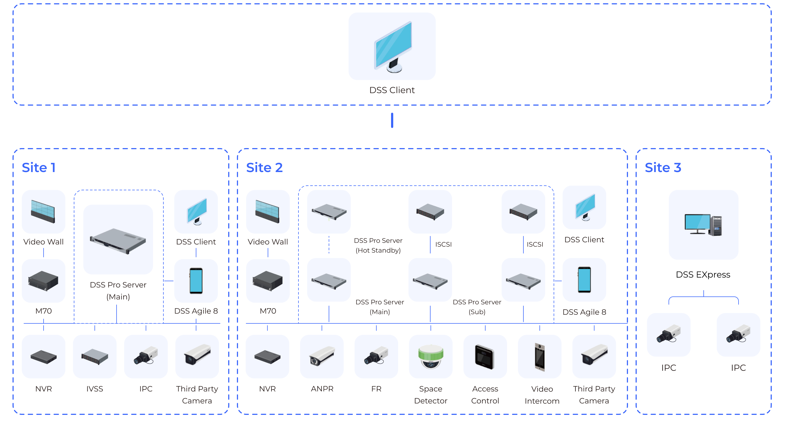
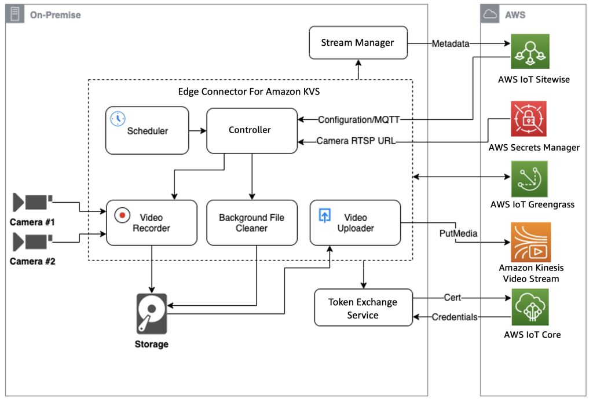
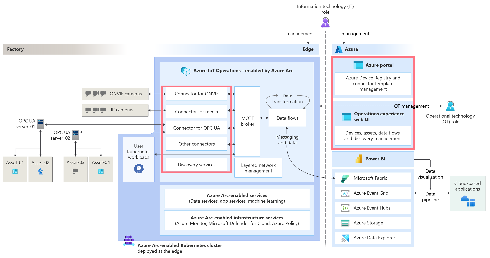

# 云哨边缘智枢商用方案调研与决策

> 研究主题：比较商用视频安防、通用 IoT 与云端边缘媒体方案，形成云哨首发取舍
> 研究日期：2026-10-04
> 状态：调研结论稿；产品范围以 [PRD](../Analysis/PRD.md) 及已确认的项目约束为准。
> 口径：产品能力以厂商公开页面和官方文档为据；优缺点及取舍结论结合云哨当前目标进行评估。

## 1. 商用主流方案参考

市场上有成熟产品，但它们不是同一种“平台”。视频安防套件以摄像头、录像、报警和值守为中心；通用 IoT 平台以设备、遥测、规则和仪表盘为中心；云厂商方案提供托管的设备、边缘、媒体与分析积木。比较时要先看它们解决的主问题，再看和云哨产品边界是否相合。

### 1.1 视频安防一体套件：HikCentral Professional、Dahua DSS Professional、Huawei eSight

这类方案最接近“监控大屏 + 告警中心 + 摄像头管理”。HikCentral Professional 把视频、门禁、报警、访客、智能分析、视频墙和证据管理等模块放在统一产品内，并提供开放 API、第三方设备与系统集成能力；Dahua DSS Professional 把视频监控、人员和车辆出入、行业应用及多站点管理放在 VMS 中；华为 eSight 的视频监控管理资料描述了接入 IVS、设备告警、资源管理、拓扑、质量图和大屏监控。[1]、[2]、[4]、[5]

*图 1：Dahua DSS Professional 多站点架构示意。[4]*

**优点**

- 视频资源、报警、地图、视频墙、移动端和运维功能由同一产品提供，适合快速建设传统安防值守中心。
- 多站点和设备规模能力明确；Dahua 官方页面给出其分布式方案的通道和中心存储规格，并说明跨站点查看实时流、回放和事件。
- 厂商已有行业流程、设备兼容、可视化工具和集成接口，减少从零实现视频管理的工作。

**缺点与对云哨的适配代价**

- 产品的中心对象是安防系统、摄像头、报警源和厂商模块。云哨还要表达自研算法部署、通用 AI 事件、个人账号数据边界及自有处置流程；接入开放 API 不等于这些领域对象与流程天然一致。这是产品适配评估；实际集成能力需按具体版本和授权核实。
- 商用授权与模块选择需要采购询价。HikCentral 官方资料说明其采用模块化许可；不能仅凭功能页判断完整项目成本。[3]
- 如果把自研事件和账号模型嵌入 VMS，产品后续可能受其接口、数据模型和升级节奏影响；如果只把它当媒体基础设施，则仍要自建设备、事件、推送和业务页面。

**适用判断**：如果首要目标是快速得到成熟的视频安防中心，优先评估此类产品；如果首要目标是围绕国产边缘设备、自研算法和通用事件打造自有产品体验，则更适合把其作为集成对象或竞品参照，而不是默认把整套业务交给 VMS。

### 1.2 通用 IoT 平台：ThingsBoard Professional Edition

ThingsBoard PE 是可自托管的商用 IoT 平台，公开产品资料覆盖设备管理、数据处理、规则链、告警、仪表盘、报表、移动端、白标、多租户和权限能力；设备接入支持 MQTT 等方式。它还提供商业支持、软件和服务组合。[6]、[7]、[8]

**优点**

- 大量常见 IoT 平台能力已经产品化，设备接入、告警规则、实时图表、设备操作和仪表盘能较快配置出来。
- 自托管形态便于控制数据部署位置；产品页支持从单体部署开始，后续按负载转向微服务部署。
- 适合先验证“设备数据能否接入、规则能否触发、统计看板是否有用”，减少重复造轮子。

**缺点与对云哨的适配代价**

- ThingsBoard 的核心抽象是设备/资产、遥测、规则和仪表盘。云哨的主要数据还包含算法事件、事件证据截图、事件处置、MediaMTX 播放授权和 PWA 推送；若由 ThingsBoard 承担这些业务，需确认其对象模型和扩展能力能否覆盖，实施成本也需纳入评估。
- 它的可配置仪表盘适合设备数据产品，但不自动替代云哨要设计的实时监控、事件详情和处置体验。视觉事件、实时媒体和处置体验仍需针对产品需求进行验证与补充。
- 使用 PE 时需核对商业许可和支持范围；产品有现成能力，也意味着需要接受其平台模型和版本演进节奏。

**适用判断**：如果平台的主价值是通用传感器接入、设备遥测规则和可配置仪表盘，可认真考虑直接使用；如果核心价值是视觉算法事件与媒体联动，可借鉴其设备模型和配置经验，但不应据此推定其规则引擎天然满足通用视觉事件处置需求。

### 1.3 云厂商托管媒体与边缘：AWS IoT Greengrass + Kinesis Video Streams

AWS 官方参考实现让 Greengrass 边缘连接器读取局域网 IP 摄像头的 RTSP 流，可进行实时上传、定时录制、边缘缓存和历史上传，再由 Kinesis Video Streams 提供视频接入与消费能力；摄像头配置和凭据分别与 SiteWise、Secrets Manager 等服务协同。官方方案明确假设边缘设备到 AWS 之间有稳定网络及足够带宽。[9]、[10]

*图 2：AWS Greengrass 与 Kinesis Video Streams 的 RTSP 接入和边缘上传架构。[9]*

**优点**

- 对 RTSP 摄像头接入给出了可落地的参考组件，而不只是抽象设备消息方案。
- 边缘缓存、按计划录制和上传有现成做法，可支持断网后的补传及云端统一回看。
- 与 AWS 身份、凭据、设备管理和媒体分析能力连接紧密，适合已经选定 AWS 且需要云端媒体处理的项目。

**缺点与对云哨的适配代价**

- 方案依赖 AWS IoT、SiteWise、Secrets Manager、Kinesis Video Streams 等多个服务；部署、身份、数据路径和费用要按 AWS 生态规划。
- 官方示例的云上传建立在稳定上行网络和带宽假设上，与“算法在国产边缘设备本地运行、平台主要汇聚事件并实时查看”的首发取舍不同。
- 云端媒体存储与回放能力和自托管实时视频分发的需求不同；采用 AWS 媒体栈会增加云端依赖与持续费用。

**适用判断**：适合采用 AWS 托管云媒体和边缘软件交付的场景；云哨当前更需要可自托管的媒体分发与自有业务服务，因此可借鉴其 RTSP 接入、缓存和凭据隔离设计，不必照搬云媒体存储方案。

### 1.4 工业边缘平台：Azure IoT Operations

Azure IoT Operations 是运行在 Azure Arc-enabled Kubernetes 集群上的边缘数据平面，包含边缘 MQTT Broker、设备/资产注册、连接器和数据流；数据流可以转换、补充上下文并路由到 Azure Event Hubs、Fabric、Storage 等云服务。官方资料还列出 ONVIF、媒体等连接器方向，并说明断网最多可运行 72 小时，期间可能降级。[11]、[12]、[13]

*图 3：Azure IoT Operations 边缘集群、资产连接器、MQTT 与数据流架构。[14]*

**优点**

- 将边缘 MQTT、设备模型、协议连接器和数据处理编排作为整体提供，适合 OT 设备种类多、数据管线复杂的工业场景。
- 云端资产注册和边缘数据流相连，便于集中配置、运维和接入 Microsoft Fabric、Power BI 等分析服务。
- 标准协议和容器化边缘生态利于连接既有工业系统。

**缺点与对云哨的适配代价**

- Arc-enabled Kubernetes 是其基础设施前提，会增加边缘集群和云控制面的运维要求。
- 官方说明的断网运行窗口最多为 72 小时，且期间可能降级；项目需要按现场网络、边缘自治和事件补传要求单独验证。
- 云哨的自研视觉推理、用户账号数据、视频播放授权、PWA 通知和自定义事件处置仍需由应用层实现。还要实际核验目标国产芯片、操作系统、Kubernetes 发行版和连接器支持矩阵，不能从“支持边缘 Kubernetes”推断所有设备都可直接运行。

**适用判断**：适合需要统一管理大量工业连接器和边缘数据管线的项目；当前首发范围不需要完整工业连接器与边缘数据编排能力，因此暂不选择完整工业边缘平台。

## 2. 方案比较与取舍

| 方案 | 主要优势 | 主要代价 | 调研结论 |
|---|---|---|---|
| HikCentral Professional / Dahua DSS Professional | 视频监控、告警、视频墙和多站点能力成熟，适合传统安防中心快速落地 | 商用许可、厂商设备及业务模型适配、接口授权需按项目核实 | 作为产品对标和潜在视频系统集成对象，不作为云哨整套产品的默认底座 |
| Huawei eSight | 与华为视频和企业网络运维生态结合紧密 | 个人账号数据、自研算法事件和跨品牌业务流程的适配程度需要逐项验证 | 在华为设备占比较高的客户项目中评估集成；不据此改变产品定位 |
| ThingsBoard PE | 设备接入、遥测规则、告警和仪表盘能力齐全，可自托管 | 视觉事件、媒体播放和事件处置需要额外建模，可能形成双重维护 | 用作通用 IoT 产品参照，不作为云哨首发完整产品 |
| AWS Greengrass + Kinesis Video Streams | 边缘部署、RTSP 接入、缓存和云端媒体处理有成熟托管组件 | 依赖 AWS 服务组合、上行网络、云媒体路径及相应费用 | 参考其边缘缓存与媒体接入能力，首发不采用整套云托管媒体方案 |
| Azure IoT Operations | 工业 MQTT、连接器、边缘数据流及云端管理能力完整 | 需要 Arc-enabled Kubernetes，边缘管理面及运行条件较重 | 面向复杂 OT 连接器需求的候选方案，不纳入当前首发选择 |

## 3. 调研决策

1. **产品定位**：围绕国产边缘设备上的自研视觉算法，提供跨场景通用事件、实时监控、告警处置和账号级数据服务。首发场景验证消防通道占用检测，不限制平台后续覆盖其他行业和事件类型。
2. **商用产品取舍**：不以传统 VMS 或通用 IoT 平台整体替代云哨产品。HikCentral、Dahua DSS、Huawei eSight 作为竞品与集成参照；ThingsBoard 作为通用 IoT 能力参照；AWS、Azure 托管方案用于比较边缘接入和媒体能力。
3. **实时视频**：首发支持最多 12 路并发视频通道；浏览器优先 WebRTC，播放失败时回退 HLS。[16][17]
4. **设备通信**：首发选用 Eclipse Mosquitto 2.x，设备通信采用 MQTT 3.1.1。设备使用独立身份，连接启用 TLS，并按设备限制发布/订阅权限；消息采用 QoS 1，业务事件按事件 ID 幂等处理。[15][18][19][20]
5. **告警查询**：告警列表按个人账号隔离，支持发生时间、事件类型、危险等级、设备/摄像头、位置和处置状态筛选。默认查询最近 7 天，按发生时间倒序；采用游标分页，每页默认 20 条、最多 100 条。
6. **阶段范围**：首发包含账号注册登录、设备管理、告警列表及详情、实时监控、基础统计和 PWA 实时推送；MCP 工具与授权审计在核心业务稳定后再定义。[21][22]

## 4. References

访问日期：2026-10-03。

- [1] Hikvision. *HikCentral Professional*. https://pro-av.hikvision.com/us-en/products/software/HikCentral-Professional-series/HikCentral-Professional/
- [2] Hikvision. *HikCentral Professional V3.0 Brochure*. https://www.hikvision.com/content/dam/hikvision/en/marketing/image/products/software/hikcentral/hikcentral-professional-subpage/Brochure-HikCentral-Professional-V3.0.pdf
- [3] Hikvision. *HikCentral License Part Number List*. https://www.hikvision.com/content/dam/hikvision/ca/files/brochure-type/brochures/License_part_number_list_v2.6_20240610.pdf
- [4] Dahua. *DSS Professional*. https://www.dahuasecurity.com/uk/products/software/software-products/dss-professional
- [5] Huawei. *eSight Video Surveillance Management*. https://support.huawei.com/enterprise/en/doc/EDOC1100268505/a09d4cd9/video-surveillance-management
- [6] ThingsBoard. *ThingsBoard Professional Edition*. https://thingsboard.io/products/thingsboard-pe/
- [7] ThingsBoard. *Dashboards*. https://thingsboard.io/docs/user-guide/dashboards/
- [8] ThingsBoard. *Pricing*. https://thingsboard.io/pricing/
- [9] AWS. *Ingesting Media to Kinesis Video Streams*. https://aws.amazon.com/blogs/iot/ingesting-media-to-kinesis-video-streams/
- [10] AWS. *Kinesis Video Streams Edge Agent*. https://docs.aws.amazon.com/kinesisvideostreams/latest/dg/gs-edge-gg.html
- [11] Microsoft. *Azure IoT Operations Overview*. https://learn.microsoft.com/en-us/azure/iot-operations/overview-iot-operations
- [12] Microsoft. *Azure IoT Architecture Guide*. https://learn.microsoft.com/en-us/azure/architecture/guide/iot/iot-get-started
- [13] Microsoft. *Azure IoT Operations Data Flows*. https://learn.microsoft.com/en-us/azure/iot-operations/connect-to-cloud/overview-dataflow
- [14] Microsoft. *Manage Assets in Azure IoT Operations*. https://learn.microsoft.com/en-us/azure/iot-operations/discover-manage-assets/overview-manage-assets
- [15] OASIS. *MQTT Version 3.1.1*. https://docs.oasis-open.org/mqtt/mqtt/v3.1.1/mqtt-v3.1.1.html
- [16] MediaMTX. *Read from the Browser*. https://mediamtx.org/docs/read/web-browsers
- [17] MediaMTX. *WebRTC-Specific Features*. https://mediamtx.org/docs/features/webrtc-specific-features
- [18] Eclipse Mosquitto. *Authentication Methods*. https://mosquitto.org/documentation/authentication-methods/
- [19] Eclipse Mosquitto. *Dynamic Security Plugin*. https://mosquitto.org/documentation/dynamic-security/
- [20] Eclipse Mosquitto. *mosquitto(8) Manual*. https://mosquitto.org/man/mosquitto-8.html
- [21] World Wide Web Consortium. *Push API*. https://www.w3.org/TR/push-api/
- [22] Apple. *Sending Web Push Notifications in Web Apps and Browsers*. https://developer.apple.com/documentation/usernotifications/sending-web-push-notifications-in-web-apps-and-browsers
