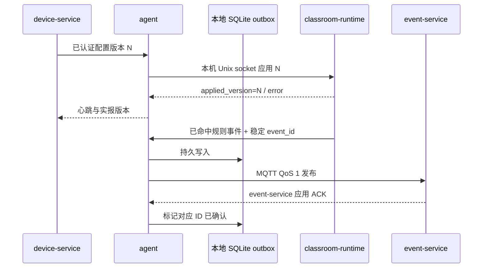

# Atlas 200I DK A2 边缘运行时与云边代理技术设计

> 关联规格：[spec.md](spec.md)；课堂推理细节见 [classroom behavior design](../classroom_behavior_detection/design.md)。

## 当前实现与目标

- `project/src/device_sides/atlas200idka2/` 已包含并构建 C++ agent、模型目录/事件队列、classroom-runtime、AscendCL 模型插件和 Atlas 媒体 pipeline。完整源码树已覆盖部署至 Atlas，并在板端重新构建、安装；3 项 CTest 通过，正式持久化 systemd runtime unit 加载 classroom OM 并对合成 H.264 完成 75/75 帧推理、OSD 与编码。工程组织参考用户给出的 AX650 项目，但 AX 芯片 API 不兼容 Atlas。PT、ONNX 和 Ascend 310B4 OM 及其清单均在 `project/preparation/model_classroom_behavior/`。
- Atlas 已核验为 Ubuntu 22.04/aarch64、CANN 7.0.RC1；有 GCC 11.3、CMake 3.22.1、SQLite 3.37.2、OpenCV 4.5.4、libavformat 58.76.100；没有 Go。板上 MQTT 客户端开发包尚未发现。
- 本次新增的 `AgentConfigurationStore`/`FileAgentConfigurationStore` 将 `/etc/yunshao/agent.env` 解析、原子更新及 `/var/lib/yunshao/activation.env` 写入/清理移到 adapter；WSL GCC C++17 语法检查和对象编译通过。Atlas 200I DK A2 CMake configure 与 `yunshao-agent` ARM64 build 已通过，包含新 adapter；未运行 CTest、激活/续期流程或服务操作。
- 本轮新增 `AgentActivationWorkflow` 和 `AgentRunLoop`，分别承接授权校验/配置租期编排与 Agent 外层轮询调度。Atlas 上 `cmake --build /root/workspace/DebugPlace/build --target yunshao-agent -j2` 成功编译、链接两者；未安装或重启服务，未运行激活/续期或云端运行时回归。
- 新增 `EvidenceFrameEncoder` port 与 `AtlasEvidenceFrameEncoder` adapter，将 Atlas ACL NV21 拷贝、OpenCV 转码/画框/JPEG 编码移出 `VideoStreamManager`。Atlas 上 `cmake --build /root/workspace/DebugPlace/build --target yunshao-classroom-runtime -j2` 成功编译并链接；未运行 CTest 或真实视频/事件证据回归。

## 方案

采用两个 systemd 管理的 C++ 进程：`yunshao-agent` 负责设备身份、MQTT/TLS、配置版本、健康状态、本地持久队列和系统生命周期；`yunshao-classroom-runtime` 负责摄像头解码、AscendCL 推理、告警规则、检测叠加和视频输出。runtime 沿用参考项目的职责模式：硬件无关 AI plugin ABI、AscendCL 模型插件、AI processor/inference/stream/config/alarm managers、Atlas DVPP/FFmpeg pipeline 和分层 JSON。AX650 的 AX Engine/AX SYS/IVPS 实现不可直接复用；Atlas 插件及媒体 pipeline 使用 CANN/AscendCL。两者的生产代码均位于 `project/src/device_sides/atlas200idka2/`；`preparation/` 保留模型转换/验证资料。agent 与 runtime 通过权限受限 Unix domain socket 交换版本化 JSON 命令、状态与命中的事件。agent 可重启而不卸载模型；推理进程失败由 systemd 恢复，待传事件存在 SQLite，不依赖进程内存。



设备身份、HTTPS Origin/CA 和初始 MQTT 凭据在部署时由管理员预置。日常激活/续期由网页创建不含秘密值的请求；agent 通过现有设备身份轮询 HTTPS 路由，服务端轮换 MQTT 凭据，agent 安全写入 systemd credential overlay 并自动重启。用户浏览器和命令行不接触新 MQTT 密码。agent 必须原样使用服务端返回的 `client_id`，不得自行从 device_id 推导，否则会与 Mosquitto Dynamic Security 登记的固定 client ID 不匹配。后续 MQTT 使用每设备凭据和 `devices/{deviceId}/...` topic ACL。凭据轮换、停用或到期时撤销。配置是带单调版本的完整快照，runtime ACK 后才报告已生效。期望态与实报态始终分开。

激活 transport、HTTP/JSON 转换、CLI 参数、日志和 systemd 生命周期仍位于 `activation.cpp`/组合根。`AgentActivationWorkflow` application service 负责 MQTT grant 校验、broker URL/授权期限解析、配置环境项组装、租期写入，以及 CLI 激活与后台轮询路径的顺序；`activation.cpp` 负责取得网页票据/HTTPS 响应并将响应转换为 grant。配置文件边界通过 `AgentConfigurationStore` port 注入。`FileAgentConfigurationStore` 负责读取并保留 `agent.env` 中未更新的键、按 root:`yunshao`/0640 原子替换该文件，以及按固定键序原子写入或删除激活凭据覆盖文件。密码以可清理的值传入/传出，adapter 在完成持久化后擦除拥有的密码缓冲区；激活流程在调用方负责擦除读取到的旧密码。此边界不改变现有激活 API、文件路径、格式或重启顺序。

实时流事件证据编码由 `EvidenceFrameEncoder` port 提供；port 仅接收 NV21 设备平面指针、尺寸/步长和检测结果，不暴露 ACL/OpenCV 类型。`AtlasEvidenceFrameEncoder` adapter 负责 ACL device-to-host 拷贝、NV21 转 BGR、事件框绘制和 JPEG 编码。帧的取得、编码和释放仍由 `VideoStreamManager` 按原顺序完成：证据编码在 `MediaPipeline::release_output_frame` 之前同步执行；事件、截图格式、图像质量和失败时继续发布空证据的行为保持不变。

模型包目录按 `models/{model_id}/{version}/` 只读保存模型文件和 `manifest.json`；安装流程在 `staging/` 校验 SHA-256，并按 `models.json` 中对应 profile 比较芯片/格式/输入尺寸/类别，成功后以原子符号链接切换 `active/{model_id}`，至少保留该 model_id 的上一个版本。公共配置/入库逻辑只做通用结构校验，不含 classroom class、类别数和 classroom event type 常量。

配置按参考项目职责拆成三份：`config/models.json` 在 runtime 节包含本机构建所支持的 backend/model family/decoder/pixel format/preprocessing/format/SoC 集合、模型加载上限和 NPU 设备；每个 profile 提供算法键、模型文件名、SoC、插件、输入、类别、置信度/NMS 和最大检测数。`config/streams_config.json` 按摄像头/来源引用配置 stream、model_id、输出尺寸/帧率/目标码率、live 来源标记、输入读取超时、RTSP 输出监听地址/端口/路径、`max_queue_ms`（100–5000 毫秒）及可选阈值覆盖；流来源 URL 由调用端提供，不要求板端注入 RTSP 输出认证字段。`config/alarm_rules.json` 提供允许的等级及 model_id/class 到 event_type/事件类别字段的映射、启用开关与持续/冷却条件。类别清单仍以安装包 manifest 为准，profile 只做一致性校验。FFmpeg 打开输入、探测流和读取每个 packet 均通过 interrupt callback 使用逐操作的有界 deadline，协议级 timeout 作为补充；live 来源断开时报告不含凭据的来源错误并进入有界退避重连，普通本地文件 EOF 正常结束。Atlas RTSP 输出使用 GStreamer RTSP Server `appsrc` 接收 VENC Annex-B H.264 access unit，时间戳由各 RTSP media pipeline 的 running time 生成，客户端中途加入时从当前画面开始发送。RTSP mount 允许匿名读取，不创建认证 manager 或 reader token；MediaMTX 及园区内受信任客户端使用 `rtsp://atlas-host:8554/classroom-demo` 形式的地址直接拉流。RTSP 端口应只在园区可路由且受控的网络开放，不向公网开放。无客户端时不缓存帧，慢客户端达到配置缓冲上限时丢预览帧而不阻塞推理。浏览器只访问受保护的 WHEP/HLS 路由。RTSP 模式默认不保存本地 H.264 连续文件，仅显式传入诊断路径时落盘。Atlas 默认 `max_loaded_models=1`；只有目标 OM 同时加载内存、时延和稳定性实测后才提高。SQLite 队列记录稳定 event_id、发布状态、重试时间与末次错误；应用 ACK 匹配设备和 ID 后完成记录，保留期限另由磁盘配额策略规定，不提前删除未确认事件。

模型和插件统一使用 `model_` 前缀、领域名和任务类型组成的下划线命名；末尾任务段为 `detection`、`segmentation` 或 `classification`。课堂行为检测对应 `model_classroom_behavior_detection`、`plugins/model_classroom_behavior_detection.cpp`、`libmodel_classroom_behavior_detection.so` 和 `ModelClassroomBehaviorDetection`。`IAIModel::name()` 返回该 profile 的 model_id。`algorithm_key`（课堂为 `classroom_behavior_detection`）和 `model_family`（如 `yolo11`）分别表示云端算法语义和网络/输出族，不混入产品模型标识。

插件动态库加载属于 `AIModelPlugin` 平台 adapter，manager 只调用其推理接口。插件导出 C 符号 `GetAIModelPluginApiVersion()`，当前返回 1；runtime 在执行 `CreateAIModel()` 前核对版本，缺失或不匹配即拒绝加载。破坏性变更递增版本，runtime 与插件必须随同一产品构建、成对安装。接口仍包含 C++ 类型，因此版本号只防止产品版本错配，不承诺不同编译器或标准库之间的二进制兼容。若要独立发布第三方插件，需要另行设计纯 C/不透明句柄 ABI。

### 产品源码目录职责

```text
src/device_sides/atlas200idka2/
├── config/                          # models.json / streams_config.json / alarm_rules.json
├── include/ai_interface.hpp         # hardware-neutral Detection/IAIModel plugin contract
├── include/application/             # runtime use cases and outbound ports
├── include/adapters/                # platform-facing plugin, file and service adapter APIs
├── include/common/                  # core.hpp / config.hpp，与 src/common 同基名配对
├── include/manager/                 # AI processor, stream, inference, config, alarm APIs
├── plugins/                         # independently built AscendCL YOLO plugins
├── include/media/                   # Atlas DVPP/VPSS/VENC + FFmpeg pipeline, OSD interfaces
├── src/media/                       # 同基名 .cpp 实现文件
├── src/agent/                       # MQTT, state, agent orchestration
├── src/application/                 # alarm event publishing, activation lease gate, agent ports, MQTT session/inbox, and evidence uploader port
├── src/adapters/                    # plugin, agent/runtime Unix socket, SQLite outbox, MQTT, HTTPS, configuration/lease files, service lifecycle and metadata adapters
├── src/common/                      # core.cpp (model catalog), config.cpp (JSON parsing)
├── src/manager/                     # processor, inference/stream managers, alarm filtering
├── src/main.cpp                     # classroom-runtime composition root
├── systemd/                         # agent and classroom-runtime units
└── tests/                           # plugin ABI, JSON, catalog, rules, integration tests
```

`include/media/media_pipeline.hpp` 与 `src/media/media_pipeline.cpp`、`include/media/region_osd.hpp` 与 `src/media/region_osd.cpp` 按基名一一对应。模块的接口和实现均归入产品标准头源结构，不保留 `common/media/`。

核心公共 API 也与实现同基名：`include/common/core.hpp` 对应 `src/common/core.cpp`，`include/common/config.hpp` 对应 `src/common/config.cpp`；不保留历史头文件名 `edge_core.hpp`、`model_config.hpp`。

The layout mirrors the reference project’s plugin/manager/config responsibilities, adapted to Atlas. Model profiles contain no weights or credentials. Stream source secrets are injected separately and referenced by camera/source ID. A profile may be registered without being active; stream startup fails closed if its model/profile is missing or disabled. Multi-profile registration does not imply concurrent loading beyond the hardware cap.

## 接口和数据

- 云端设备 API、MQTT 心跳/命令/回执遵守 [device-service spec](../device_service/spec.md)；业务事件与应用 ACK遵守 [event-service spec](../event_service/spec.md)。
- 本机 IPC 只监听 Unix socket，不开公网端口；消息含 `schema_version`、`config_version`/`model_version` 与关联 ID。
- 设备运行状态字段至少区分 `device_online`、`camera_state`、`npu_state`、`model_state`、`stream_state`、`mqtt_state`、`desired_config_version`、`applied_config_version`、`queue_depth`。
- 边缘端本地缓存 `event_id` 及最小事件 JSON，不缓存未命中规则的检测历史；截图只在规则命中时生成并通过 TLS HTTPS 上传。
- 本地 systemd 环境参数/凭据文件权限按服务账号限定；secret 不写 SQLite 或普通日志。

## 安全、运维与兼容

- MQTT aarch64 TLS client library 需由边缘构建打包提供；板端当前未发现 `libmosquitto` pkg-config，因此依赖交付为先决条件，不能用明文 MQTT 替代。
- TLS 证书/凭据由激活/部署流程安全注入；设备服务重置不重新使用泄露或撤销身份。
- 两个 systemd 单元均强制加载 `/etc/yunshao/cann.env`。该权限受限文件由运维基于板上 `/usr/local/Ascend/ascend-toolkit/set_env.sh` 准备，至少包含 `LD_LIBRARY_PATH` 及 CANN 算子/运行环境变量；服务不得依赖登录 shell、Conda 或运行时手工 `source`。
- CANN 启动路径同样适用于直接调用的模型目录 CLI：CMake 从 `/etc/yunshao/cann.env` 读取 toolkit 与驱动库路径，为安装目标写入传递式 ELF `DT_RPATH`，以覆盖 AscendCL 的间接共享库依赖；`yunshao-agent model` 在 ACL 操作前加载同一环境文件。CMake 将产品 JSON 安装到程序默认读取的 `/etc/yunshao`，systemd 仍通过 `EnvironmentFile` 加载服务环境，不要求调用者在 shell 中拼接环境变量。
- 两个 systemd 单元以 `yunshao` 非 root 身份运行，并显式加入 `video`、`HwHiAiUser`、`HwBaseUser` 设备组。产品 udev 规则将 `/dev/rgn` 授权给 `HwHiAiUser`，MODE 为 `0660`；不得放宽为任何用户可访问。该节点由设备驱动重建，部署须重新加载 udev 规则并对现有节点触发规则。
- Atlas 310B4 实测表明 CANN/ACL 初始化依赖进程可见的主机文件系统与共享临时目录：在正式 runtime 的 systemd unit 中启用 `ProtectHome`、`PrivateTmp`、`ProtectSystem=full/strict` 或 `ReadWritePaths` 会导致 `aclInit` 返回 507008；保留 `NoNewPrivileges=true`、非 root 用户及硬件组，同时移除这些文件系统隔离设置后，service 成功处理固定 H.264 视频 75/75 帧。正式 runtime unit 不使用上述未兼容选项；未来若 CANN/驱动版本改变，需先在目标板验证再调整。
- 2026-10-20 的 30 分钟 Atlas systemd 合成实时 UDP 测试保持 runtime active、0 次重启、RSS 约 375 MiB；来源发送端到时退出后，runtime 仍挂起等待。该结果证明长时进程 RSS 稳定，但暴露实时源读超时/服务恢复缺口；AC-05.2 要求为修复门禁。
- 修复后在 Atlas systemd runtime 上以 3 秒测试超时验证无源等待、UDP 源恢复、再次断流和第二次恢复；同一 PID 保持 active、NRestarts=0，两次恢复各输出约 1.49 MB。加入 FFmpeg interrupt callback 后，持续合成 UDP 流采样 535 秒，RSS 样本保持 383164 KiB，NPU 样本峰值为 2332/3513 MiB、目标码率约 1.52 Mbps；首次接源时仍发生一次原因未明的自动重启，结束后重开本地输出导致最终帧数不可计。详见 `atlas_runtime_reconnect_sustained.json`。此测试不代替真实 RTSP 或 MediaMTX 发布验收。
- 2026-10-20：采用进程内 GStreamer RTSP Server/AppSrc 将每帧 VENC Annex-B H.264 发布为 RTSP 源，不在板端再部署 MediaMTX，也不把客户端播放连接耦合到推理生命周期。此记录中的认证方式由 2026-10-21 的简化决定取代。
- 2026-10-21：Atlas RTSP 输出去除认证 manager、reader token 和 RTSP 环境变量；配置地址直接以可达 RTSP URL 提交 media-service。RTSP 只在受控园区网络开放；MQTT TLS/设备身份不变。
- 部署验收在最小 `PATH` 和 systemd 环境中检查 agent/runtime 的共享库解析；toolkit/driver 路径来自目标板实际安装，不写入模型 JSON 或提交 CANN 机器专属绝对路径。
- 健康检查分活性与就绪；无模型文件时控制服务可 alive，但算法和整体 NPU readiness 标为 false。
- 日志带 device_id、request/event/config ID，不带密码、私钥、完整视频 URL 或课堂图片内容。
- 断网时先持久化，再发布；磁盘满时拒绝“已缓存”成功并报告 degraded，服务不得删除未确认记录以隐藏积压。
- systemd StopTimeout 先停收新工作、同步 SQLite、等待子进程退出；升级前保留旧 binary/config/model 便于回滚。

## 备选方案和取舍

| 方案 | 优点 | 放弃原因/代价 |
|---|---|---|
| C++ agent + C++ runtime + SQLite | 板端已有 C++/SQLite/NPU 生态；明确进程故障边界 | 需要打包 MQTT TLS 库和维护本机 IPC |
| 单个进程集成全部能力 | 部署简单、少 IPC | MQTT 故障/代理更新会影响 NPU 会话，不利于独立恢复 |
| Go agent | 服务端模型相同 | 当前板上无 Go，增加交叉编译和运行时依赖 |

## 未决项

- 编译验证 `libmosquitto` 或等效 MQTT TLS 客户端的 aarch64 包和 TLS 证书路径。
- 验证 GStreamer RTSP Server/AppSrc 与 RTP H.264 payloader 在目标 Atlas CANN/OS 镜像中的开发与运行依赖、匿名拉流、VENC access-unit 封装和 MediaMTX `sourceOnDemand` 拉流。
- 记录目标摄像头帧率、推理延迟、编码负载、RSS、NPU 使用率和队列磁盘上限。

## 变更记录

| 日期 | 变更 |
|---|---|
| 2026-10-18 | 采用 Agent/runtime 双进程、SQLite outbox、版本模型目录和显式设备状态设计。 |
| 2026-10-29 | 开始 Atlas runtime 分层：新增告警发布/租期 gate 用例与 ports、Unix socket/文件/事件元数据 adapters；main 与 VideoStreamManager 共用租期状态 port，文件格式解析集中在 adapter；Agent 本机控制 socket 服务移入 server adapter 并通过 `LocalAgentControl` port 调用；SQLite outbox 从 common/core 移入 `SQLiteEventOutbox` adapter，Agent 通过 `DurableAgentEventOutbox` port 使用；libmosquitto 生命周期/TLS/发布订阅移入 MQTT transport adapter，Agent 经 transport port 收发；命令/ACK 入站解析和有界队列移入 `AgentMqttInbox`；命令队列消费/拒绝 ACK 移入 `AgentCloudCommandProcessor`，ACK payload 由 `AgentCommandAcknowledger` 组装，云规则配置匹配、落盘和重载位于共享锁保护的 adapter；已应用规则 readiness、outbox 同步、ACK 顺序由 `AgentAppliedRuleAcknowledger` 编排，runtime 状态与就绪文件位于 `AppliedCloudRuleState` adapter；Agent 周期循环仍留在 agent.cpp；插件 ABI v1 检查放入插件 adapter。Atlas 200I DK A2 完整 ARM64 CMake configure/build 成功，Agent/runtime 均链接；未运行 CTest 或运行时回归，媒体边界仍待处理。 |
| 2026-10-29 | Agent 不再在 `agent.cpp` 中执行截图目录扫描和 libcurl 上传；通过 `EvidenceUploader` port 注入 `HttpsEvidenceUploader` adapter。保留事件 ACK 后上传、4 MiB 文件上限、HTTPS/TLS 校验、单次心跳最多处理一个待传文件及失败后重试。后续将 activation CLI/后台轮询的 libcurl 请求抽到 `HttpsTransport` port 与 `CurlHttpsTransport` adapter，保留 TLS 校验、禁止跳转/代理、64 KiB 响应上限和原超时；该阶段激活编排与 systemd 操作仍在 `activation.cpp`。Atlas 完整 ARM64 构建包含当前 adapter 并成功链接；受时钟偏差警告影响，未运行 CTest 或目标板运行时回归。 |
| 2026-10-29 | Agent MQTT 连接状态、commands/event-acks 订阅、发布主题构造和连接回调从 `agent.cpp` 移入 `AgentMqttSession` application component；session 通过 `MqttTransport` port 连接 adapter，并将入站消息交给 inbox。主题、QoS、ACK 和断线语义保持不变；Atlas 目标板完整 ARM64 build 已编译并链接 Agent/runtime，未运行 CTest 或运行时回归。 |
| 2026-10-29 | 将 Agent 已连接后的云端工作流从 `agent.cpp` 提取到 `AgentCloudCycle`，并通过 `AgentStatusReader` port 读取设备状态。新用例保持原顺序：处理命令、尝试已应用规则 ACK、发布状态、发布到期事件并记录尝试、上传已确认事件的证据；Agent 仍负责 MQTT/session 启动、激活轮询和外层定时调度。Atlas 200I DK A2 完整 ARM64 CMake configure/build 成功并链接 Agent/runtime；未运行 CTest 或云端运行时回归。 |
| 2026-10-29 | 激活命令在写入凭据后直接执行 `fork`/`execv` 调用 `systemctl`。新增 `AgentServiceLifecycle` port 与 `SystemdAgentServiceLifecycle` adapter，将固定的 `enable --now yunshao-agent.service` 与 `restart yunshao-agent.service` 操作移出 `activation.cpp`；`agent.cpp` 组合根负责注入 adapter，命令顺序和失败语义不变。Atlas 200I DK A2 完整 ARM64 CMake build 成功，Agent/runtime 均链接；未执行激活命令或重启服务。 |
| 2026-10-29 | Agent 激活 CLI 与后台续期轮询直接写授权租期文件。新增 `ActivationLeaseWriter` port 与 `FileActivationLeaseWriter` adapter；云端 UTC 到期时间（允许非零小数秒）由激活流程校验并向上取整为 Unix 秒值，缺失、null 或空字符串表示无限期；adapter 负责原子 JSON 写入及服务用户/组权限。组合根把同一路径 writer 注入 CLI 与后台轮询，默认文件位置及 `YUNSHAO_ACTIVATION_LEASE_FILE` 覆盖行为与 runtime 保持一致。Atlas 200I DK A2 完整 ARM64 CMake build 成功；未运行激活/续期流程或服务。 |
| 2026-10-29 | `activation.cpp` 仍直接解析/更新 `/etc/yunshao/agent.env`，并写入、清理临时激活凭据覆盖文件。新增 `AgentConfigurationStore` port 与 `FileAgentConfigurationStore` adapter；adapter 接管环境文件解析、保留未更新键、root:`yunshao`/0640 原子更新及激活覆盖文件原子写入/删除。激活流程仍负责校验云端 MQTT 凭据、生成配置项、擦除调用方秘密并编排租期与服务生命周期，文件路径和内容顺序保持不变。WSL Ubuntu 24.04 下 C++17 语法检查与对象编译通过；Atlas 200I DK A2 CMake configure 与 `yunshao-agent` ARM64 build 成功，包含新 adapter。未运行 CTest、激活流程或服务操作。 |
| 2026-10-29 | CLI 与后台轮询仍在 `activation.cpp` 内重复校验 MQTT grant、解析 broker/期限并编排配置覆盖、租期和文件更新。新增 `AgentActivationWorkflow` application service，集中校验/解析及配置、租期顺序；CLI/JSON/HTTPS 和 systemd 交互保持在外围。Atlas 200I DK A2 `yunshao-agent` ARM64 build 编译并链接成功；未运行激活/续期流程或服务操作。 |
| 2026-10-29 | Agent MQTT 启动、激活轮询节拍、connected cycle 调用和主循环休眠仍混在 `Agent::run`。新增 `AgentRunLoop` application service，通过回调接入 HTTPS 激活轮询、停止信号和休眠；保留 15 秒轮询间隔、5 秒循环周期与凭据更新后返回重启语义。Atlas 200I DK A2 `yunshao-agent` ARM64 build 成功；未安装、重启或进行运行时回归。 |
| 2026-10-29 | `VideoStreamManager` 曾直接调用 ACL 拷贝 VPSS 设备帧，并通过 OpenCV 转 BGR、绘制事件框和编码 JPEG。新增无 ACL/OpenCV 类型的 `EvidenceFrameEncoder` port 与 `AtlasEvidenceFrameEncoder` adapter；同步编码仍在输出帧释放前完成，事件顺序、NV21/JPEG 质量和失败时空证据语义保持不变。Atlas `yunshao-classroom-runtime` ARM64 target 编译并链接成功；未运行 CTest 或运行时视频回归。 |
