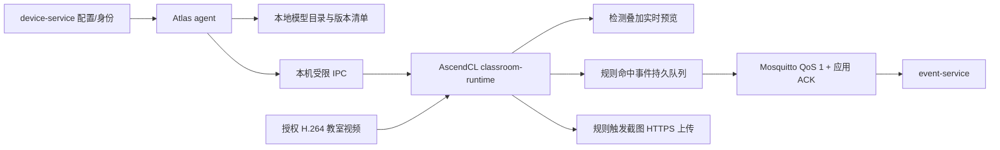

# 教室行为检测技术设计

> 关联规格：[spec.md](spec.md)；边缘部署细节见 [Atlas runtime design](../atlas_edge_runtime/design.md)。

## 当前实现与目标

- 模型准备目录 `project/preparation/model_classroom_behavior/` 保存 YOLO11n/640 训练/导出资料、PT、ONNX、Ascend 310B4 OM 及模型清单。`model_deployment/` 另提供独立 C++/AscendCL 视频验收 demo；它复用车辆/仓储流程的 VDEC、VPSS、AIPP、ACL、Region OSD 和 VENC 路径，不管理产品模型 catalog。OM SHA-256 已与运行时清单核对并安装到 Atlas；正式非 root runtime 已对合成 H.264 完成 75/75 帧推理/OSD/编码；课堂模型 demo 源码恢复后的板端重新构建与真实课堂流仍待验收。
- 正式边缘代码 `project/src/device_sides/atlas200idka2/` 已包含 agent、模型包校验/outbox、课堂推理 runtime、`ModelClassroomBehaviorDetection` 插件及媒体 pipeline；Atlas 交叉编译和现有配置/插件身份 CTest 已通过。
- 目标为同一 Atlas 工程树内包含可构建的 `agent`、`classroom-runtime`、共享 model catalog 和持久事件缓存。组织方式借鉴 [device_side_ax650](https://gitee.com/milo-ally-intern/manhole-cover-detection/tree/master/model_deployment/device_side_ax650)：稳定模型插件 ABI、manager/pipeline、逐流模型绑定和独立告警 JSON；AX650 的 AX Engine/AX SYS/视频接口不得复制，Atlas 插件和媒体 pipeline 使用 AscendCL/DVPP。模型包目录、校验、按 model_id 独立激活和回滚沿用 [Atlas 边缘运行时设计](../atlas_edge_runtime/design.md)。

## 方案

边缘控制代理负责设备身份、心跳、期望配置和云端重连；模型包生命周期由 Atlas 边缘运行时负责。推理进程独占 NPU 与视频解码/叠加/编码资源，通过本机受限 IPC 暴露健康、活动模型语义和配置版本状态。课堂运行时校验活动模型的类别映射为 `hand-raising`、`reading`、`writing`、输入尺寸为 640；模型包、芯片兼容和 SHA-256 由 Atlas 合同校验，不在此重复定义。

规则配置以版本化完整快照同步。每个类别默认禁用；启用时须含置信度阈值、持续时间条件和事件等级。推理进程对同一类别/区域使用持续窗口和冷却窗口生成单个稳定事件 ID；普通帧检测只用于视频叠加，不持久化、不上传。事件先写入设备本地有界持久队列，再经 MQTT QoS 1 发布；只有业务 ACK 后删除队列项。证据使用设备认证 HTTPS 上传。媒体输出路径需依据 Atlas 实机推流能力选择并记录验收证据。

### preparation 独立验收 demo

`model_classroom_behavior/model_deployment/` 保留独立 CLI 工程：`src/main.cpp` 负责 OM 加载、YOLO 输出解码、按 labels 类别数校验和帧循环；`src/include/media_pipeline.hpp` 负责 H.264 demux、Atlas VDEC/VPSS、静态 NV21 AIPP 输入路径和 H.264 VENC 输出；`src/include/region_osd.hpp` 负责 VPSS Region 叠加。`classes.txt` 的行顺序必须与模型训练类别顺序一致。其输入/输出和阈值由 CLI 指定，结果只用于模型部署调试，不发布业务事件、不读取 active model symlink，也不替代 systemd `classroom-runtime`。训练、导出、转换、构建、烟测和评估 SOP 分别保存在各模型对应阶段目录的 README.md。

## 接口和数据

- 设备注册、命令、心跳和状态按 [device-service 合同](../device_service/spec.md)；事件、应用 ACK、截图按 [event-service 合同](../event_service/spec.md)。
- 活动模型身份和类别映射来自 Atlas runtime 的本地接口；课堂运行时校验 YOLO11n/640 语义和有序类别 `hand-raising`、`reading`、`writing`，完整模型清单字段由 [Atlas 边缘运行时规格](../atlas_edge_runtime/spec.md)定义。
- `config/models.json` 使用 `models[]` profiles 注册可装载模型插件；每个 profile 声明 `model_id`、AscendCL backend/plugin、YOLO11 decoder、640x640 NV21/AIPP 输入、有序预期类别和默认后处理阈值。`config/streams_config.json` 逐路引用 `model_id` 并允许显式阈值覆盖；`config/alarm_rules.json` 独立定义课堂告警且初始全关闭。包版本与真实类别事实仍以 model catalog manifest 为准，运行时校验二者一致；当前只登记已确认的 classroom YOLO11n。
- 课堂模型及插件统一命名为 `model_classroom_behavior_detection`；共享库为 `libmodel_classroom_behavior_detection.so`，实现类为 `ModelClassroomBehaviorDetection`。`algorithm_key` 保持 `classroom_behavior_detection`，`model_family` 保持 `yolo11`。
- 规则记录含 `config_version`、类别、`enabled`、置信度阈值、持续时长、冷却时长和事件等级。云端 `account_id` 不接受边缘自报。
- 事件载荷只使用命中规则的可见行为元数据；稳定 `event_id`、设备/摄像头、`event_type`、发生时间、模型/规则版本、置信度、持续时间、可选区域。截图不进入 MQTT。
- MQTT 断线时持久队列重试同一 ID；队列占用/磁盘达到阈值须报告，不能静默丢弃或伪造 ACK。

## 安全、运维与兼容

- 每台设备独立凭据和 topic ACL；证书/密码由设备初始化安全注入，日志不输出凭据。
- 设备状态与摄像头、NPU、模型、MQTT 状态分开；`model_missing`、`model_load_failed`、`camera_disconnected`、`cloud_disconnected` 可诊断。
- 视频和截图仅用于授权课堂；不持久化或上传未命中规则的检测。云端截图仍受账号鉴权与 24 小时过期规则保护。
- systemd 服务支持有序停止、自动重启和上一有效模型恢复。安装/配置升级先兼容旧状态，失败恢复旧版本。
- Atlas 板端 CANN/OpenCV/FFmpeg 兼容性以当前设备实测为准；模型缺失时可编译服务但不得报告推理 ready。

## 备选方案和取舍

| 方案 | 优点 | 放弃原因/代价 |
|---|---|---|
| C++ 控制代理 + C++/AscendCL 推理进程 | 复用板端现有 C++ 依赖，不需板上 Go | MQTT 客户端依赖和 IPC 需实测 |
| Go 代理 + C++ 推理子进程 | 云边协议层开发简便 | 板端未安装 Go，需额外交叉构建及维护两套运行栈 |

## 未决项

- MQTT C/C++ 库可用性及加密配置方式：Atlas 上核验。
- Atlas 的实时输入/叠加视频 RTSP 发布目标与性能：实机原型确认。
- `[待验收]` 获取真实授权课堂视频/RTSP 并验证摄像头重连、MediaMTX 发布和持续资源；现有 model-only 与 synthetic media pipeline 基准见 `model_val/reports/release_20261019/` 和 `release_20261020/atlas_runtime_smoke.json`。完整测试集精度对比不作为当前运行时集成的前置要求。

## 变更记录

| 日期 | 变更 |
|---|---|
| 2026-10-18 | 定义 Classroom edge 服务、模型目录、规则禁用优先及云边交互设计。 |
| 2026-10-19 | 按 AX650 示例调整为 AI plugin + manager/pipeline、逐流模型绑定和独立 alarm rules，硬件后端使用 AscendCL。 |
| 2026-10-20 | 明确 preparation 模型验收 demo 与生产 runtime 的边界；在三套模型工作流内统一补充分阶段复现文档。 |
