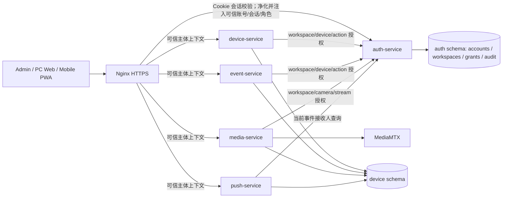

# 技术设计：三类用户与工作空间授权

> 关联规格：[spec.md](spec.md) 
> 状态：评审设计建议；产品规则已确认，须在服务规格同步后作为实现合同。

## 当前实现与目标

当前实现已有 auth-service 账号/会话、Nginx auth 子请求、五个服务独立 schema、以 `account_id` 做资源过滤、media-service 观看租约、event-service 处置/outbox 与 push-service 订阅/outbox。Web 的统一个人工作台已有设备详情首次 SSH 接入（指纹确认与异步任务状态）、激活/续期、摄像头/RTSP 来源配置和最多 12 路监控。窄屏仅显示单列栅格；所有挂载的 CameraPlayer 都会申请自己的租约，并非单路流。账号类型、工作空间成员关系、邀请、admin API、角色路由和设备级成员授权均未实现。

目标是在现有五个服务上加一层由 auth-service 管理的主体与授权数据。业务服务继续拥有各自设备、事件、媒体和 Push 数据；服务间不跨 schema 直接联表。Nginx 继续负责浏览器会话入口和身份头净化，具体资源权限由服务端逐次核验。

## 方案

### 身份和授权边界

auth-service 是账号、会话、工作空间、邀请和授权策略的唯一写入者。它提供受服务凭据保护的内部授权合同，至少支持：

- 校验 `(account_id, session_id)` 的有效状态和角色；不得相信调用方提供的角色或 workspace。
- 对 `workspace_id + device_id + capability` 判定当前 PC owner/mobile member 是否获准；admin 角色不隐式获准业务资源。
- 按账号/工作空间/能力列出当前有效设备授权，供设备、事件、统计和通知筛选使用。
- 按事件设备查询当前有效 Push 接收账号；push-service 在每次投递尝试时重算，不依赖创建事件时的旧快照。

内部接口仅监听 loopback/内网，使用独立服务身份、超时和请求 ID。授权依赖失败时 fail closed；高敏媒体、事件和管理操作不使用可能延迟撤销的长时间授权缓存。授权响应可带 `policy_version` 便于排障，但版本值不能替代逐请求的当前权限核验。

Nginx 的现有 auth 子请求继续验证 Cookie/CSRF/Origin。返回的 `X-Account-ID`、`X-Session-ID` 和新增的 `X-User-Type`、`X-Workspace-ID` 只能从 auth-service 子请求结果生成；Nginx 必须先清除客户端同名头。workspace 和角色头仅作已认证主体上下文，服务仍按本地资源 `workspace_id` 与 auth-service 授权结果校验。生产服务端口只向本机 Nginx/受信服务开放。

### 用户与入口流程

1. 受控部署命令创建首个 admin；不开放 `user_type=admin` 自助注册，也不使用默认密码。管理员创建/停用/恢复 PC 账号并查看平台健康及审计元数据。
2. PC 用户可继续公开自助注册，也可由 admin 受控预建；两种流程都在服务端固定 `user_type=pc`，成功后创建唯一工作空间。
3. PC owner 选择设备和能力创建邀请。邀请随机 token 只展示一次，数据库保存哈希；移动新用户用邀请注册 `mobile`，已有 mobile 用户需先登录再兑换。兑换和成员/权限创建在一个 auth schema 事务中完成。
4. owner 可变更成员设备权限或撤销成员。撤销先在 auth schema 提交，立即影响同步授权决策；同事务写 outbox，通知 media-service、push-service 等收敛缓存、订阅和租约。
5. 登录后 `/auth/me` 决定进入 `/admin`、`/app` 或 `/m`。原 PC 路由在迁移期映射到 `/app` 对应页面；Push 深链依据真实角色重新定向，并重新取事件授权。

移动权限按 `(member_id, device_id, capability)` 正规化存储，不用一个模糊的 `member_type` 字段或客户端 JSON 作为权限事实。初始 capability 为 `device.read`、`event.read`、`event.handle`、`stream.view`、`alert.receive`。页面显示范围由此列表推导，服务端拒绝未授予能力；移动账号只能维护自己的 Push endpoint，owner 管理成员的告警设备范围。

### 角色 UI 操作覆盖

| 角色 | 对应界面必须完成的日常操作 | 明确边界 |
|---|---|---|
| PC owner | 注册/登录；查看和维护工作空间资料；登记/编辑/停用设备；通过现有向导完成 Atlas 首次接入、激活和续期；管理摄像头 RTSP 来源及状态；配置算法规则；多路监控；查询/处置事件、查看统计；邀请成员、配置设备权限、撤权和管理通知范围。 | 保留现有设备页的 host-key 指纹确认、私网受限 SSH provisioning、异步进度与续期操作；来源 RTSP 仍由媒体服务保存，不回显给成员端。 |
| Mobile member | 兑换邀请/登录；查看本人空间和授权范围；维护本人 Push 订阅；查看授权设备状态、事件、有效截图；按权限处置；打开获授权的单路实时画面。 | 不提供激活、RTSP 编辑、AI/规则、成员管理或多路监控。每设备的 `stream.view` 覆盖其下所有摄像头，页面列出这些摄像头，但每个 PWA 会话最多只为选中摄像头建立一个活动播放器/租约；切换时释放旧租约。 |
| Admin | 日常创建/停用/恢复允许管理的账号；查看平台健康、脱敏诊断和审计记录。 | 首个管理员由受控部署命令创建；主机配置、服务重启和 shell 不暴露给 Web。admin 不获得客户媒体/证据权限。 |

正常产品操作都从角色对应界面进入，前端调用同源业务 API；权限、状态和错误由服务端确认。无权限按钮可隐藏或禁用以减少误操作，但服务端仍须独立拒绝越权请求。

### 源码层次与目标边界

仓库当前 Web 已按 api、state、pages、layouts、components 等目录初步分区；Go 服务仍以各自 go module 下 cmd/service-name 的 main package 为主要实现边界；Atlas 原有 common、agent、manager、media 和 plugins 子系统外，现已加入 `application`、`application/ports` 与 `adapters`，但只覆盖事件发布、激活租期和算法插件这些首段边界。它们是已观察到的物理目录，不足以证明硬件/通信依赖已全面隔离。

目标 Go 依赖为：HTTP/MQTT/worker 入站适配器 → application 用例 → domain；application 定义 outbound ports，PostgreSQL/内部 HTTP/MQTT/MediaMTX/Push/文件适配器依赖这些 ports，cmd 负责装配。domain 不导入外部框架。每个服务通过自己的 module 和 schema 保持写入所有权，接口与消息以版本化合同集成。

Web 页面按角色和业务 feature 组织，页面调用 feature use cases/state，再经类型化 API adapter 访问后端；通用展示组件不携带授权决策。Atlas main.cpp 负责组合 agent/runtime；硬件及通信适配器隔离 AscendCL、VENC、MQTT、RTSP 和 SQLite，算法插件实现稳定接口。当前代码切片已将告警事件发布与租期 gate 放进 `application`，通过 ports 调用 Unix socket、证据文件、租期文件与事件元数据 adapters；main 和 VideoStreamManager 共用租期状态 port，租期文件读写通过 status/writer adapters；Agent 本机控制服务、SQLite outbox、libmosquitto transport、命令/ACK inbox、MQTT session、`AgentCloudCycle`、云端命令处理/applied ACK、激活 HTTPS transport、截图 HTTPS 上传、systemd Agent 生命周期、配置文件读写和授权租期写入也通过 application ports 接入；云规则配置、agent.env/激活覆盖文件读写、运行时 readiness/就绪标记、systemd 调用和租期 JSON 写入位于 adapters；模型插件加载从 AIProcessor 移至 adapter 并加入 API 版本拒绝检查。`AgentCloudCycle` 负责连接后的命令处理、已应用规则 ACK、状态/事件发布与证据上传；`AgentRunLoop` 负责 MQTT/session 启动、外层定时调度并调用激活轮询与 connected cycle；`AgentActivationWorkflow` 负责激活授权校验及配置/租期编排，CLI/HTTPS/JSON 边界仍在 agent 入口；`EvidenceFrameEncoder` port 与 `AtlasEvidenceFrameEncoder` adapter 隔离媒体帧证据处理的 Atlas ACL/OpenCV 实现。Atlas 200I DK A2 `yunshao-agent` 与 `yunshao-classroom-runtime` ARM64 targets 均已构建并链接本轮相关切片。板端 clock-skew 与 CANN 头文件警告；未运行 CTest 或真实媒体/激活回归，RTSP/AscendCL 及其余 runtime 边界仍待分层。具体层级及重构顺序见系统结构 §12。

### 数据和身份字段语义

auth-service schema 新增：

| 表/字段 | 用途与约束 |
|---|---|
| `accounts.user_type`, `accounts.status` | `admin/pc/mobile` 与 `active/disabled`；类型仅受控服务端写入。用户名仍全局唯一。 |
| `workspaces` | 一行对应一个 PC owner；`owner_account_id` 唯一，workspace 与 owner 状态同步。首版建议 `id = owner_account_id`。 |
| `workspace_members` | `(workspace_id, account_id)` 唯一，`account_id` 全局最多一个有效 workspace；保存邀请者、加入、撤销时间与状态。 |
| `workspace_invitations` | workspace、创建者、token 哈希、到期/使用/撤销时间、授权设备/能力草案；兑换时原子消耗。 |
| `workspace_member_device_grants` | member、device、capability 唯一组合；只允许 owner 授权本 workspace 设备。 |
| `audit_logs` | actor、workspace、action、resource、result、request ID、时间和可选原因；不记录 secret 或原始内容。 |

device 的 devices/cameras/algorithm assignments、media 的 streams、event 的 events/outbox 等租户所有资源增加 `workspace_id`。新写入先双写 `account_id` 兼容列与 `workspace_id`。`workspace_id = account_id` 的首版映射可在每个服务本 schema 内回填。`account_id` 的最终删除不属于本次变更。

以下字段保持“用户主体”语义，不能机械迁移：auth session 的 `account_id`、event disposition 的 `actor_account_id`、media viewer lease 的观看者 `account_id/session_id`、push subscription/delivery 的订阅用户/接收用户 `account_id`。租约另增 workspace/stream 范围；Push 事件载荷增加 workspace/device 标识，接收账号由 auth-service 实时返回。

设备 MQTT 主题、激活票据和边缘协议不增加客户端可写的 workspace 权限。device-service 根据已登记设备解析可信 workspace，再把 workspace/device 放入 event-created outbox；旧 `account_id` 字段在协议兼容窗口内可保留。

### 建议的 API 形状

以下是待各领域规格确认的 API 草图，不代表当前代码存在：

| 类别 | 建议路径 | 说明 |
|---|---|---|
| admin | `GET /api/v1/admin/accounts`、`POST /api/v1/admin/accounts`、`PATCH /api/v1/admin/accounts/{id}/status` | 仅管理账号元数据，不含设备、来源、事件证据。 |
| admin | `GET /api/v1/admin/system/health`、`GET /api/v1/admin/audit-logs` | 汇总只读、脱敏依赖状态与审计。部署配置修改、服务重启、原始服务日志和主机 shell 不对 Web 开放。 |
| workspace | `GET /api/v1/workspace/members`、`POST /api/v1/workspace/invitations` | PC owner 管理成员和短时邀请。 |
| workspace | `POST /api/v1/invitations/redeem`、`PATCH/DELETE /api/v1/workspace/members/{id}` | 移动成员兑换、权限更新及撤销；实际动词由 auth-service spec 定稿。 |
| internal authz | `POST /internal/v1/authorization/check`、`POST /internal/v1/authorization/device-grants` | 仅服务身份调用，验证会话/角色/工作空间/设备能力。 |
| mobile | 复用既有 devices/events/media/push API 的受限视图 | 尽量复用既有业务逻辑，不建立并行的移动业务实现。 |

`/api/v1/mobile/*` 可以作为聚合读接口，但不能绕过对应服务的授权检查。错误码、资源隐藏语义和具体路由由全局 SPEC 与 service specs 统一。

### 媒体与撤权

PC 和 mobile 都经 media-service 请求现有 viewer lease。服务先校验主体与 workspace，再校验摄像头归属、`stream.view` 和原有 12 源/24 观看连接配额。mobile 播放页面只挂载当前选择的一个 CameraPlayer；切换、退出或撤权时释放旧租约，不能依赖单列 CSS 隐藏其他已挂载播放器。媒体 auth 子请求在 WebRTC 信令和每次 HLS 受保护请求上复核当前授权与租约；媒体地址不是 bearer token。来源 RTSP URL 仍加密保存且不返回浏览器。

成员撤销事务立即让新的 authz 请求失败，并按统一撤权事件合同通知下游；media-service 需释放租约并通过 MediaMTX 控制面断开已有观看，失败时保留待重试状态和指标。产品已确认服务健康时 30 秒指标；当前代码采用 25 秒租约及到期扫描，但 MediaMTX 实际断开时限尚无验收证据。无论媒体断开是否完成，后续授权请求都必须被拒绝。

### 管理端健康与审计

admin 页面汇总现有服务的存活/就绪检查与数据库、Mosquitto、MediaMTX 的依赖状态，不读客户业务表的明细。优先让各服务提供内部只读健康结果，Web 层组合展示并标明检查时间；若部署现状无法从现有接口判断 broker/MediaMTX，则先标记“未检查/未知”，不能显示虚假的健康。`auth-service` 持久化角色、账号、成员和邀请变更；其他服务的受控管理动作通过内部审计写入合同留痕。首版管理页不直接改主机服务配置或触发重启，继续使用受控部署/运维入口。

## 迁移、兼容与恢复

1. **基线和备份**：从生产副本/隔离数据库记录每个 schema 的记录数、旧 account 归属、孤儿数和可恢复快照；演练恢复。
2. **扩展**：各服务增加可空 `workspace_id` 与索引，读写代码兼容旧字段；auth-service 为现有活跃 PC 账号创建 workspace，首版 ID 沿用 owner UUID。
3. **回填**：各服务只迁移本 schema 中真正属于租户的资源行，按 `workspace_id = account_id` 回填；遇到缺失 owner 或不一致关联写入核对清单并隔离，不自动猜测。
4. **双写/核对**：新 PC 创建的数据同时写旧 owner 字段与 workspace；验证行数、设备/摄像头关系、event/outbox 归属、media 来源与历史处置一致。
5. **授权切换**：先在测试副本启用 PC workspace 授权，再启用 mobile/admin；按服务逐个切换读路径和媒体授权。Nginx/服务任一授权不可用时按拒绝返回。
6. **观察与回滚**：比较旧账号访问结果和新 workspace 范围；若迁移失败，回滚应用到旧字段并从备份恢复损坏 schema。旧列保留至明确结束回滚窗口后另行评审清理。

数据库角色按服务隔离，因此不能从每个业务服务直接读取 `auth` schema 映射；初始化/核对步骤由受控迁移操作者通过备份/管理连接执行。运行时成员授权走 auth-service 内部合同，业务服务不共享数据库凭据。

## 安全、运维与兼容

- 客户端不能提交生效的 `user_type`、owner、workspace、member、grant 或角色头。
- admin 与 customer authorization 分离；不以平台管理员绕过 media/event 权限。
- 邀请 token 高熵、一次性、短时有效，数据库只存哈希；避免 URL、代理 access log 和分析系统记录原 token。
- 所有授权、成员撤销、账号停用和媒体断开失败进入结构化日志/指标；日志只含 ID、动作、决策与 request ID。
- auth-service 属于所有业务服务授权依赖；内部授权超时/不可用时敏感操作拒绝，并为高错误率/延迟告警。
- 原设备身份、MQTT topic ACL、RTSP URL 加密、事件幂等和截图保留规则不变。
- admin health 聚合与服务就绪探针需要独立健康检查，避免 admin API 与 auth DB 故障相互遮蔽。

## 备选方案和取舍

| 方案 | 优点 | 放弃原因/代价 |
|---|---|---|
| auth-service 集中成员策略；业务服务在线校验 | 单一权限事实；撤权立即影响新请求；不需要跨 schema 共享 DB 角色 | 请求增加内部调用与 auth 可用性依赖；必须 fail closed 并监控。**建议采用**。 |
| 把成员/grants 复制到各服务 schema，靠 outbox 最终一致 | 读路径无同步 authz 调用 | 撤权传播期间权限可能仍有效；副本漂移和恢复复杂。不能满足立即拒绝目标。 |
| 把完整权限列表放在 Nginx 请求头/会话 Cookie | 页面请求少一次服务调用 | 请求头/claims 过期、尺寸增长，无法可靠表达设备级变更与即时撤权。 |
| 新建独立 workspace-service | 边界清楚、易独立扩展 | 当前规模增加第六个运行服务、部署和迁移面；auth-service 已是会话身份权威。暂不采用。 |

## 未决项

- 活动 WebRTC 会话的 30 秒目标已由产品确认；实际 MediaMTX 断开验收及 MediaMTX 故障时用户可见状态仍待验证。
- `workspace_id = owner_account_id` 已作为首版迁移映射；服务级扩展列/回填代码部分存在，孤儿核对、唯一性/非空切换和 owner 恢复流程仍待完成。
- health aggregation 覆盖范围及内部健康接口的已有能力核对。

## 变更记录

| 日期 | 变更 |
|---|---|
| 2026-10-29 | 建立授权迁移架构，并记录 Go/Web/Atlas 的目标源码分层和现状边界。 |
| 2026-10-29 | 建立目标架构，按当前五服务、Nginx 身份转发、独立 schema 与媒体租约实现设计迁移及授权边界。 |
| 2026-10-29 | 推进 T-16 Atlas 分层：增加告警/租期 use cases、outbound ports 与 Unix socket/文件/插件/SQLite/MQTT/evidence adapters；后续加入云端命令处理、ACK 组装及云规则配置 adapter；插件以版本符号拒绝不兼容版本。Atlas ARM64 完整 CMake build 已编译并链接 Agent/runtime；CTest、运行时回归及硬件/媒体边界仍待验证。 |
| 2026-10-29 | 继续推进 T-16：增加 `AgentCloudCycle` 与 `AgentStatusReader`，将 MQTT 已连接后的云端操作顺序从 Agent 主循环提取到 application service。Agent 外层调度和激活轮询仍未提取；目标板完整 ARM64 构建通过，尚无 CTest/运行时回归证据。 |
| 2026-10-29 | 继续推进 T-16：新增 `AgentServiceLifecycle` port 与 `SystemdAgentServiceLifecycle` adapter，将固定 systemd Agent unit 操作移出 activation.cpp 并由 agent main 注入。WSL C++17 语法编译与 Atlas 完整 ARM64 链接通过；未执行激活流程或服务重启。 |
| 2026-10-29 | 继续推进 T-16：新增 `ActivationLeaseWriter` port 与 `FileActivationLeaseWriter` adapter，激活 CLI 和后台轮询使用由组合根注入的文件 writer；expiry 解析留在应用流程，安全原子写和权限留在 adapter。WSL 语法编译及 Atlas ARM64 全量链接通过；未执行激活/续期运行时流程。 |
| 2026-10-29 | 继续推进 T-16：新增 `AgentConfigurationStore` port 与 `FileAgentConfigurationStore` adapter，将 agent.env 和激活覆盖文件解析/原子更新/删除移出 activation 文件；激活凭据校验、配置组装和服务流程编排仍由原用例负责。WSL GCC C++17 语法检查与对象编译通过；Atlas CMake configure 与 `yunshao-agent` ARM64 build 成功；未运行激活流程或服务操作。 |
