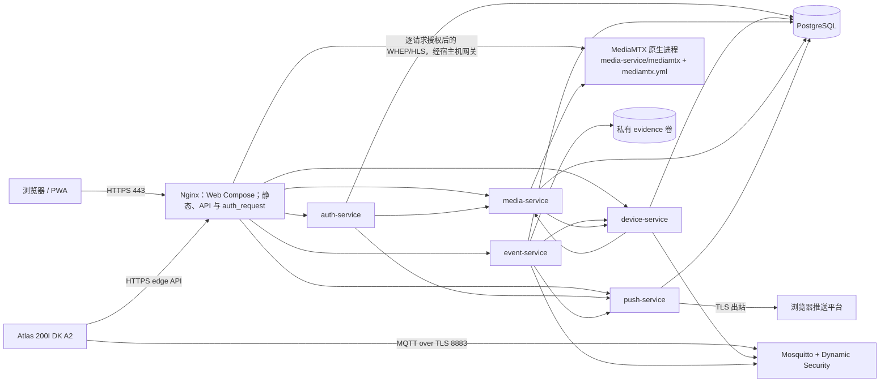

# 技术设计：首发平台部署与整合运行

> 关联规格：[spec.md](spec.md) 
> 本文档组状态见 [proposal.md](proposal.md)。

## 当前实现与目标

- 当前代码：五个 Go 服务使用 Gin/GORM，监听 `:8080`，通过各自 Dockerfile 构建；服务按启动配置调用 `AutoMigrate` 并暴露 `/health/live`、`/health/ready`。Dockerfile 中服务进程以非 root 用户运行。Web/PWA 使用 Vue 3、TypeScript、Vite 和 `project/src/clients/web/Dockerfile` 构建，Nginx 配置随 Web 源码维护。
- 部署入口拆为两个 Compose 项目：`project/src/services/docker-compose.yaml` 只编排五个 Go 服务、PostgreSQL、Mosquitto 与初始化任务；`project/src/clients/web/docker-compose.yaml` 只构建/运行 Web 客户端中的 Nginx。后端创建稳定命名的 `BACKEND_NETWORK`（默认 `yunshao_backend`），Web 声明同名 external network 并以服务名访问后端；先启动后端并确认健康，再启动 Web。Web 停止、重建或升级不操作后端 Compose 项目。MediaMTX 是 `project/src/services/media-service/mediamtx` 下的原生可执行文件，直接使用同目录 `mediamtx.yml` 运行。`.env`、各服务机密文件及 `clients/web` 中的 Nginx 运行机密由 Git 忽略；备份位置由运维文档说明。
- 构建约束：Web 镜像的 Docker 构建上下文是 `project/src/clients/web`，其 Dockerfile 不读取 Web 源码目录之外的文件；Compose 按相对服务源码路径构建五个 Go 服务。工作树不设置独立 `project/deploy/`；`src/services` 的子目录一律为 `*-service`，共享部署入口与说明留在 services 根目录。全新检出后按 README 准备 `.env`、各服务机密文件、MediaMTX 官方二进制和配置，再校验与启动；无需脚本生成机密。
- 边界依据：[全局技术 SPEC §2.1–2.3、§7.2–7.3](../../Analysis/SPEC.md)、[系统结构 §2、§4、§8](../../Design/STRUCTURE.md) 与服务 Spec。

## 方案

- 拆分 Compose 不改变运行时的数据路径：Web Compose 的 Nginx 通过 external `backend` 网络发现 `auth-service`、`device-service`、`event-service`、`media-service` 与 `push-service`。后端 Compose 只发布按园区接口绑定的 Mosquitto TLS；Web Compose 单独发布 Nginx HTTP/HTTPS。MediaMTX 原生进程直接监听宿主机配置端口：UDP ICE 8189 仅对园区网段开放；API 9997、RTSP 8554、HLS 8888 与 WHEP 8889 通过宿主机网关供后端和 Web 容器访问，并由宿主机防火墙限制来源为本机 Compose 网络。数据库、服务 HTTP、Mosquitto 明文/控制端口不映射到宿主机。
- Web 站点静态文件随镜像构建；`nginx.conf` 以只读 Compose bind mount 提供，确保当前配置在本地启动和镜像升级时一致，并可独立执行 `nginx -t`。
- Nginx 容器由 Web Compose 独立创建；它丢弃默认 capability，仅保留绑定低端口及将 master/worker 临时目录切换到 `nginx` UID 所需的 `NET_BIND_SERVICE`、`CHOWN`、`SETUID`、`SETGID`；`/var/cache/nginx`、`/var/run`、`/tmp` 使用临时文件系统。
- Nginx 路由按既有 API 路径匹配 auth/device/event/media/push 服务。Protected API 走 auth_request，转发前覆写身份头；auth login/register 与正确 logout 路由遵守全局 SPEC。 `/edge/v1/activate` 与证据 upload 不走浏览器会话；后端服务仍校验设备身份。
- 媒体路由的每次子请求先由 auth-service 校验会话/Origin/CSRF，再将可信会话头、原始 URI 和查询传给 media-service 内部 GET 授权入口；该入口校验账号、stream 和有效租约，匹配路径和租约规则见 [media-service Spec](../media_service/spec.md)。禁止为部署而降级为 MediaMTX 匿名读。
- Mosquitto 的初始 Dynamic Security 管理员用于 device-service 运行期创建/撤销设备帐号；独立的一次性 broker 初始化步骤建立 device-service 与 event-service 的最小系统角色、用户及 Topic ACL。broker 使用 TLS 与持久卷；TLS CA/服务证书 SAN 要覆盖 `mosquitto` 容器名及 Atlas 所用 DNS 名（或通过证书 SAN 别名配置）。ACL 来源为 device/event messaging Spec 中实际 topic。
- MediaMTX 使用官方独立程序包中的单文件 `mediamtx` 可执行文件和 media-service 内的 `mediamtx.yml`，不自建镜像、不作为 Compose 服务、不增加包装启动器。凭据保存在 Git 忽略的本地 `mediamtx.yml`，提交可公开的 `mediamtx.yml.example`；运维按 README 直接执行二进制并先校验配置。media-service 与 Nginx 经 `host.docker.internal:host-gateway` 访问本机进程；宿主机防火墙必须限制 9997/8554/8888/8889 来源，并按园区范围开放 8189/UDP。[MediaMTX 配置与独立安装](https://mediamtx.org/docs/features/configuration)
- PostgreSQL 初始化脚本创建五个登录角色和 schema 并将 schema 所有权分给相应角色；GORM 服务继续负责自有 schema 的 AutoMigrate。已验证 GORM PostgreSQL migrator 会在服务启动时执行 `CREATE SCHEMA IF NOT EXISTS`，且 PostgreSQL 即使在目标 schema 已存在时仍要求数据库级 `CREATE` 权限。为保留服务自行迁移，每个服务角色获得数据库级 `CREATE`，但仅对自有 schema 授予 `USAGE`/schema `CREATE`，不获得其他服务 schema 的权限或所有权；这允许角色创建额外空 schema，是当前迁移器带来的权限范围。不得将超级用户凭据注入业务容器。
- 两份 Docker Compose 分别声明本部署单元实际需要的顶层 `secrets`，以只读文件逐容器授权。敏感 Go 配置从对应环境变量名加 `_FILE` 后缀的文件路径读取；保留普通环境变量回退用于单测和本地开发兼容，但 Compose 不设置敏感明文环境变量。Web Compose 只挂载 Web TLS/header secrets；Nginx 使用只包含安全 header 指令的 secret include，使 auth-service/media-service 内部 token 不进入 Nginx 环境变量或镜像；密钥只使用安全的随机字符集以避免配置注入。
- 后端 Compose service healthcheck 调用每个 Go 服务的 `/health/live` 与 `/health/ready`；PostgreSQL 与 Mosquitto 使用各自原生命令或可观察协议检查。Web Compose 的健康检查只表示 Nginx 静态入口存活，不跨 Compose 伪造 `depends_on` 或替代后端 readiness。运维按文档直接运行 MediaMTX 配置校验命令，media-service `/health/ready` 通过控制 API 检查其运行状态；Compose 不将宿主机 MediaMTX 伪装成容器依赖。启动文档先启动 MediaMTX、后端 Compose，确认后端健康后再启动 Web Compose。
- 源码部署布局：`src/clients/web/Dockerfile`、独立 `docker-compose.yaml`、Nginx 配置、Web `.env.example` 及 Git 忽略的 TLS/header secret 文件均归 Web 客户端源码；`src/services/docker-compose.yaml` 是后端部署入口，`auth-service` 保存数据库初始化文件，`device-service` 保存 broker 配置，`media-service` 保存 MediaMTX 可执行文件与 YAML，其他服务只保存自己的源码与机密文件。`src/services` 子目录清一色为 `*-service`，没有集中 `postgres`、`mosquitto`、`mediamtx`、`scripts`、`secrets` 或 `web-service` 目录。运维、备份/恢复、smoke 命令由 services README 简洁说明；不提供 PowerShell 运维脚本、集中脚本目录或服务启动包装脚本。部署配置读取相对路径，不依赖仓库根目录的当前工作目录。

## 接口和数据

- 浏览器路由、身份/CSRF与 edge 路径见全局技术 SPEC §2.1–2.2，不在部署规格复制字段语义。
- PostgreSQL：数据库名由部署配置决定；独立角色 `auth_service`、`device_service`、`event_service`、`media_service`、`push_service` 对应 `auth`、`device`、`event`、`media`、`push` schema。初始化只对空数据目录执行。运行服务 DB URL 以只读 secret file 注入。
- MQTT TLS listener：服务端口 8883，MQTT 3.1.1；设备、device-service、event-service 用户分别配置 Dynamic Security ACL。业务 Topic 如 `devices/{id}/state`、`events`、`commands`、`command-acks`、`event-acks` 按消息 Spec 执行。
- MediaMTX：原生二进制由 media-service 目录的 `mediamtx.yml` 配置，control API 使用内部 Basic 凭据；服务端由 Nginx 代理 WebRTC/WHEP 与 HLS。设备源 RTSP 仅作为 MediaMTX pull source；API、RTSP、HLS/WHEP 进程监听由宿主机防火墙保护；首发关闭 MoQ、SRT、RTMP 等未使用协议监听。
- 持久数据：Postgres data、Mosquitto data/config、event evidence 各自命名卷。MediaMTX 动态流路径由 media-service 对账恢复。证据卷路径 `/var/lib/yunshao/evidence` 需让容器 UID 可写。
- 错误/重试：容器健康失败由 Compose 反映；服务内部对 MQTT 重连与 outbox 仍按各服务 Spec 重试。启动不因依赖短暂启动顺序失败而丢失 outbox 或确认结果。

## 安全、运维与兼容

- 认证与数据：使用独立 service-to-service tokens；Go 服务不接受未签发的账号头；DB service role 不读取或修改其他服务 schema。数据库级 `CREATE` 只为 GORM 的自有 schema 迁移保留，后续若 migrator 不再创建 schema，应撤销此权限。Nginx 确保实际信任代理与 Gin 的 trusted proxy CIDR 合同一致。
- Mosquitto Dynamic Security 初始化不能仅根据 `mosquitto_ctrl` 进程退出码判断成功：2.1.2 在对象缺失时可能输出 `Role not found`/`Client not found` 但仍返回成功码。bootstrap 必须检查 `getRole`、`getClient` 的返回内容，并在创建/赋权后重新读取对象确认状态。
- 机密：生产运行时凭据、CA/private key、DB URLs、服务令牌、加密/签名密钥和 VAPID private key 不进入 Git、镜像构建上下文、Compose 环境变量、公开卷或日志。各 service 根目录与 `clients/web` 中的 `.secret-*` 文件按 Compose secret 只读挂载；不提供集中机密目录或 PowerShell 配置脚本。
- TLS：Nginx Cookie Secure 固定开启；本地生成的自签证书只用于开发验证并需在客户端导入信任；MQTT 证书校验不禁用 hostname verification。Nginx HTTP 仅用于重定向到 HTTPS。
- 初始固定镜像候选（实现中执行拉取、构建及配置验证；验证后记录 digest）：`postgres:17.11-alpine3.24`、`eclipse-mosquitto:2.1.2-alpine`、`nginx:1.31.7-alpine3.24`。Go 服务仍采用仓库各自多阶段 Dockerfile；MediaMTX 固定官方原生程序版本 `v1.21.2`，运维按官方 release 页面下载单文件并自行校验 checksum，放入 `media-service` 后直接运行，不构建/运行其 Docker 镜像。[MediaMTX v1.21.2 release](https://github.com/bluenviron/mediamtx/releases/tag/v1.21.2)
- Web 构建阶段固定为 `node:24.15.0-alpine3.23`：首轮 `npm ci` 在 Node 24.10 下发现 lockfile 依赖声明 `^24.15.0`，因此升级构建镜像至满足 engines 的版本；Docker Hub 官方镜像 tag 已核验，构建后需重新确认无 engine mismatch。
- 健康和观测：`live` 不依赖数据库；`ready` 按服务自己的必需 DB、broker、MediaMTX、证据卷及出站配置报告。Compose 日志用 JSON 服务日志查看；不把 endpoint、token、RTSP URL 或 screenshot paths复制到操作输出。
- 备份/回滚：README 提供短小的 pg_dump/pg_restore 命令和操作顺序，先保存当前备份再更换迁移镜像；保留稳定数据卷与 broker Dynamic Security 状态。恢复后重新放回各服务机密文件并检查所有服务 ready；截图卷按全局保留规则执行，不随常规数据库 dump 备份。
- Atlas 网络：用户确认板端已联网；实机 MQTT TLS 与 edge HTTPS 连接要从 Atlas 实测并记录 CA、目标主机、固件和结果，不能只用宿主机 curl 推断板端可达。

## 备选方案和取舍

| 方案 | 优点 | 放弃原因/代价 |
|---|---|---|
| Compose 文件 secret source、服务 `*_FILE` 读取 | 容器拿到只读文件；各服务只获授权机密；环境变量与 `docker inspect` 不含 secret。 | 本地 Compose secret 是宿主机文件挂载；主机目录权限仍重要。需修改各 Go 服务配置。 |
| `.env` 直接注入所有密码和密钥 | 修改少、启动直观。 | 所有容器 env 与 `docker inspect` 易见明文，并扩大各服务 secret 的注入范围。 |
| Swarm secret / 云 KMS | 机密生命周期与访问审计更强。 | 当前单机开发与 Compose 环境不满足其部署前置条件；生产可作为同一文件合同的机密来源替代。 |

## 规格映射

实现与验收的 REQ/AC 追踪以 [spec.md](spec.md) 的追踪矩阵为唯一依据。本设计不另立验收语义。

## 未决项

- 生产域名、证书、宿主机接口绑定值和备份策略仍由生产运维确认；不阻塞开发环境实现。
- 首次生成的本地 TLS/SAN 和基准镜像 patch 在 T-01 至 T-03 构建/连通测试后写入变更记录。

## 变更记录

| 日期 | 变更 |
|---|---|
| 2026-10-19 | 初稿，基于现有服务配置、路由与全局部署合同拆出可实施集成拓扑。 |
| 2026-10-19 | 联调发现 GORM 在已存在 schema 上仍要求数据库级 CREATE；Mosquitto 2.1.2 的 Dynamic Security 对象缺失错误不可靠地通过退出码表示。记录权限边界及 bootstrap 状态校验要求。 |
