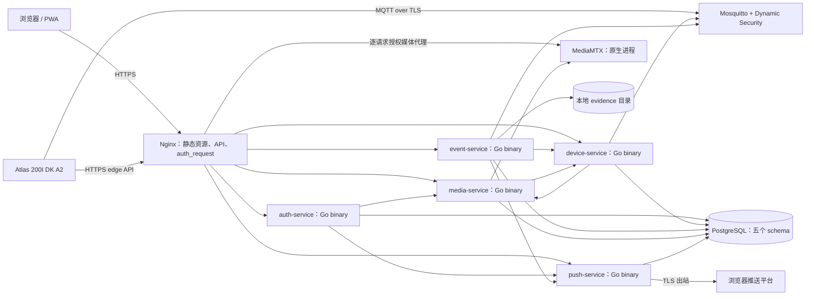

# 技术设计：原生轻量部署

> 关联规格：[spec.md](spec.md)；范围：[proposal.md](proposal.md)。

## 运行拓扑

## 进程、路径和端口

| 进程 | 部署方式 | 监听/数据 |
|---|---|---|
| Nginx + Web | system package + `/var/www/microvisspec` 静态文件 | HTTP/HTTPS |
| auth-service | 单一 Go 二进制 + systemd | `127.0.0.1:18081` |
| device-service | 单一 Go 二进制 + systemd | `127.0.0.1:18082` |
| event-service | 单一 Go 二进制 + systemd | `127.0.0.1:18083`；`/var/lib/microvisspec/evidence` |
| media-service | 单一 Go 二进制 + systemd | `127.0.0.1:18084` |
| push-service | 单一 Go 二进制 + systemd | `127.0.0.1:18085` |
| PostgreSQL | 系统服务 | Unix socket/localhost；系统数据目录 |
| Mosquitto | 系统服务 + TLS/Dynamic Security 插件 | 园区 MQTT/TLS；系统数据目录 |
| MediaMTX | `media-service/mediamtx` 单文件 + systemd | API/RTSP/HLS/WHEP/ICE |

服务调用使用 `127.0.0.1`，不依赖容器 DNS。Go 服务用 `CGO_ENABLED=0` 构建至 `services/bin/linux-amd64/`，systemd 以 `microvisspec` 用户运行。Nginx 静态文件用 Node/Vite 生产构建生成。

## 前端与安全入口

`npm ci && npm run build` 生成 `clients/web/dist`，发布到 `/var/www/microvisspec`。源码 Nginx 配置从 `/etc/microvisspec` 读取 TLS 和 header include。API 路由指向各自 loopback listener；auth_request 验证会话、CSRF 和来源，Nginx 覆盖客户端身份头。`/edge/v1` 仍使用设备凭据校验。媒体 WHEP/HLS 在每次请求上先向 media-service 请求授权，再转发至 MediaMTX。

五个 Go listener、数据库、MediaMTX API/RTSP 管理端口不对外开放。由主机防火墙只开放 TLS Web、园区 MQTT/TLS 和批准的 WebRTC ICE 端口。

## 数据与初始化

- PostgreSQL 保持单实例、五角色与五 schema；`auth-service/database-bootstrap.sh` 以 postgres OS 用户运行，应用账号只获各自迁移权限。
- Mosquitto 使用 `device-service/mosquitto.conf` 作为系统配置模板，持久化目录为 `/var/lib/mosquitto`。初始化脚本建立 device/event 两个系统角色和精确 topic ACL，可安全重复运行。
- MediaMTX 以 `media-service/mediamtx` 和 `/etc/microvisspec/mediamtx.yml` 启动；其 API 凭据、来源 URL 与读者凭据不得写入 Git。
- 数据库与 broker 数据由各自系统服务维护；证据文件位于 `/var/lib/microvisspec/evidence`，按原服务规则过期清理且不进入长期 DB dump。

## 构建、升级与观测

根目录 `DEPLOY.md` 是原生部署主手册，`project/src/services/README.md` 提供后端服务命令索引。构建脚本输出五个独立二进制；各 owner 目录提供 service unit 和 `.env.example`。发布先备份数据库和当前部署目录，再替换二进制或 Web dist、执行 `nginx -t`、`systemctl daemon-reload` 并重启受影响 unit。状态和日志通过 `systemctl` 与 `journalctl` 查看。

机密只以文件放于 `/etc/microvisspec`，配置环境文件包含路径而非密钥值。Go 服务由 `*_FILE` 读取密钥；Nginx 通过 root-only include 注入内部 token。部署目录和机密文件不在 Git 中。

三类用户目标下，管理 Web 只读展示脱敏健康、诊断与审计；主机部署修改、服务重启、密钥操作和数据库恢复仍属受控运维。workspace schema 迁移须遵循共享规格的扩展、回填、双写核对和回滚顺序；不得在迁移验收前删旧字段。见 [共享授权规格](../multi_user_workspace_access/)。

## 变更记录

| 日期 | 内容 |
|---|---|
| 2026-10-26 | 将部署拓扑从双 Compose 改为主机原生服务与静态 Web。 |
