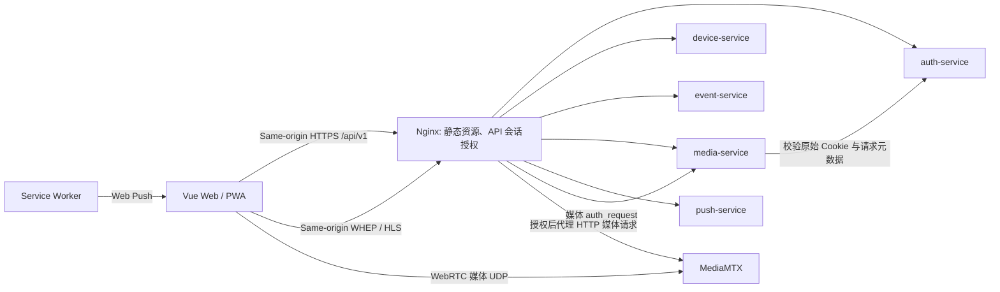

# Web 与 PWA 客户端技术设计

> 关联行为合同：[spec.md](spec.md)。

## 当前实现与目标

- 当前源码为 Vue 3、Vite、TypeScript；已有八类业务页面及认证、设备、媒体、事件、统计、通知 API 模块。PWA、更新与离线代码已有实现，真实媒体与手机通知仍独立验收。
- 目标在既有 SPA 中按 `auth`、`devices`、`events`、`media`、`push` 拆 API 模块，按公用 dashboard 布局组织页面与导航。
- 部署时 Web/PWA 由 Node.js 构建为静态文件，系统 Nginx 托管静态资源并代理 API、edge 与媒体授权请求；Go 服务监听 loopback，由各自 systemd unit 独立运行。完整安装与升级步骤见仓库根目录 [DEPLOY.md](../../../../DEPLOY.md)。

2026-10-22 展品视觉对齐：`readme/microvisspec-exhibit.html` 是配色与排版层级的依据。工作台沿用自己的信息架构，将底色调整为 `#faf8f4` 暖纸色、公共导航调整为 `#1c1917` 墨色、交互强调调整为 `#1f4d3a` 森林绿；业务标题采用本地系统衬线字体，正文继续使用系统无衬线字体。保留卡片、表格和表单的原有内容与行为，使用局部样式覆盖统一边框、圆角、焦点和状态色，不引入远程字体或新依赖。

2026-10-26 部署调整：Web 不再由 Compose 发布，主机 Nginx 直接监听配置的 HTTPS 地址；Go 服务与主机 Nginx 通过 loopback 通信。实际部署需按访问网络配置证书 SAN、`PUBLIC_ORIGIN`、MediaMTX 来源/WebRTC candidates 与主机防火墙；不要把接口绑定当作访问控制替代品。

## 方案

2026-10-22 本轮整合远端 `28384dd`，复用其 `style.css` 和组件主题，移除本轮重复主题文件，保持单一视觉来源。独立推送工具位于 `src/tools/push-debug/`，不进入正式导航或生产 API；本机回归见 T-14。

2026-10-20 视觉方案沿用现有页面与业务组件：`style.css` 保留同一套共享组件规则并展开为可读格式，统一字体、间距、边界、深绿导航及浅色内容面板；新 `AppIcon.vue` 提供本地 SVG 图标，`AuthBrandPanel.vue` 供登录/注册共用品牌区。响应式适配 1440/1024/390/360px，移动端保留底部导航和堆叠表单；概览不再显示写死的星期/早上问候，选定范围同时驱动卡片标题。可见性切换只作用于密码框，不持久化凭据。无新依赖和远程视觉资源。

2026-10-21 品牌统一复用 `BrandLockup.vue`：前端品牌图从仓库 `readme/assets/logo.png` 拷贝到 Web `public/logo.png`，替换原有占位字母；座右铭“边缘智能识别，云端统一处置”显示在品牌副标。组件用于桌面工作台侧栏、认证页、手机认证卡片和手机工作台顶栏；现有 PWA 安装图标已采用项目图形，保持不变。仅改品牌呈现，不改变路由、API、认证、告警和离线缓存合同。

路由包含公开注册/登录页与受保护的概览、设备、监控、事件、分析、账号/通知设置。桌面导航提供概览、监控和统计；窄屏优先事件、设备与处置。平台级品牌和引导文案保持跨行业通用，实际算法类别只在相关规则、筛选和事件记录中按部署能力呈现。监控由 media-service 返回 viewer URL 与协议，客户端只负责播放器，不访问 MediaMTX 管理端口。告警规则表单把模型可用类别渲染为 allowlisted 选项，所有项默认 disabled；保存后分别展示云端期望配置版本和设备实报配置版本，避免乐观地显示已生效。

API client 使用同源请求、`credentials: include`、CSRF 头和 snake_case 序列化；统一解码 `{error:{code,message,request_id}}`。401 清空账号态并执行安全站内返回；409 触发资源刷新，410 显示证据过期；请求取消随路由切换，避免旧账号响应污染当前用户。

PWA worker 只缓存应用壳、manifest 和版本化静态资源；明确排除 `/api/`、证据、播放器/媒体、Push endpoint 和个人响应。Push 点击只解析受限站内事件路径并 focus/open，目标页面自行请求 API 鉴权。

三类用户目标：以 `/auth/me` 返回的服务端 user_type 分流 `/admin`、`/app`、`/m`；PC owner 在 UI 邀请和授权设备，mobile 成员查看授权范围与单路视频。前端不推断账号类型或授权结论，所有查询和播放由后端重新鉴权。详细合同见 [共享授权规格](../multi_user_workspace_access/)。

## 接口和数据

- 复用 [全局 API 合同](../../Analysis/SPEC.md) 及 auth/device/event/media/push 服务规格；web 不引入第二份 API 字段定义。
- 本地类型定义与服务响应保持一致；设备详情来源表单仅持有授权状态接口返回的 RTSP URL，不持有独立 RTSP 认证凭据、`account_id` 权限结论、完整截图或历史通知敏感数据。写入使用 media-service 来源 API，账号归属由后端验证。
- 播放 URL 和过期时间由 media-service 发放；证据始终走 event-service 同源授权 API。

## 安全、运维与兼容

- 生产环境要求 HTTPS、安全 Cookie；不写 `localStorage` 保存 access token 或 Push subscription secret。
- 对写请求加 Origin/CSRF；显示数据前处理账号切换、登出与会话过期。
- PWA 更新采用现有 `PwaUpdatePrompt` 并验证 worker 激活流程；离线时清除/不显示旧的用户专属缓存。
- 页面和 API 错误日志仅保留 request ID 与错误类别，不输出视频 URL 凭据、订阅 endpoint 或截图字节。

## 备选方案和取舍

| 方案 | 优点 | 放弃原因/代价 |
|---|---|---|
| 现有 Vue SPA + 响应式路由 | 复用模板，Web/PWA 同源认证 | 桌面媒体与手机页面需分级展示 |
| Web/PWA 双应用 | 独立部署 | 重复维护认证、路由和事件 UI |

## 未决项

- WebRTC/HLS 实际播放能力由 media-service 和园区网验证；前端根据合同选择，不猜测 RTSP 源地址。
- Push 验收依赖 HTTPS/VAPID 部署配置。

## 变更记录

| 日期 | 变更 |
|---|---|
| 2026-10-18 | 定义首发工作台页面、同源安全 API、媒体播放和 PWA 缓存边界。 |
| 2026-10-20 | 明确工作台通用产品定位；具体行业与算法只在对应数据和配置中出现。 |
| 2026-10-21 | 设备详情来源配置仅保留 RTSP 地址；URL 通过 media-service 状态接口回显和写接口保存。 |
