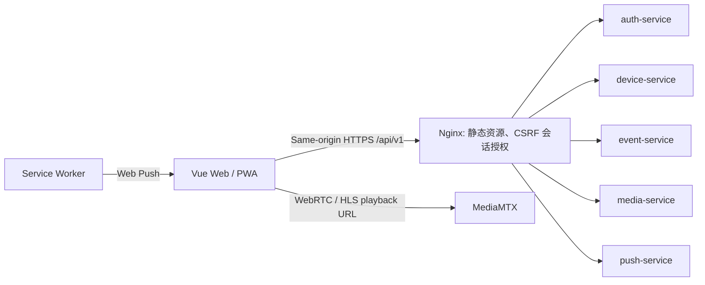

# Web 与 PWA 客户端技术设计

> 关联行为合同：[spec.md](spec.md)。

## 当前实现与目标

- 当前源码为 Vue 3、Vite、TypeScript；路由和 API index 是空壳，页面只有占位组件；已有 PWA 图标、service worker 插件和更新提示。
- 目标在既有 SPA 中按 `auth`、`devices`、`events`、`media`、`push` 拆 API 模块，按公用 dashboard 布局组织页面与导航。
- 部署归 Web 客户端源码：`src/clients/web/Dockerfile` 构建静态站点与 Nginx 镜像，`src/clients/web/docker-compose.yaml` 单独运行名为 `web` 的入口容器。该 Compose 加入后端 Compose 创建的 external `BACKEND_NETWORK`（默认 `yunshao_backend`），仅发布 Web HTTP/HTTPS 与挂载 Web 自有 TLS/header secrets；不会创建 `web-service` 目录，也不管理后端服务的生命周期。

## 方案

路由包含公开注册/登录页与受保护的概览、设备、监控、事件、分析、账号/通知设置。桌面导航提供概览、监控和统计；窄屏优先事件、设备与处置。监控由 media-service 返回 viewer URL 与协议，客户端只负责播放器，不访问 MediaMTX 管理端口。告警规则表单把模型可用类别渲染为 allowlisted 选项，所有项默认 disabled；保存后分别展示云端期望配置版本和设备实报配置版本，避免乐观地显示已生效。

API client 使用同源请求、`credentials: include`、CSRF 头和 snake_case 序列化；统一解码 `{error:{code,message,request_id}}`。401 清空账号态并执行安全站内返回；409 触发资源刷新，410 显示证据过期；请求取消随路由切换，避免旧账号响应污染当前用户。

PWA worker 只缓存应用壳、manifest 和版本化静态资源；明确排除 `/api/`、证据、播放器/媒体、Push endpoint 和个人响应。Push 点击只解析受限站内事件路径并 focus/open，目标页面自行请求 API 鉴权。

## 接口和数据

- 复用 [全局 API 合同](../../Analysis/SPEC.md) 及 auth/device/event/media/push 服务规格；web 不引入第二份 API 字段定义。
- 本地类型定义与服务响应保持一致；客户端状态不存 `account_id` 权限结论、RTSP 凭据、完整截图或历史通知敏感数据。
- 播放 URL 和过期时间由 media-service 发放；证据始终走 event-service 同源授权 API。

## 安全、运维与兼容

- 生产环境要求 HTTPS、安全 Cookie；不写 `localStorage` 保存 access token 或 Push subscription secret。
- 对写请求加 Origin/CSRF；显示数据前处理账号切换、登出与会话过期。
- PWA 更新采用现有 `PwaUpdatePrompt` 并验证 worker 激活流程；离线时清除/不显示旧的用户专属缓存。
- 页面和 API 错误日志仅保留 request ID 与错误类别，不输出视频 URL 凭据、订阅 endpoint 或截图字节。

## 备选方案和取舍

| 方案 | 优点 | 放弃原因/代价 |
|---|---|---|
| 现有 Vue SPA + 响应式路由 | 复用模板，Web/PWA 同源认证 | 桌面媒体与手机页面需分级展示 |
| Web/PWA 双应用 | 独立部署 | 重复维护认证、路由和事件 UI |

## 未决项

- WebRTC/HLS 实际播放能力由 media-service 和园区网验证；前端根据合同选择，不猜测 RTSP 源地址。
- Push 验收依赖 HTTPS/VAPID 部署配置。

## 变更记录

| 日期 | 变更 |
|---|---|
| 2026-10-18 | 定义首发工作台页面、同源安全 API、媒体播放和 PWA 缓存边界。 |
