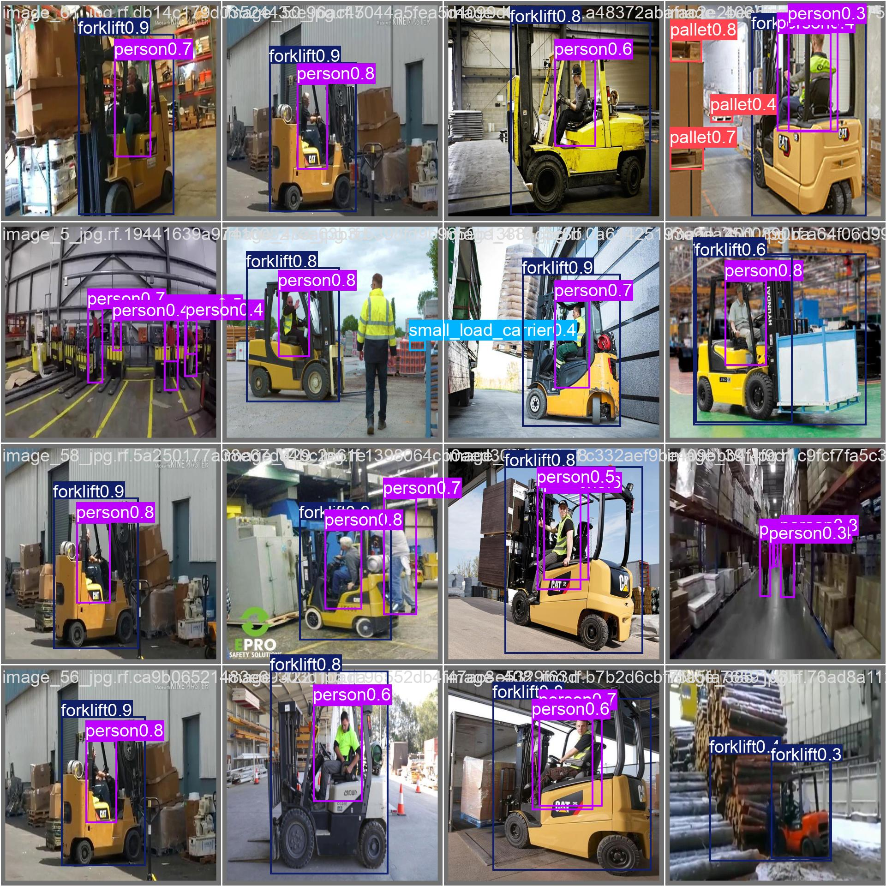
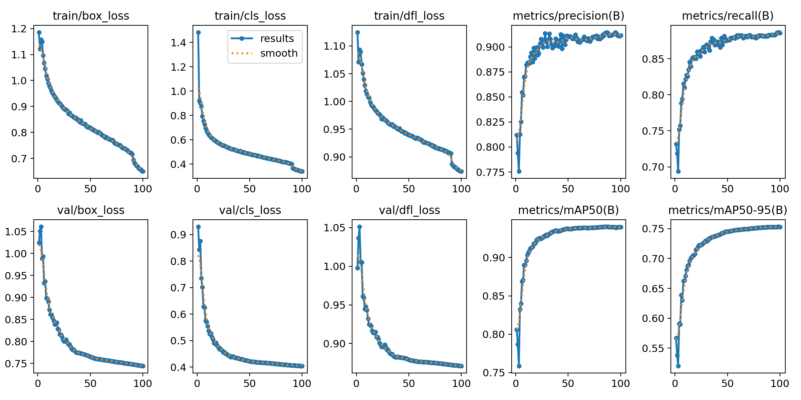
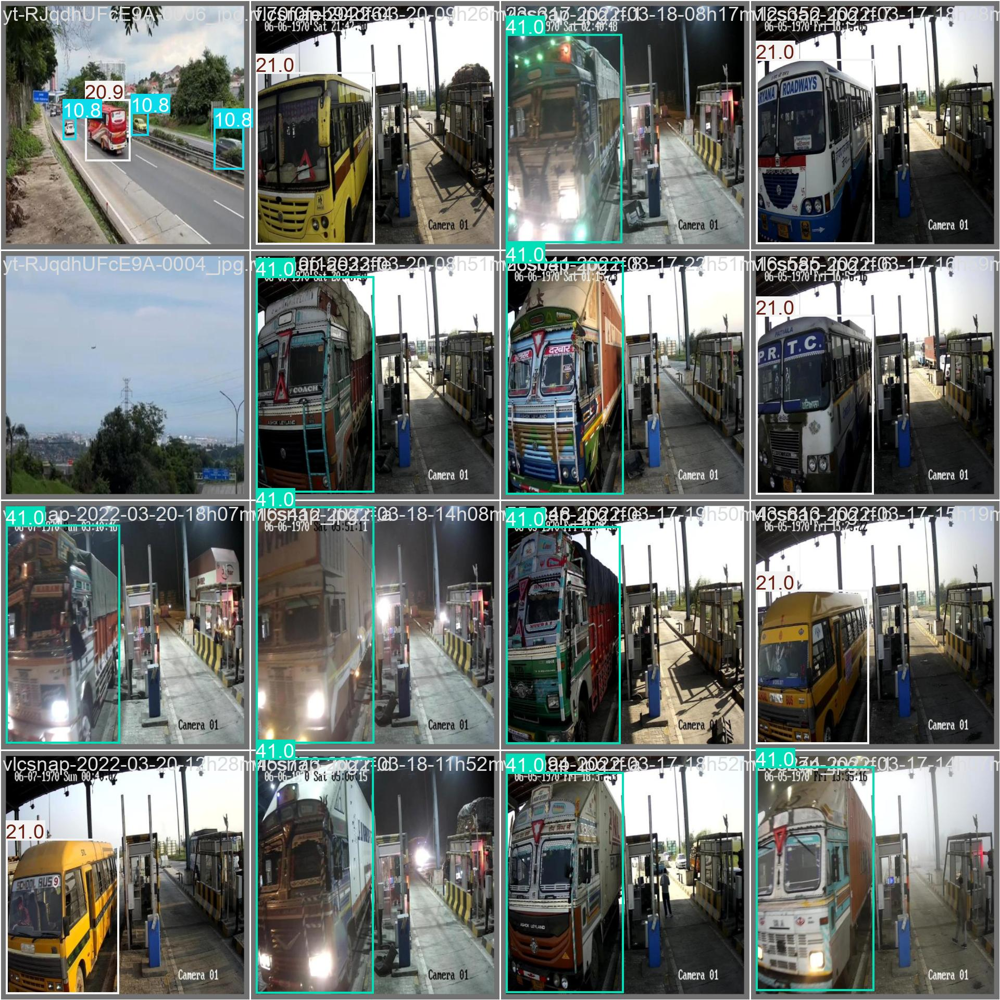
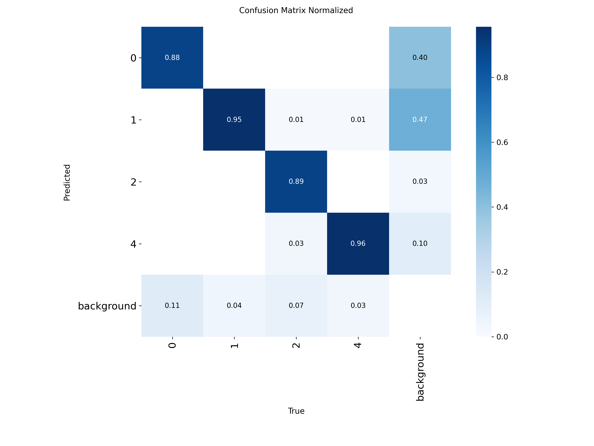
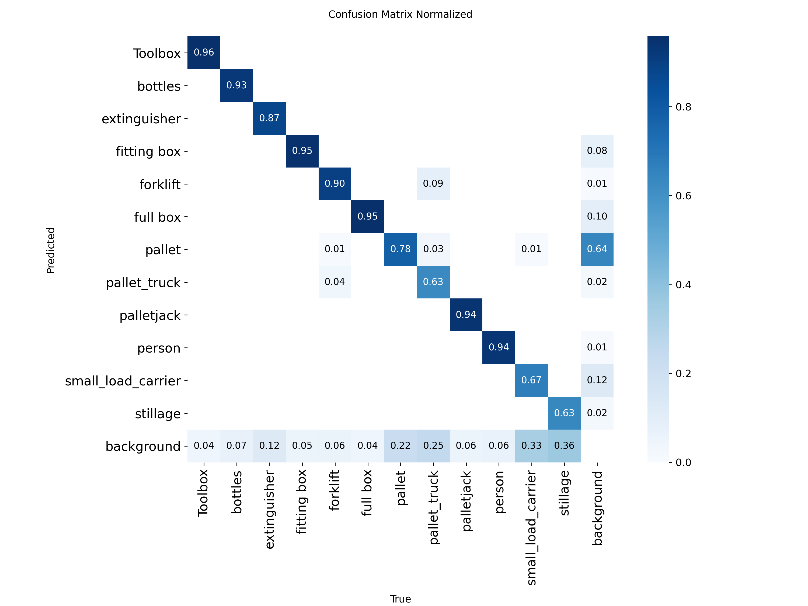
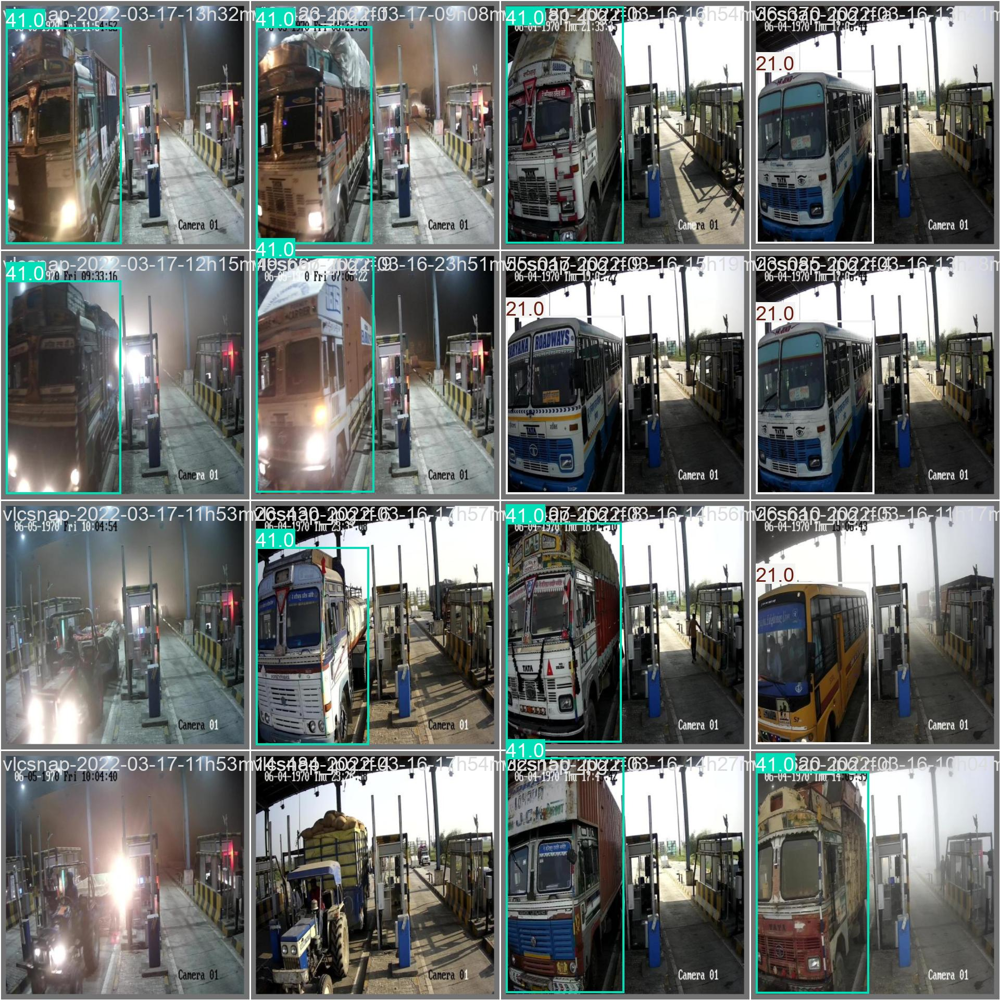

# YOLO11n 训练与评估报告

> 报告覆盖 warehouse_detection 与 vehicle_detection 两个检测模型。训练共 100 轮；评估使用训练中保存的 `best.pt`，在独立 `test` 集上完成。ONNX 使用 Ultralytics 导出，输入尺寸为 640×640，静态输入，opset 17。

## 训练配置与训练阶段指标

- 模型：YOLO11n（检测任务）
- 训练配置：100 epochs，imgsz=640，batch=16，seed=42，GPU 0
- 表中训练阶段数据为第 100 轮日志的验证指标；最终交付的 PT/ONNX 文件由 `best.pt` 导出。

| 数据集 | Precision | Recall | mAP@50 | mAP@50–95 |
|---|---:|---:|---:|---:|
| warehouse_detection | 0.8657 | 0.8104 | 0.8699 | 0.6006 |
| vehicle_detection | 0.9115 | 0.8859 | 0.9397 | 0.7527 |

### 训练曲线与训练阶段样例

#### 仓储检测

训练阶段验证预测样例：

训练阶段归一化混淆矩阵：

#### 车辆检测

训练阶段验证预测样例：

训练阶段归一化混淆矩阵：

## 独立测试集总体指标

| 数据集 | 源图片数 | 实际评估图片数 | 实例数 | Precision | Recall | F1* | mAP@50 | mAP@50–95 |
|---|---:|---:|---:|---:|---:|---:|---:|---:|
| warehouse_detection | 945 | 905 | 21393 | 0.8496 | 0.8073 | 0.8279 | 0.8639 | 0.6043 |
| vehicle_detection | 651 | 651 | 4541 | 0.8983 | 0.8819 | 0.8900 | 0.9291 | 0.7527 |

> *总体 F1 由总体 Precision 与 Recall 的调和平均计算。类别表中的 F1 使用 Ultralytics 按类别汇总值。

### 测试评估延迟（每张图片）

| 数据集 | 预处理 (ms) | 模型推理 (ms) | 后处理 (ms) | 合计 (ms) |
|---|---:|---:|---:|---:|
| warehouse_detection | 0.332 | 1.437 | 0.971 | 2.739 |
| vehicle_detection | 0.376 | 1.147 | 0.275 | 1.799 |

> 延迟取自 Ultralytics 验证器记录的每图速度，测量条件为 GPU 0、batch=16、imgsz=640。合计为预处理、模型推理和后处理三项之和，不包含验证损失计算、模型加载和应用侧 I/O；它用于比较本次评估条件下的速度，不等同于特定部署平台的端到端延迟。

### 演示类别推荐

- **主推：**仓储 `full box`、`fitting box`、`person`；车辆检测中的小汽车。
- **补充：**仓储 `Toolbox`（测试实例较少）；车辆检测中的货车（mAP@50–95 较高）。
- 车辆数据导出配置使用数字类别名；此处根据测试集标注样例将类别语义标为摩托车、小汽车、客车、货车。数据集项目列出的类别可见 [Roboflow Vehicle Detection](https://universe.roboflow.com/jey-mtuyv/vehicle-detection-tqbaf-7cck5)。

### 仓储检测逐类别指标

| 类别 | 图片数 | 实例数 | Precision | Recall | F1 | mAP@50 | mAP@50–95 |
|---|---:|---:|---:|---:|---:|---:|---:|
| **Toolbox（补充演示）** | 24 | 24 | 0.8370 | 0.9583 | 0.8936 | 0.9431 | 0.8434 |
| bottles | 66 | 138 | 0.8861 | 0.9130 | 0.8994 | 0.9409 | 0.7384 |
| extinguisher | 32 | 32 | 0.9126 | 0.8750 | 0.8934 | 0.9494 | 0.5989 |
| **fitting box（主推）** | 257 | 2971 | 0.9095 | 0.9195 | 0.9145 | 0.9713 | 0.7451 |
| forklift | 174 | 195 | 0.7883 | 0.8783 | 0.8309 | 0.9184 | 0.7247 |
| **full box（主推）** | 259 | 2507 | 0.8604 | 0.9314 | 0.8945 | 0.9580 | 0.8335 |
| pallet | 513 | 12410 | 0.8231 | 0.6845 | 0.7475 | 0.7781 | 0.3627 |
| pallet_truck | 147 | 285 | 0.7941 | 0.5955 | 0.6806 | 0.7089 | 0.3620 |
| palletjack | 17 | 17 | 0.8329 | 0.8799 | 0.8557 | 0.9069 | 0.6306 |
| **person（主推）** | 184 | 296 | 0.9234 | 0.9257 | 0.9245 | 0.9502 | 0.7046 |
| small_load_carrier | 104 | 1905 | 0.7619 | 0.5796 | 0.6584 | 0.6436 | 0.3031 |
| stillage | 117 | 613 | 0.8656 | 0.5465 | 0.6700 | 0.6983 | 0.4049 |

#### 仓储检测测试阶段图像

归一化混淆矩阵：

测试集预测样例：

### 车辆检测逐类别指标

| 类别 | 图片数 | 实例数 | Precision | Recall | F1 | mAP@50 | mAP@50–95 |
|---|---:|---:|---:|---:|---:|---:|---:|
| 摩托车（Motorcycle） | 349 | 1617 | 0.9252 | 0.8335 | 0.8770 | 0.9175 | 0.6175 |
| **小汽车（Car，主推）** | 489 | 2337 | 0.9246 | 0.9292 | 0.9269 | 0.9640 | 0.7702 |
| 客车（Bus） | 90 | 113 | 0.8444 | 0.8850 | 0.8642 | 0.8927 | 0.7959 |
| **货车（Truck，补充演示）** | 149 | 474 | 0.8992 | 0.8797 | 0.8894 | 0.9422 | 0.8273 |

#### 车辆检测测试阶段图像

归一化混淆矩阵：

测试集预测样例：

## 评估说明

- Warehouse 测试集有 945 个源图片文件，40 张因数据/标注格式问题被 Ultralytics 跳过，实际评估 905 张。评估日志指出该数据集中存在检测框与分割标注混用；需修正标注后再复评。
- Vehicle 测试集 651 张全部参与评估。日志显示存在分割标注与检测框混用，本次评估按检测框进行，分割标注被忽略；表中类别名已按数据集标注样例转为语义名称。
- Warehouse 的 `pallet`、`pallet_truck`、`small_load_carrier`、`stillage` 类别表现较弱，建议优先检查漏检样例并补充/清理标注。
- 导出的 ONNX 文件采用静态 640×640 输入。部署时请保持预处理（RGB/归一化/缩放与填充）和 YOLO 输出解码、NMS 后处理与训练类别顺序一致。

## 交付文件

| 数据集 | PyTorch 权重 | ONNX 权重 |
|---|---|---|
| warehouse_detection | [`yolo11n_warehouse_detection_best.pt`](yolo11n_warehouse_detection_best.pt) | [`yolo11n_warehouse_detection_best.onnx`](yolo11n_warehouse_detection_best.onnx) |
| vehicle_detection | [`yolo11n_vehicle_detection_best.pt`](yolo11n_vehicle_detection_best.pt) | [`yolo11n_vehicle_detection_best.onnx`](yolo11n_vehicle_detection_best.onnx) |

评估报告生成时间：2026-10-08T09:02:47+08:00。
