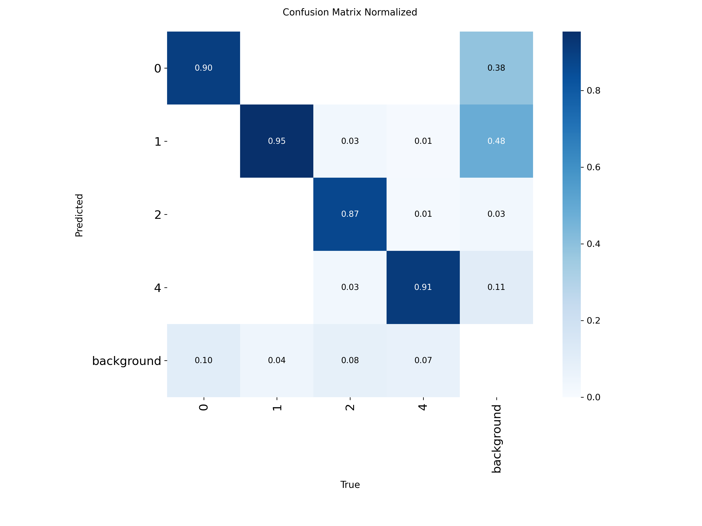

# YOLO11n 车辆检测历史报告

此报告来自 2026-10-08 的桌面训练和独立 test 集评估，仅作为原始基线记录；不是本轮重新评估，也不是 Atlas NPU 实测。

## 配置与总体指标

历史训练参数：YOLO11n，100 epochs，640×640，batch 16，seed 42，GPU 0。保存的 best checkpoint 为 `yolo11n_vehicle_detection_best.pt`，导出的固定静态 ONNX 为 `yolo11n_vehicle_detection_best.onnx`，opset 17。

| 集合 | 源图片 | 实际评估图片 | 实例 | Precision | Recall | F1 | mAP@50 | mAP@50–95 |
|---|---:|---:|---:|---:|---:|---:|---:|---:|
| 训练阶段验证 | — | — | — | 0.9115 | 0.8859 | — | 0.9397 | 0.7527 |
| 独立 test | 651 | 651 | 4541 | 0.8983 | 0.8819 | 0.8900 | 0.9291 | 0.7527 |

| 类别 | Images | Instances | Precision | Recall | F1 | mAP@50 | mAP@50–95 |
|---|---:|---:|---:|---:|---:|---:|---:|
| Motorcycle | 349 | 1617 | 0.9252 | 0.8335 | 0.8770 | 0.9175 | 0.6175 |
| Car | 489 | 2337 | 0.9246 | 0.9292 | 0.9269 | 0.9640 | 0.7702 |
| Bus | 90 | 113 | 0.8444 | 0.8850 | 0.8642 | 0.8927 | 0.7959 |
| Truck | 149 | 474 | 0.8992 | 0.8797 | 0.8894 | 0.9422 | 0.8273 |

桌面 GPU 0、batch=16 的历史每图耗时：预处理 0.376 ms，推理 1.147 ms，后处理 0.275 ms；不代表板端性能。历史评估日志报告分割标注被忽略，复测应重新核验数据和标注。

## 图表

## 文件

- `yolo11n_vehicle_detection_best.pt`：训练 checkpoint。
- `yolo11n_vehicle_detection_best.onnx`：固定 `1×3×640×640` 输入、opset 17 的历史导出模型。
- `../../model_export/artifacts/`：本次可重建导出清单和导出产物。
