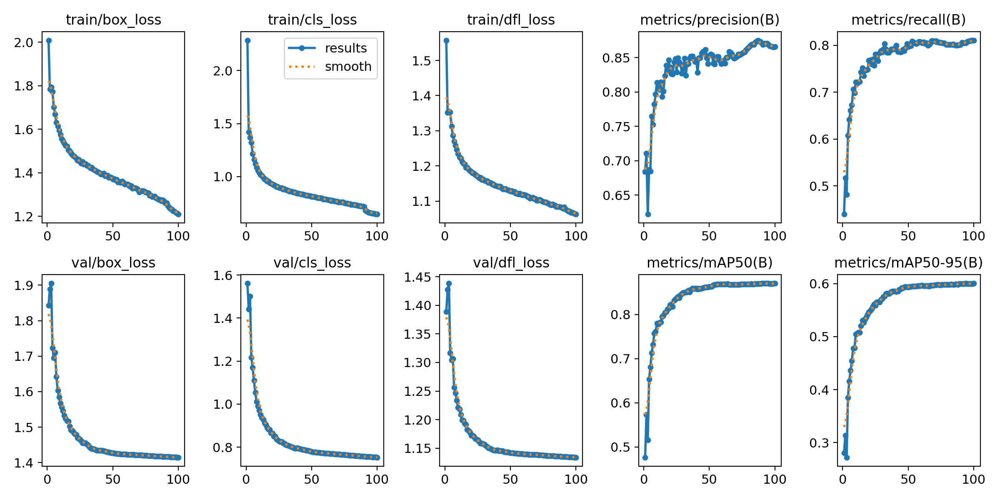
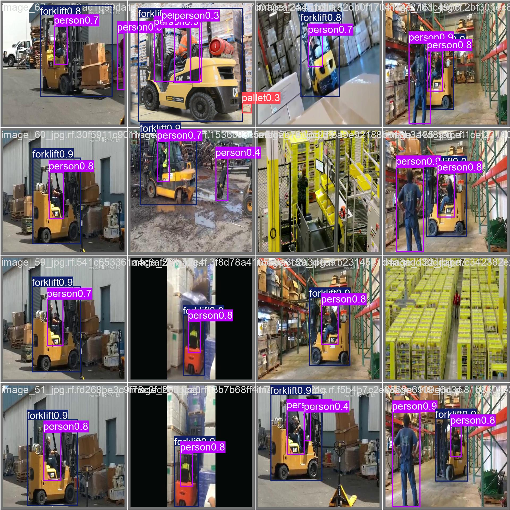

# YOLO11n 仓储物品检测历史报告

此报告来自 2026-10-08 的桌面训练和独立 test 集评估，仅作为原始基线记录；不是本轮重新评估，也不是 Atlas NPU 实测。

## 配置与总体指标

历史训练参数：YOLO11n，100 epochs，640×640，batch 16，seed 42，GPU 0。保存的 best checkpoint 为 `yolo11n_warehouse_detection_best.pt`，导出的固定静态 ONNX 为 `yolo11n_warehouse_detection_best.onnx`，opset 17。

| 集合 | 源图片 | 实际评估图片 | 实例 | Precision | Recall | F1 | mAP@50 | mAP@50–95 |
|---|---:|---:|---:|---:|---:|---:|---:|---:|
| 训练阶段验证 | — | — | — | 0.8657 | 0.8104 | — | 0.8699 | 0.6006 |
| 独立 test | 945 | 905 | 21393 | 0.8496 | 0.8073 | 0.8279 | 0.8639 | 0.6043 |

历史评估有 40 张图像因检测框和分割标注混用而跳过；复测必须使用相同 Roboflow 项目和版本，并报告本次实际参与数量。

| 类别 | Images | Instances | Precision | Recall | F1 | mAP@50 | mAP@50–95 |
|---|---:|---:|---:|---:|---:|---:|---:|
| Toolbox | 24 | 24 | 0.8370 | 0.9583 | 0.8936 | 0.9431 | 0.8434 |
| bottles | 66 | 138 | 0.8861 | 0.9130 | 0.8994 | 0.9409 | 0.7384 |
| extinguisher | 32 | 32 | 0.9126 | 0.8750 | 0.8934 | 0.9494 | 0.5989 |
| fitting box | 257 | 2971 | 0.9095 | 0.9195 | 0.9145 | 0.9713 | 0.7451 |
| forklift | 174 | 195 | 0.7883 | 0.8783 | 0.8309 | 0.9184 | 0.7247 |
| full box | 259 | 2507 | 0.8604 | 0.9314 | 0.8945 | 0.9580 | 0.8335 |
| pallet | 513 | 12410 | 0.8231 | 0.6845 | 0.7475 | 0.7781 | 0.3627 |
| pallet_truck | 147 | 285 | 0.7941 | 0.5955 | 0.6806 | 0.7089 | 0.3620 |
| palletjack | 17 | 17 | 0.8329 | 0.8799 | 0.8557 | 0.9069 | 0.6306 |
| person | 184 | 296 | 0.9234 | 0.9257 | 0.9245 | 0.9502 | 0.7046 |
| small_load_carrier | 104 | 1905 | 0.7619 | 0.5796 | 0.6584 | 0.6436 | 0.3031 |
| stillage | 117 | 613 | 0.8656 | 0.5465 | 0.6700 | 0.6983 | 0.4049 |

桌面 GPU 0、batch=16 的历史每图耗时：预处理 0.332 ms，推理 1.437 ms，后处理 0.971 ms；不代表板端性能。

## 图表

## 文件

- `yolo11n_warehouse_detection_best.pt`：训练 checkpoint。
- `yolo11n_warehouse_detection_best.onnx`：固定 `1×3×640×640` 输入、opset 17 的历史导出模型。
- `../../model_export/artifacts/`：本次可重建导出清单和导出产物。
