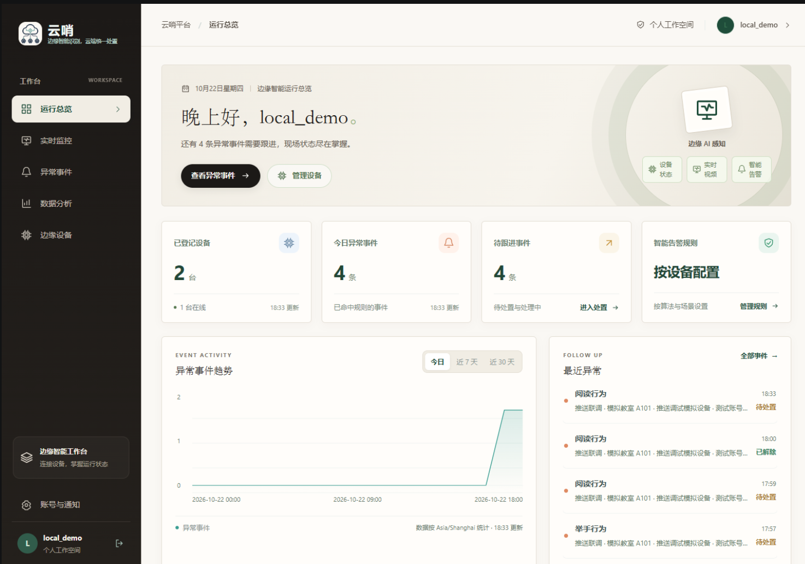
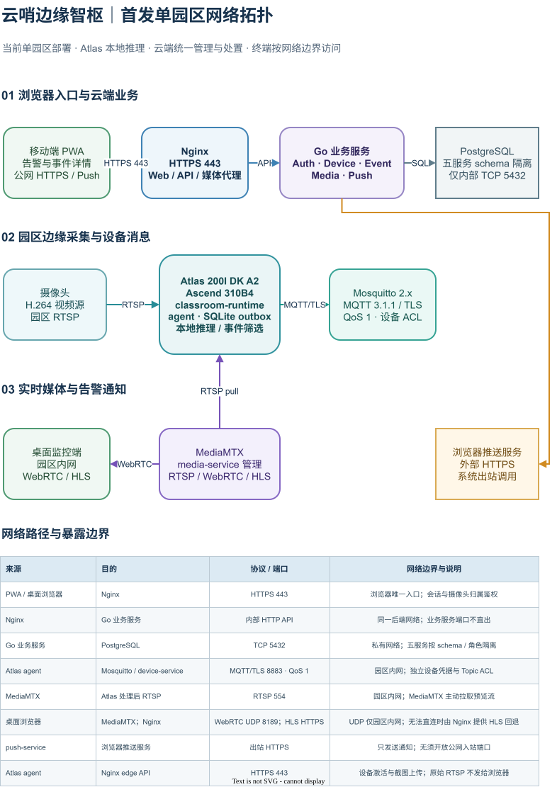
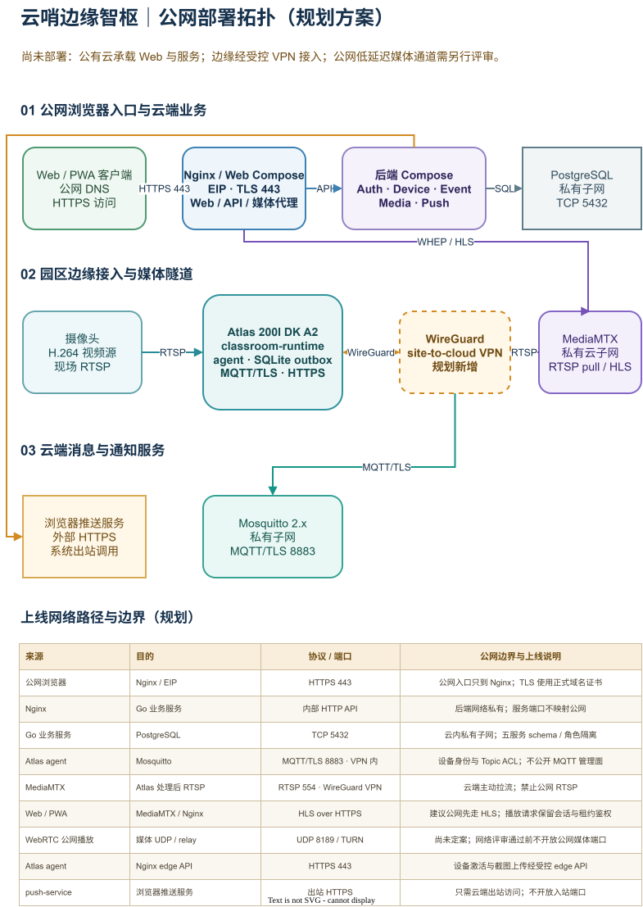

<p align="center">
  
</p>

<h1 align="center">云哨·边缘智枢</h1>

<p align="center">
  面向园区、校园与工厂的云边协同视频智能平台
</p>

<p align="center">
  <a href="../LICENSE"></a>
  
  
</p>

> 项目链接: https://atomgit.com/milo-ally-stu/Yunshao

云哨·边缘智枢（Yunshao）将视频接入、边缘 AI 推理、设备管理、事件处置与运行分析整合在一个可部署的平台中。摄像头视频由边缘设备就近处理，结构化事件和经授权的证据再进入云端工作台，帮助组织统一查看设备与告警状态。

项目首发部署目标为 **华为 Atlas 200I DK A2（Ascend 310B4）**。当前仓库处于 MVP 与试点验证阶段；本文会区分已实现能力和仍需现场验收的能力，不将规划功能描述为已交付功能。

## 平台首页预览

下图为 Web 工作台「运行总览」页面截图，内容来自演示环境。



## 适用场景

- 校园、园区和工厂的多点位视频巡检与异常事件管理
- 需要在边缘侧运行视觉模型，并集中管理设备和事件的场景
- 需要将视频流、模型版本、告警规则和处置记录纳入统一工作流的试点项目

## 核心能力

| 能力域 | 说明 |
|---|---|
| 边缘视频分析 | 在 Atlas 边缘设备上运行 AscendCL 推理程序，接入视频流并输出检测结果。 |
| 设备管理 | 在 Web 工作台登记和查看设备、位置、连接状态及算法状态。 |
| 视频与媒体服务 | 通过 MediaMTX 管理媒体流接入与分发，支持云端服务和边缘设备协同。 |
| 事件闭环 | 汇聚边缘事件，按账号隔离查询，查看授权证据并记录处置结果。 |
| 规则与通知 | 按已启用的告警规则生成事件及通知意图；Web Push 的手机端实际投递仍需目标环境验收。 |
| 运行分析 | 提供事件趋势、等级、类型、位置和处置状态等基础统计。 |

## 系统架构

### 当前单园区部署

下图展示浏览器、云端服务、Atlas 边缘设备和摄像头之间的主要通信链路。



可编辑源文件：[system-network-current.drawio](assets/system-network-current.drawio)

### 公有云部署规划

下图是后续公有云上线规划，**尚未部署**。跨园区边缘接入建议通过 VPN；公网 WebRTC 与中继端口需要先完成网络评审。



可编辑源文件：[system-network-online-proposed.drawio](assets/system-network-online-proposed.drawio)

## 首发示范：教室行为检测

首发示范用于验证边缘推理、视频呈现、设备管理和云端事件链路。课堂检测流程定义 `hand-raising`、`reading`、`writing` 三类目标，模型输入尺寸为 640；模型部署链路为 **PyTorch → ONNX → CANN ATC → OM → AscendCL**。

告警规则默认关闭。只有用户明确启用并配置相应规则后，边缘检测结果才会作为异常事件上报；单帧目标检测本身不等于告警。行为类别只描述画面中可见的动作，不代表学生身份、成绩或专注度。

已有模型产物与 Atlas 合成流测试记录见[课堂行为检测规格与任务记录](../project/docs/Specification/classroom_behavior_detection/tasks.md)。合成流结果不能替代真实摄像头画质、模型精度、网络条件和长期稳定性验收。消防通道检测属于后续场景，不在当前首发范围内。

## 当前交付状态

| 模块 | 状态与验证边界 |
|---|---|
| 后端服务 | 认证、设备、事件、媒体和推送服务已有实现；部署及环境配置见[部署指南](../DEPLOY.md)。 |
| Web 工作台 | 已实现设备、监控、事件、处置、通知设置和基础统计页面；相关构建与浏览器证据见[交付记录](../project/docs/Specification/web_pwa_client/evidence/delivery_20261022.json)。 |
| 账号与事件 | 已有本机 HTTPS、MQTT、PostgreSQL 联调记录，覆盖模拟设备与事件、授权截图、跨账号隔离和处置流程。 |
| 边缘模型 | 仓库包含课堂、车辆、仓储等模型研发流程及 Atlas 端合成流记录；本轮并发容量目标尚未完成验收。 |
| 视频链路 | 提供局域网演示和推流验证流程；实时播放效果仍取决于现场设备、网络和媒体配置。 |
| Web Push | 订阅、投递代码和隔离测试已有；手机系统上的实际通知及点击流程需要在目标设备上验收。 |
| MCP / 原生客户端 | 后续规划。当前 `mcp-service` 尚未实现可供生产使用的工具、权限与调用审计；Android、iOS 原生 App 尚未实现。 |

## 快速开始

### 环境要求

- Linux 主机或服务器，用于运行云端服务与 Web 工作台
- Docker Engine 与 Docker Compose 插件
- 华为 Atlas 200I DK A2，用于边缘推理演示
- 摄像头或经授权的视频源；具体编码、网络和端口要求见部署指南

### 获取代码

```bash
git clone https://atomgit.com/milo-ally-stu/Yunshao.git
cd Yunshao
```

### 部署

请按[部署指南](../DEPLOY.md)配置服务地址、证书、密钥、MediaMTX、云端服务和 Atlas 运行时。生产或试点部署时，应为目标环境生成独立密钥并限制管理接口与媒体端口的网络访问；不要将真实密钥提交到仓库。

## 仓库结构

```text
project/
├── docs/Specification/       # 产品与系统规格、设计、任务和验收记录
├── preparation/              # 模型训练、导出、转换、验证和部署工程
└── src/
    ├── clients/web/          # Web 工作台
    ├── device_sides/          # Atlas 边缘端运行时
    ├── services/              # 云端后端与媒体服务
    └── tools/                 # 开发与调试工具
readme/                       # 项目素材、网络图和辅助说明
ppt/                           # 项目汇报材料
video/                         # 演示视频
```

## 文档入口

- [部署指南](../DEPLOY.md)：本机/局域网部署、云端服务、MediaMTX 与 Atlas 端联调
- [服务端说明](../project/src/services/README.md)：服务启动、检查、日志与数据维护
- [Atlas 边缘运行时](../project/src/device_sides/atlas200idka2/README.md)：边缘端构建、模型接入和视频测试
- [课堂行为检测任务](../project/docs/Specification/classroom_behavior_detection/tasks.md)：首发模型任务与验证记录
- [产品展示页](yunshao-exhibit.html)
- [汇报材料索引](../ppt/README.md)
- [协作与提交约定](../ONBOARDING.md)

## 安全与数据边界

- 设备凭据、服务密钥和个人访问令牌应通过目标环境的安全配置注入，不应写入源码或提交到 Git。
- 事件、截图和媒体访问应遵循部署方的授权、留存和访问控制要求。当前授权截图的默认留存时间为 24 小时，部署方仍需依据实际制度确认配置。
- 账号隔离已通过本机测试覆盖；上线前仍须结合实际身份体系、网络边界、备份策略和运维流程完成安全验收。
- AI 推理结果用于辅助巡检和告警，不应直接作为人员身份、纪律处分或其他高影响决策的唯一依据。

## 参与贡献

欢迎通过 Issue 或 Pull Request 报告问题、提交改进和补充部署验证。提交前请阅读[协作与提交约定](ONBOARDING.md)，并在变更说明中记录影响范围、验证方式和未覆盖项。

## 许可证

本项目采用 [Apache License 2.0](../LICENSE)。
